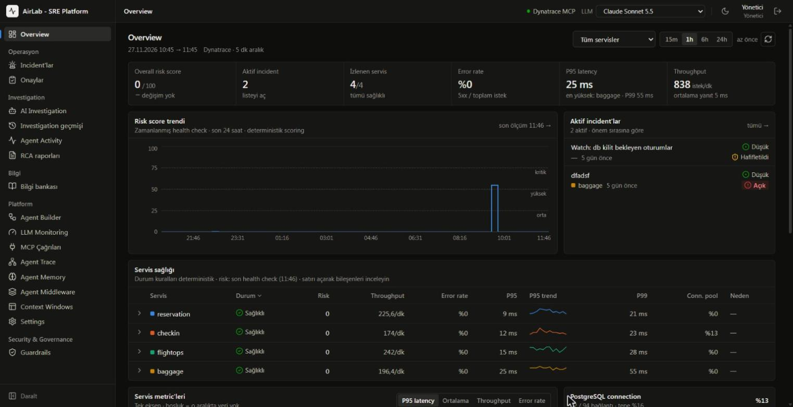
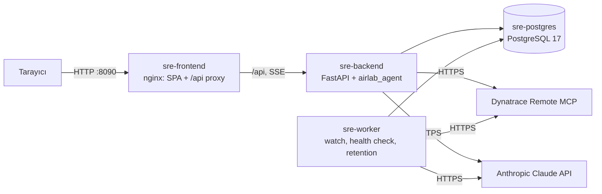

# SRE Agent Management Platform

Uygulama ve veritabanı olaylarını **Dynatrace Remote MCP** üzerinden inceleyen salt okunur bir SRE Agent ve onun
çevresine kurulmuş çok kullanıcılı bir agent yönetim platformu. Repository ayrıca agent'ın analiz ettiği telemetriyi
üreten **airlab** laboratuvarını (Java / PostgreSQL havayolu örneği ve Chaos Controller) içerir.



## Dokümantasyon

| Doküman | İçerik | Kimin için |
|---|---|---|
| [Kurulum Kılavuzu](docs/INSTALLATION.md) | Gereksinimler, environment variable'lar, servisleri başlatma, sağlık kontrolü, hata çözümü | Platformu kuran ekip |
| [Kullanıcı Kılavuzu](docs/USER_GUIDE.md) | Her ekranın amacı, adım adım kullanım, roller ve yetkiler | SRE ve operasyon kullanıcıları |
| [Teknoloji Yığını](docs/TECH_STACK.md) | Kullanılan teknolojiler, doğrulanmış sürümler ve kaynak dosyaları | Geliştiriciler |
| [Teknik Mimari](docs/TECHNICAL_ARCHITECTURE.md) | Bileşenler, veri katmanı, entegrasyonlar, deployment, güven sınırları | Mimarlar ve geliştiriciler |
| [Agent Mimarisi](docs/AGENT_ARCHITECTURE.md) | Graph, state, MCP, LLM, memory, middleware, guardrails, risk scoring | AI ve platform mühendisleri |
| [Çalışma Akışları](docs/WORKFLOWS.md) | Soru-cevap, zamanlanmış çalışma, RCA, hata ve failover akışları | Tüm teknik okuyucular |
| [Ekran Görüntüleri](docs/SCREENSHOTS.md) | Platform ekranlarının açıklamalı görselleri | Tüm okuyucular |

Konuya özel ayrıntılı dokümanlar [Ek dokümanlar](#ek-dokümanlar) bölümündedir.

## İçindekiler

- [Proje nedir?](#proje-nedir)
- [Hangi SRE problemlerini çözer?](#hangi-sre-problemlerini-çözer)
- [Hedef kullanıcılar](#hedef-kullanıcılar)
- [Temel özellikler](#temel-özellikler)
- [Teknoloji özeti](#teknoloji-özeti)
- [Mimari özeti](#mimari-özeti)
- [Hızlı başlangıç](#hızlı-başlangıç)
- [Repository yapısı](#repository-yapısı)
- [Testler](#testler)
- [Ek dokümanlar](#ek-dokümanlar)
- [Güvenlik, lisans ve katkı](#güvenlik-lisans-ve-katkı)

## Proje nedir?

| Bileşen | Dizin | Açıklama |
|---|---|---|
| **SRE Agent** | [`sre-agent/`](sre-agent/) | `airlab_agent` Python paketi. Sabit bir DQL (Dynatrace Query Language) kataloğunu Dynatrace Remote MCP üzerinden çalıştıran bir LangGraph akışıdır. Feature çıkarır, risk score hesaplar ve olası sorunları (row lock, Connection Pool saturation, DB CPU, network latency vb.) deterministik olarak belirler. LLM yalnızca soruyu yorumlar ve bulguları açıklar. |
| **SRE Agent Management Platform** | [`sre-platform/`](sre-platform/) | FastAPI backend, arka plan worker'ı ve React arayüzü. Agent'ı kütüphane olarak içine alır; kalıcı kayıt (PostgreSQL), kimlik doğrulama ve roller, canlı adım akışı (SSE), incident, RCA raporu, bilgi bankası, onay, sürekli izleme (watch) ve zamanlanmış health check ekler. |
| **airlab laboratuvarı** | [`lab/`](lab/), [`db-vm/`](db-vm/), [`observability/`](observability/) | Ortak bir PostgreSQL 17 veritabanını kullanan dört Spring Boot servisi (reservation, check-in, flight operations, baggage) ve 20 arıza senaryolu Chaos Controller. *İzlenen* sistem budur. |

Agent ayrı bir servis ya da komut satırı aracı değildir. Platform imajına Python paketi olarak kurulur ve yalnız
platform üzerinden (`sre-backend` ve `sre-worker`) çalışır.

## Hangi SRE problemlerini çözer?

- **Tutarsız inceleme.** Her olayda dashboard'lar arasında elle gezinmek yerine aynı evidence kümesi toplanır.
- **Eksik verinin sıfır sayılması.** Risk şiddeti, data coverage ve causality confidence ayrı alanlardır. Veri
  gelmediğinde değer "bilinmiyor" olarak kalır ve rapor bunu açıkça yazar.
- **Kontrolsüz otomasyon.** Agent salt okunurdur. Bir sistemi değiştirecek her adım, bir insanın karar verdiği onay
  talebi olarak açılır.
- **Açıklanamayan AI kararı.** Skor ve sorunlar Python kurallarıyla hesaplanır; her LLM çağrısı, MCP çağrısı ve graph
  adımı platform ekranlarından izlenebilir.

## Hedef kullanıcılar

- Olay inceleyen **SRE ve operasyon ekipleri**.
- Agent davranışını izleyen ve yapılandıran **platform yöneticileri**.
- LangGraph tabanlı bir agent'ın nasıl kurulduğunu çalışan bir örnek üzerinden öğrenmek isteyen **AI ve platform
  mühendisleri**.

## Temel özellikler

- **Deterministik analiz, LLM açıklaması.** Skorlama ve Root Cause ataması Python servislerinde yapılmaktadır; LLM skoru değiştiremez ve
  tool çağıramaz.
- **Veri kalitesini bilen evidence.** Her signal `OK`, `EMPTY`, `PERMISSION`, `ERROR`, `STALE`, `UNAVAILABLE` ya da
  `SKIPPED_BUDGET` olarak işaretlenir. MCP'ye ulaşılamazsa agent kısmi rapor yazar; başka bir kaynağa geçmez.
- **AI Investigation (soru-cevap)** ve canlı agent adımları (Server-Sent Events), yarıda kalan çalışmayı sürdürme
  (LangGraph PostgreSQL checkpointer) ve konuşma hafızası.
- **Incident, RCA raporu ve bilgi bankası** (bilinen sorunlar, runbook'lar) ile sonuçlara kullanıcı feedback'i.
- **Sürekli izleme (watch) ve zamanlanmış health check**; işleri worker yürütür.
- **Human-in-the-loop onaylar**: salt okunur olmayan her aksiyon için.
- **Agent Builder**: özel agent'ları görsel workflow olarak oluşturma, test etme, yayımlama, içe ve dışa aktarma.
- **Agent harness ekranları**: LLM Monitoring, MCP Çağrıları, Agent Trace, Agent Memory, Agent Middleware, Context
  Windows ve Guardrails.
- **Settings modülü**: connector'lar, LLM profilleri, şifreli secret'lar, zamanlama, risk scoring ve audit.
- **İsteğe bağlı entegrasyonlar**: LangSmith tracing (girdi ve çıktı maskelenir) ve yüksek riskli RCA'lar için Slack
  bildirimi.
- **Chaos Controller v2** (laboratuvar): 20 senaryo, adaptive control, güvenlik bütçesi ve recovery doğrulaması.

## Teknoloji özeti

| Katman | Teknoloji |
|---|---|
| Frontend | React 19, TypeScript, Vite, Tailwind CSS, nginx |
| Backend | Python 3.13, FastAPI, SQLAlchemy (asyncio), Alembic |
| Agent | LangGraph, LangChain, `langchain-anthropic` (Claude) |
| MCP | `mcp`, `langchain-mcp-adapters` (Streamable HTTP) |
| Veri | PostgreSQL 17 (platform), PostgreSQL 17 (izlenen laboratuvar) |
| Observability | Dynatrace SaaS, LangSmith (isteğe bağlı) |
| Laboratuvar | Java 21, Spring Boot |
| Altyapı | Docker Compose, GitHub Actions |

Sürümler ve kaynak dosyaları: [Teknoloji Yığını](docs/TECH_STACK.md).

## Mimari özeti



Ayrıntılar: [Teknik Mimari](docs/TECHNICAL_ARCHITECTURE.md) ve [Agent Mimarisi](docs/AGENT_ARCHITECTURE.md).

## Hızlı başlangıç

Docker Engine ve Compose v2 kurulu bir Linux host'ta (ya da WSL / Git Bash), repository kökünden:

```bash
# 1. Platform secret'ları (rastgele değerler üretir, mevcut dosyanın üzerine yazmaz)
scripts/gen-sre-platform-env.sh app-vm/sre-platform.env

# 2. Agent entegrasyonları: app-vm/agent.env dosyasını oluşturun (Dynatrace ve isteğe bağlı Claude değerleri)
#    Değişken listesi: docs/INSTALLATION.md

# 3. Compose ortam dosyası
cd app-vm
cp .env.example .env && chmod 600 .env

# 4. Derle ve başlat
docker compose --profile platform build sre-migrate sre-frontend
docker compose --profile platform up -d sre-frontend sre-worker

# 5. Sağlık kontrolü
curl -s http://localhost:8090/api/health
curl -s http://localhost:8090/api/ready
```

Ardından `http://<host>:8090` adresini açın ve `app-vm/sre-platform.env` içindeki `SRE_ADMIN_USERNAME` ve
`SRE_ADMIN_PASSWORD` ile giriş yapın. Tüm adımlar, değişken tablosu ve hata çözümü
[Kurulum Kılavuzu](docs/INSTALLATION.md) içindedir.

## Repository yapısı

```text
sre-agent/        Agent çekirdeği (airlab_agent): graph, signal kataloğu, feature, scoring, MCP ve LLM adapter'ları, eval
sre-platform/
  backend/        FastAPI uygulaması, worker, Alembic migration'ları, agent runtime, settings, guardrails, testler
  frontend/       React arayüzü, nginx yapılandırması
app-vm/           docker-compose.yml (tüm servisler), compose.local.yml (laboratuvar için yerel PostgreSQL), .env.example
lab/              Java 21 laboratuvarı: Maven reactor, dört servis, db-migrator, chaos-controller, Dockerfile
db-vm/            İzlenen veritabanı host'u için PostgreSQL 17 kurulum ve bootstrap script'leri
observability/    pg-lock-collector, netem-agent, Dynatrace kurulum notları
scripts/          Build, env üretimi, smoke test, deney çalıştırıcıları
docs/             Bu dokümantasyon merkezi (docs/*.md), ekran görüntüleri (docs/assets/), konu dokümanları (docs/platform, docs/lab)
deploy/evidence/  Kurulum ve deney kanıtları
.github/workflows CI pipeline'ı
```

## Testler

| Komut | Dizin | Kapsam |
|---|---|---|
| `python -m pytest -q tests` | `sre-agent/` | Agent unit, senaryo, graph ve watch testleri (sahte MCP, ağ gerekmez) |
| `python -m pytest -q tests` | `sre-platform/backend/` | API ve servis testleri; `SRE_TEST_DATABASE_URL` yoksa veritabanı testleri atlanır |
| `npx tsc -b --noEmit && npx vitest run && npm run build` | `sre-platform/frontend/` | Tip kontrolü, arayüz testleri, production build |
| `scripts/build.sh` | repository kökü | Laboratuvar için Docker içinde `mvn verify` |
| `scripts/smoke.sh` | repository kökü | Çalışan laboratuvara karşı uçtan uca kontroller |

CI, ilk üç grubu ve ek olarak gitleaks, `pip-audit` ve `npm audit` adımlarını `main` dalına yapılan her push'ta ve
pull request'lerde çalıştırır ([`.github/workflows/ci.yml`](.github/workflows/ci.yml)). Testler dış servis ya da secret
gerektirmez.

## Ek dokümanlar

| Konu | Doküman |
|---|---|
| Platform iç yapısı, API listesi, bilinen sınırlar | [sre-platform/README.md](sre-platform/README.md) |
| Agent tasarımı, scoring, watch davranışı | [sre-agent/README.md](sre-agent/README.md), [docs/platform/sre-agent-runbook.md](docs/platform/sre-agent-runbook.md) |
| Settings modülü | [docs/platform/settings.md](docs/platform/settings.md) |
| Agent Builder | [docs/platform/agent-builder.md](docs/platform/agent-builder.md) |
| Agent Memory | [docs/platform/agent-memory.md](docs/platform/agent-memory.md), [docs/platform/memory/](docs/platform/memory/) |
| Agent Middleware | [docs/platform/agent-middleware.md](docs/platform/agent-middleware.md) |
| Guardrails | [docs/platform/guardrails/](docs/platform/guardrails/) |
| Agent Trace, Context Windows, MCP Çağrıları | [agent-trace.md](docs/platform/agent-trace.md), [context-windows.md](docs/platform/context-windows.md), [mcp-calls.md](docs/platform/mcp-calls.md) |
| LangSmith tracing | [docs/platform/langsmith-tracing.md](docs/platform/langsmith-tracing.md) |
| Güvenlik uygulaması ve kanıtları | [docs/platform/security/](docs/platform/security/) |
| Laboratuvar mimarisi, deneyler, runbook | [docs/lab/](docs/lab/) |
| Chaos Controller v2 | [docs/lab/chaos-v2-architecture.md](docs/lab/chaos-v2-architecture.md) |
| Dynatrace kurulumu ve token scope'ları | [observability/dynatrace/README.md](observability/dynatrace/README.md) |

## Güvenlik, lisans ve katkı

- **Güvenlik politikası:** [SECURITY.md](SECURITY.md). Güvenlik açıklarını bu dosyadaki yönteme göre bildirin.
- **Lisans:** Repository'de bir lisans dosyası bulunmuyor. Lisans eklenene kadar kullanım ve dağıtım koşulları için
  repository sahibine danışın.
- **Katkı:** Ayrı bir katkı rehberi yok. Değişiklik göndermeden önce [Testler](#testler) bölümündeki komutların
  geçtiğini doğrulayın; CI aynı kontrolleri çalıştırır.
- Arayüz düz HTTP ile sunulur. Erişimi `SRE_UI_BIND_IP` ile sınırlayın ya da önüne TLS sonlandıran bir proxy koyun.
