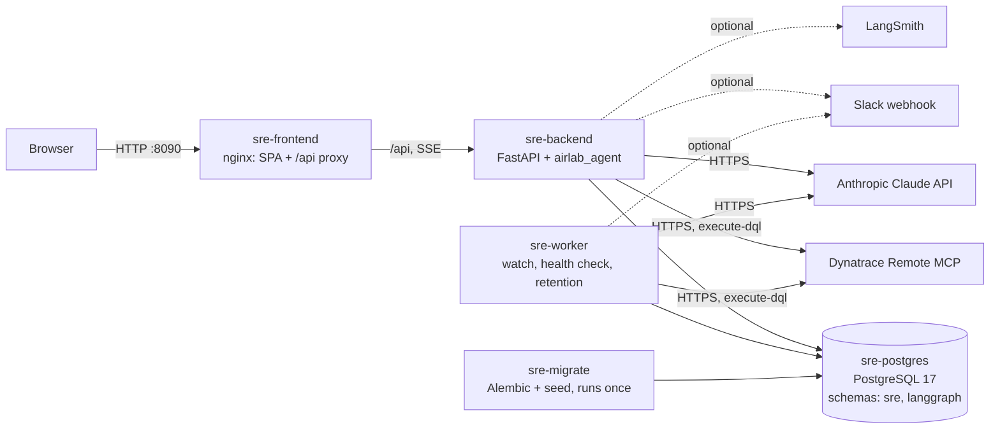
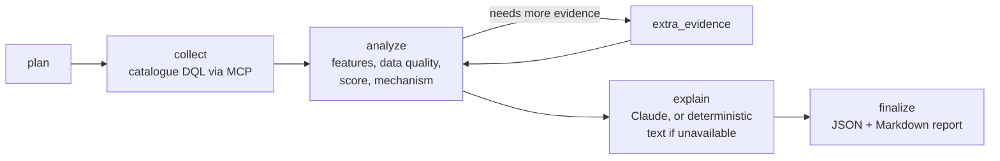
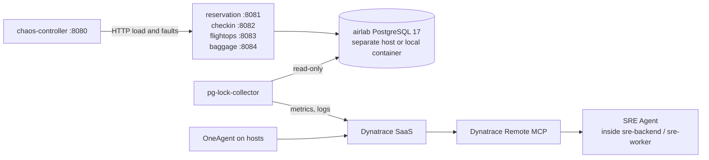

# SRE Agent & SRE Operations Platform

A read-only SRE agent that investigates application and database incidents through **Dynatrace Remote MCP**, and a
multi-user operations platform built around it (chat, investigations, incidents, RCA reports, scheduled checks,
approvals). The repository also contains **airlab**, a Java/PostgreSQL airline laboratory with a chaos controller that
produces the telemetry the agent analyses.

> The user interface, agent answers and most documents under `docs/` are written in Turkish. This README is the
> English entry point.

## Contents

- [Project overview](#project-overview)
- [Key features](#key-features)
- [Tech stack](#tech-stack)
- [Architecture](#architecture)
- [Prerequisites](#prerequisites)
- [Installation and configuration](#installation-and-configuration)
- [Quick start](#quick-start)
- [Project structure](#project-structure)
- [Tests](#tests)
- [Troubleshooting](#troubleshooting)
- [Further documentation](#further-documentation)

## Project overview

| Component | Path | What it is |
|---|---|---|
| **SRE Agent** | `sre-agent/` | Python package `airlab_agent`. A LangGraph flow that runs a fixed catalogue of DQL queries through Dynatrace Remote MCP, derives features, scores risk and attributes a mechanism (row lock, pool saturation, DB CPU, network latency, …) deterministically, then asks Claude only to interpret the question and explain the findings. |
| **SRE Operations Platform** | `sre-platform/` | FastAPI backend, background worker and React UI. It embeds the agent as a library and adds persistence (PostgreSQL), authentication and roles, live step streaming (SSE), incidents, RCA reports, a knowledge base, approvals, continuous watch and scheduled health checks. |
| **airlab laboratory** | `lab/`, `db-vm/`, `observability/` | Four Spring Boot services (reservation, check-in, flight operations, baggage) on a shared PostgreSQL 17 database, plus a chaos controller with 20 fault scenarios. It is the *monitored* system. |

The agent is **not** a separate service or CLI: it is installed into the platform image and is used only through the
platform (`sre-backend` and `sre-worker`).

Problems it addresses:

- Collecting the same evidence set for every incident instead of ad-hoc dashboard browsing.
- Separating *risk severity*, *data coverage* and *causal confidence*, and stating explicitly when data is missing
  rather than treating gaps as zero.
- Keeping the agent read-only: any step that would change a system is opened as an approval request for a human.

## Key features

- **Deterministic analysis, LLM explanation.** Scoring and root-cause attribution are plain Python; the LLM cannot
  change the score and has no tools.
- **Data-quality aware evidence.** Each signal is marked `OK`, `EMPTY`, `PERMISSION`, `ERROR`, `STALE`,
  `UNAVAILABLE` or `SKIPPED_BUDGET`. If MCP is unreachable the agent writes a partial report; it does not fall back to
  another source.
- **Chat and investigations** with live agent steps over Server-Sent Events, resumable runs (LangGraph PostgreSQL
  checkpointer) and conversation memory.
- **Incidents, RCA reports and knowledge base** (known issues, runbooks), with user feedback on results.
- **Continuous watch and scheduled health checks** run by the worker (PostgreSQL-backed job leasing).
- **Human-in-the-loop approvals** for anything that is not read-only.
- **Roles:** `viewer` < `sre` < `admin`.
- **Operations views:** LLM monitoring, MCP call log, agent trace, agent memory, middleware, guardrails, context
  windows, agent builder and a settings module (connectors, LLM providers, encrypted secrets, scheduling, audit).
- **Optional integrations:** LangSmith tracing (inputs/outputs redacted) and Slack notification for high-risk RCAs.
- **Chaos Controller v2** for the lab: 20 scenarios, adaptive control, safety budget and recovery verification.

## Tech stack

Versions are taken from `sre-agent/pyproject.toml`, `sre-platform/backend/pyproject.toml`,
`sre-platform/frontend/package.json`, `lab/pom.xml`, the Dockerfiles and `app-vm/docker-compose.yml`.

| Category | Technology | Version | Used for |
|---|---|---|---|
| Frontend | React, React DOM | ^19.1 | Platform UI |
| | TypeScript | ~5.8.3 | Type checking |
| | Vite | ^6.3.5 | Build and dev server |
| | Tailwind CSS | ^4.1.8 | Styling |
| | TanStack Query | ^5.80 | Server state |
| | React Router | ^7.6 | Routing |
| | Recharts / @xyflow/react | ^3.1 / ^12.12 | Charts / graph views |
| | nginx | 1.29 (alpine) | Static files and `/api` reverse proxy |
| Backend | Python | 3.13 image (`>=3.12` required) | Backend, worker, agent |
| | FastAPI / Uvicorn | 0.165.0 / 0.54.0 | HTTP API |
| | sse-starlette | 3.7.0 | Live run streaming |
| | SQLAlchemy (asyncio) / Alembic | 2.1.9 / 1.20.1 | ORM and migrations |
| | psycopg | 3.3.9 | PostgreSQL driver |
| | PyJWT | 2.15.1 | Session tokens |
| AI / LLM | Anthropic Claude via `langchain-anthropic` | 1.7.12 (default model `claude-opus-5-5`) | Question interpretation, explanation, RCA summary |
| Agent orchestration | LangGraph | 1.2.24 | Agent `StateGraph` |
| | LangChain / langchain-core | 1.5.2 / 1.8.4 | Model and tool abstractions |
| | langgraph-checkpoint-postgres | 3.2.1 | Checkpoints and long-term store |
| MCP | `mcp` / `langchain-mcp-adapters` | 1.30.0 / 0.3.2 | Dynatrace Remote MCP client (streamable HTTP) |
| Database | PostgreSQL | 17.7 (alpine) | Platform database (`sre` schema) |
| | PostgreSQL | 17 | Monitored lab database (`airlab`) |
| Observability | Dynatrace SaaS (OneAgent, Metrics/Logs API v2) | – | Telemetry source for the agent |
| | LangSmith | 0.16.0 | Optional tracing |
| | `pg-lock-collector` | in-repo (Python 3.13) | Lock/statement metrics from the lab DB to Dynatrace |
| Lab | Java / Spring Boot | 21 / 4.1.3 | Four business services and chaos controller |
| | Flyway | managed by Spring Boot | Lab schema migrations (`db-migrator`) |
| | springdoc-openapi | 3.2.0 | Lab OpenAPI |
| Infrastructure | Docker, Docker Compose | Compose v2 syntax | Build and run all services |
| | GitHub Actions | – | CI: tests, gitleaks, pip-audit, npm audit |
| Testing | pytest | 9.2.0 | Agent and backend tests |
| | Vitest / Testing Library | ^3.2 / ^16.3 | Frontend tests |
| | JUnit + Testcontainers (PostgreSQL 17) | managed by Spring Boot | Lab integration tests |

## Architecture

### Platform and agent



`sre-postgres` is on an internal Docker network and publishes no port. Only `sre-frontend` is published
(`SRE_UI_PORT`, default `8090`).

### Agent flow



### Monitored lab and telemetry path



There are two separate databases. The **platform database** (`sre-postgres`) stores users, conversations,
investigations, reports and agent memory. The **monitored database** (`airlab`) belongs to the lab. The agent never
connects to the monitored database; it sees it only through Dynatrace.

## Prerequisites

| Requirement | Notes |
|---|---|
| Docker Engine with the Compose v2 plugin | All builds and services run in containers. Verified with Compose v5.8.0 on Rocky Linux 10. |
| Bash and `openssl` | Used by `scripts/gen-sre-platform-env.sh`. On Windows use WSL or Git Bash. |
| Git | To clone the repository. |
| Dynatrace SaaS tenant and a **platform token** | Scopes: `mcp-gateway:servers:invoke`, `mcp-gateway:servers:read`, `storage:metrics:read`, `storage:logs:read`, `storage:entities:read`, `storage:events:read`, `storage:buckets:read`, `storage:smartscape:read`, `storage:spans:read`. |
| Anthropic API key | Optional. Without it the agent runs in deterministic mode (no LLM explanation). |
| LangSmith API key, Slack incoming webhook | Optional. |
| Outbound HTTPS from the Docker host | To Dynatrace and the Anthropic API. |

Not needed on the host: Python, Node.js, Java or Maven (unless you want to run tests outside Docker).

The compose file sets container memory limits of 384 MB (`sre-postgres`), 640 MB (`sre-backend`), 640 MB
(`sre-worker`) and 96 MB (`sre-frontend`). No host sizing beyond these limits has been validated.

## Installation and configuration

Commands below are for a Linux host (or WSL / Git Bash) and start from the repository root unless stated otherwise.

### 1. Clone

```bash
git clone <repository-url>
cd <repository-directory>
```

### 2. Platform secrets (`app-vm/sre-platform.env`)

```bash
scripts/gen-sre-platform-env.sh app-vm/sre-platform.env
```

The script generates random values, writes the file with mode `600` and never overwrites an existing file. It sets:

| Variable | Required | Purpose |
|---|---|---|
| `POSTGRES_PASSWORD` | yes | Password of the `sre-postgres` container. Written to the data volume on first start. |
| `SRE_DB_PASSWORD` | yes | Backend/worker connection password. Must equal `POSTGRES_PASSWORD`. |
| `SRE_JWT_SECRET` | yes | Token signing secret (at least 32 characters). |
| `SRE_SETTINGS_KEY` | recommended | Encryption key for secrets stored through the Settings screen. If lost, stored secrets cannot be decrypted. |
| `SRE_ADMIN_USERNAME`, `SRE_ADMIN_PASSWORD` | yes | Initial admin account. Used only when no admin exists at first start. |
| `SRE_ENVIRONMENT` | no | Environment label (default `lab`). |

All other `SRE_*` variables are optional and documented with their defaults in `sre-platform/.env.example`
(session lifetime, rate limits, worker intervals, Slack, LangSmith sync, outbound allowlist, UI port and bind address).
Add the ones you need to `app-vm/sre-platform.env`.

### 3. Agent integrations (`app-vm/agent.env`)

Create the file by hand (it must exist, even if some values are empty) and restrict its permissions:

```bash
cat > app-vm/agent.env <<'EOF'
# Dynatrace Remote MCP: set the tenant id, or set DT_MCP_URL to a full MCP URL instead
DT_ENV=<dynatrace-environment-id>
DT_PLATFORM_TOKEN=<dynatrace-platform-token>

# LLM (optional): without a key the agent runs in deterministic mode
ANTHROPIC_API_KEY=<anthropic-api-key>
CLAUDE_MODEL=claude-opus-5-5

# LangSmith tracing (optional)
LANGSMITH_API_KEY=
LANGSMITH_TRACING=false
LANGSMITH_PROJECT=airlab-sre-agent
EOF
chmod 600 app-vm/agent.env
```

| Variable | Required | Purpose |
|---|---|---|
| `DT_ENV` or `DT_MCP_URL` | yes | With `DT_ENV` the URL is derived as `https://<DT_ENV>.apps.dynatrace.com/platform-reserved/mcp-gateway/v0.1/servers/dynatrace-mcp/mcp`. |
| `DT_PLATFORM_TOKEN` | yes | Bearer token for the MCP gateway (scopes listed in [Prerequisites](#prerequisites)). |
| `ANTHROPIC_API_KEY` | no | Enables Claude. |
| `CLAUDE_MODEL`, `CLAUDE_RCA_MODEL` | no | Chat/interpretation model and RCA model. Both default to `claude-opus-5-5`. |
| `LANGSMITH_API_KEY`, `LANGSMITH_TRACING`, `LANGSMITH_PROJECT` | no | Tracing is active only when a key is set and `LANGSMITH_TRACING=true`. |
| `AGENT_CONFIG` | no | Path to a YAML file merged over the built-in `defaults.yaml` (thresholds, weights, budgets). |

Both env files are ignored by Git. Never commit real values.

### 4. Compose environment file

`app-vm/docker-compose.yml` also defines the lab services, which read `app-vm/.env`. Create it even if you only run
the platform, so that Compose can load the whole file:

```bash
cd app-vm
cp .env.example .env && chmod 600 .env
```

For a platform-only setup the example values can stay as they are. For the lab, fill in the database host and
passwords (see [Running the lab](#optional-running-the-lab-locally)).

### 5. Build and start the platform

Run in `app-vm/`:

```bash
docker compose --profile platform build sre-migrate sre-frontend
docker compose --profile platform up -d sre-frontend sre-worker
```

Naming the two services starts only the platform: `sre-postgres` → `sre-migrate` (applies Alembic migrations and
seeds the knowledge base, then exits) → `sre-backend` → `sre-frontend`, plus `sre-worker`. Running
`docker compose --profile platform up -d` without service names also starts the lab services.

The Docker build context is always the repository root (`context: ..` in the compose file).

Useful follow-up commands (in `app-vm/`):

```bash
# re-run migrations and seed
docker compose --profile platform run --rm sre-migrate

# create an additional user (roles: admin, sre, viewer)
docker compose exec -e SRE_NEW_USER_PASSWORD='<password>' sre-backend sre-platform create-user <username> sre
```

### Local development without Docker

The backend and frontend can be run from source for development and tests. This mirrors the CI workflow
(`.github/workflows/ci.yml`); a PostgreSQL 17 instance is required for database tests.

```bash
# backend + agent (Python 3.12+)
cd sre-platform/backend
pip install -e ../../sre-agent -e ".[test]"
SRE_TEST_DATABASE_URL='postgresql+psycopg://<user>:<password>@127.0.0.1:5432/<db>' pytest

# frontend (Node.js 22)
cd sre-platform/frontend
npm ci
npm run dev        # Vite dev server
npm run build
```

### Optional: running the lab locally

The lab gives the agent something to analyse. Telemetry reaches the agent only if Dynatrace is configured for the
hosts and the collector (`observability/dynatrace/README.md`).

```bash
scripts/build.sh                                   # mvn verify inside Docker (unit + Testcontainers tests)
cd app-vm && cp .env.example .env.local            # set DB_HOST=postgres, add LOCAL_PG_SUPERUSER_PASSWORD, change passwords
C="docker compose -f docker-compose.yml -f compose.local.yml --env-file .env.local"
$C up -d --build postgres
$C --profile tools run --rm db-migrator migrate
$C --profile tools run --rm db-migrator seed --scale=1
$C --profile observability up -d
cd .. && scripts/smoke.sh                          # UI → API → DB checks
```

In the target topology PostgreSQL runs as a systemd service on a separate database host, prepared with
`db-vm/install-postgres17.sh` and `db-vm/bootstrap-db.sh`. The full procedure is in `docs/lab/runbook.md`.

## Quick start

1. **Check the containers** (in `app-vm/`):

   ```bash
   docker compose --profile platform ps
   ```

   `sre-postgres`, `sre-backend`, `sre-worker` and `sre-frontend` should be `healthy`; `sre-migrate` should have
   exited with code 0.

2. **Check the API through the frontend proxy:**

   ```bash
   curl -s http://localhost:8090/healthz       # nginx
   curl -s http://localhost:8090/api/health    # backend liveness
   curl -s http://localhost:8090/api/ready     # database and schema version
   ```

3. **Sign in.** Open `http://<host>:8090` and log in with `SRE_ADMIN_USERNAME` and `SRE_ADMIN_PASSWORD` from
   `app-vm/sre-platform.env`. Change the password on the account page (`/account`).

4. **Verify the integrations.** The system status in the UI (backed by `GET /api/system/info`) shows whether MCP,
   Claude and LangSmith are configured. Connectors and LLM providers can also be managed under `/settings`.

5. **Run the agent for the first time.** Open `/investigate`, start a conversation and ask about a service and a time
   range. The agent steps (plan, DQL queries, evidence, explanation) stream live. The finished investigation is
   listed under `/investigations`, and an RCA report can be generated from it and found under `/rca`.

6. **Scheduled runs.** The worker evaluates watch conditions every minute and runs a health check every
   `SRE_HEALTH_CHECK_MINUTES` (default 15). Jobs can be inspected and triggered from the scheduling section of
   `/settings`.

The OpenAPI schema (`/api/openapi.json`, `/api/docs`) is disabled by default; set `SRE_API_DOCS=true` to enable it.

## Project structure

```text
sre-agent/        Agent core (airlab_agent): graph, signal catalogue, features, scoring, MCP and LLM adapters, eval
sre-platform/
  backend/        FastAPI app, worker, Alembic migrations, agent runtime, settings, guardrails, tests
  frontend/       React UI, nginx config
app-vm/           docker-compose.yml (all services), compose.local.yml (local PostgreSQL for the lab), .env.example
lab/              Java 21 lab: Maven reactor, four services, db-migrator, chaos-controller, lab/Dockerfile
db-vm/            PostgreSQL 17 install and bootstrap scripts for the monitored database host
observability/    pg-lock-collector, netem-agent, Dynatrace setup notes
scripts/          Build, env generation, smoke tests, experiment runners
docs/lab/         Lab architecture, experiments, telemetry contract, runbook, ADRs, OpenAPI
docs/platform/    Platform docs: memory, guardrails, security, settings, agent builder, trace, example reports
docs/specs/       Original requirement texts (historical)
deploy/evidence/  Installation and experiment evidence
.github/workflows CI pipeline
```

## Tests

| Command | Where | Scope |
|---|---|---|
| `python -m pytest -q tests` | `sre-agent/` | Agent unit, scenario, graph and watch tests (fake MCP, no network) |
| `python -m pytest -q tests` | `sre-platform/backend/` | API and service tests; needs `SRE_TEST_DATABASE_URL` (DB tests are skipped without it) |
| `npx tsc -b --noEmit && npx vitest run && npm run build` | `sre-platform/frontend/` | Type check, UI tests, production build |
| `scripts/build.sh` or `.\scripts\build.ps1` | repository root | Lab `mvn verify` inside Docker |
| `scripts/smoke.sh` | repository root | End-to-end checks against a running lab |

CI runs the first three groups plus gitleaks, `pip-audit` and `npm audit` on every push to `main` and on pull
requests. No external service or secret is needed for the tests.

## Troubleshooting

| Symptom | Likely cause | What to do |
|---|---|---|
| `env file .../app-vm/.env not found` (or `agent.env`, `sre-platform.env`) | Compose loads every `env_file` referenced in the file | Create the missing file (steps 2–4). |
| `sre-backend` restarts with a database authentication error | `sre-platform.env` was regenerated after the first start; the old password is stored in the `sre-pg-data` volume | Restore the original password in the env file, or change it in PostgreSQL with `ALTER ROLE`. |
| `sre-frontend` does not start | It waits for `sre-backend` to become healthy, which waits for `sre-migrate` | `docker compose logs sre-migrate sre-backend` |
| Login fails with the generated admin password | `SRE_ADMIN_PASSWORD` is applied only when no admin exists | Use the current password, or create another admin with `sre-platform create-user`. |
| Report status `partial`, evidence `UNAVAILABLE` | Dynatrace MCP is unreachable | Check `DT_ENV` / `DT_MCP_URL`, token validity and outbound HTTPS from the host. |
| A signal is marked `PERMISSION` | Platform token lacks a scope | Add the missing `storage:*:read` scope. |
| Signals are `EMPTY` or `STALE` | No telemetry for that period | Check OneAgent and `pg-lock-collector` (`docker logs airlab-pg-lock-collector`). |
| Answers contain no LLM explanation | `ANTHROPIC_API_KEY` is empty or the API is unreachable | Set the key in `agent.env` and restart `sre-backend` and `sre-worker`. |
| Secrets cannot be added in Settings | `SRE_SETTINGS_KEY` is empty | Set it in `sre-platform.env` and restart the backend. |

The UI is served over plain HTTP. Restrict exposure with `SRE_UI_BIND_IP`, or place a TLS-terminating proxy in front
of it.

## Further documentation

- Platform internals, API list and known limits: `sre-platform/README.md`
- Agent design, scoring and watch behaviour: `sre-agent/README.md`, `docs/platform/sre-agent-runbook.md`
- Settings, guardrails, memory, tracing: `docs/platform/`
- Lab architecture, experiments and deployment runbook: `docs/lab/`
- Dynatrace setup and token scopes: `observability/dynatrace/README.md`
- Security policy: `SECURITY.md`
