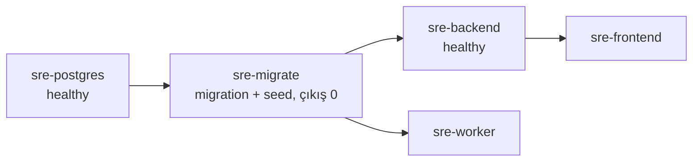

# Kurulum Kılavuzu

Bu kılavuz SRE Operations Platform'u (ve içine gömülü SRE Agent'ı) Docker Compose ile kurmayı anlatır. İzlenen
laboratuvarın (airlab) kurulumu isteğe bağlıdır ve ayrı bir bölümde özetlenir.

[← Dokümantasyon merkezine dön](../README.md)

## İçindekiler

- [1. Kurulumun kapsamı](#1-kurulumun-kapsamı)
- [2. Gereksinimler](#2-gereksinimler)
- [3. Repository'yi klonlama](#3-repositoryyi-klonlama)
- [4. Environment variable'lar](#4-environment-variablelar)
- [5. Veritabanları](#5-veritabanları)
- [6. Dynatrace MCP bağlantısı](#6-dynatrace-mcp-bağlantısı)
- [7. LLM provider](#7-llm-provider)
- [8. Derleme ve başlatma](#8-derleme-ve-başlatma)
- [9. Sağlık kontrolü](#9-sağlık-kontrolü)
- [10. Giriş ve ilk agent çalıştırması](#10-giriş-ve-ilk-agent-çalıştırması)
- [11. Durdurma, güncelleme ve geri alma](#11-durdurma-güncelleme-ve-geri-alma)
- [12. Docker olmadan geliştirme kurulumu](#12-docker-olmadan-geliştirme-kurulumu)
- [13. Laboratuvarı çalıştırma (isteğe bağlı)](#13-laboratuvarı-çalıştırma-isteğe-bağlı)
- [14. Hata çözümü](#14-hata-çözümü)
- [15. Bu kılavuzda neler doğrulandı?](#15-bu-kılavuzda-neler-doğrulandı)

## 1. Kurulumun kapsamı

Platform beş container'dan oluşur. Hepsi [`app-vm/docker-compose.yml`](../app-vm/docker-compose.yml) dosyasında
`platform` profili altında tanımlıdır.

| Servis | Görev | Yayımlanan port |
|---|---|---|
| `sre-postgres` | Platform veritabanı (PostgreSQL 17.7) | Yok (yalnız iç ağ) |
| `sre-migrate` | Alembic migration'larını uygular, bilgi bankasını tohumlar ve çıkar | Yok |
| `sre-backend` | FastAPI API'si ve agent runtime | Yok (yalnız `sre-frontend` erişir) |
| `sre-worker` | Zamanlanmış işler: watch, health check, retention, LangSmith senkronu | Yok |
| `sre-frontend` | nginx: React arayüzü ve `/api` reverse proxy | `SRE_UI_PORT` (varsayılan `8090`) |

Agent ayrı kurulmaz; `sre-backend` ve `sre-worker` imajının içindedir.

## 2. Gereksinimler

### İşletim sistemi ve araçlar

| Gereksinim | Not |
|---|---|
| Docker Engine ve Compose v2 eklentisi | Tüm derleme ve servisler container içinde çalışır. Rocky Linux 10 üzerinde Compose v5.8.0 ile doğrulandı. |
| Bash ve `openssl` | [`scripts/gen-sre-platform-env.sh`](../scripts/gen-sre-platform-env.sh) kullanır. Windows'ta WSL ya da Git Bash kullanın. |
| Git | Repository'yi klonlamak için. |
| Host'tan dışarı HTTPS erişimi | Dynatrace ve Anthropic API için. |

Host'ta Python, Node.js, Java ya da Maven **gerekmez**; yalnız testleri Docker dışında çalıştırmak isterseniz kurun.

Rocky Linux 10 dışındaki Linux dağıtımları ve Docker Desktop ile kurulum bu çalışmada denenmedi. Compose dosyası
dağıtıma özgü bir özellik kullanmaz, ancak bu bir doğrulama değildir.

### Dış servisler

| Servis | Zorunlu mu? | Not |
|---|---|---|
| Dynatrace SaaS tenant'ı ve platform token | Evet | Agent'ın tek canlı veri kaynağıdır. Gerekli scope'lar [6. bölümde](#6-dynatrace-mcp-bağlantısı). |
| Anthropic API key | Hayır | Olmadan agent deterministik modda çalışır: analiz yapılır, LLM açıklaması üretilmez. |
| LangSmith API key | Hayır | Tracing ve LLM Monitoring ekranındaki maliyet verisi için. |
| Slack incoming webhook | Hayır | Yüksek riskli RCA bildirimi için. |

### Kaynak gereksinimleri

Compose dosyası container başına bellek sınırı tanımlar: `sre-postgres` 384 MB, `sre-backend` 640 MB, `sre-worker`
640 MB, `sre-frontend` 96 MB, `sre-migrate` 256 MB (geçici).

> **Öneri (ölçülmedi):** Bu sınırların toplamı yaklaşık 1,8 GB'tır. İmaj derlemesi için ek bellek gerekir; en az
> 4 GB RAM ve 2 vCPU ayırmanız önerilir. Bunların ötesinde bir host boyutlandırması doğrulanmadı.

## 3. Repository'yi klonlama

```bash
git clone <repository-url>
cd <repository-dizini>
```

Aşağıdaki komutlar, aksi belirtilmedikçe **repository kökünden** ve **Bash** ile çalıştırılır. Docker build context'i
her zaman repository köküdür (compose dosyasında `context: ..`).

## 4. Environment variable'lar

Üç dosya gerekir. Üçü de Git tarafından yok sayılır; gerçek değerleri asla commit etmeyin.

| Dosya | Kim okur | İçerik |
|---|---|---|
| `app-vm/sre-platform.env` | `sre-postgres`, `sre-migrate`, `sre-backend`, `sre-worker` | Platform secret'ları ve `SRE_*` ayarları |
| `app-vm/agent.env` | `sre-backend`, `sre-worker` | Dynatrace, Claude ve LangSmith değerleri |
| `app-vm/.env` | Compose ve laboratuvar servisleri | Laboratuvar ayarları; yalnız platformu çalıştırsanız da dosya var olmalıdır |

### 4.1 Platform secret'ları: `app-vm/sre-platform.env`

```bash
scripts/gen-sre-platform-env.sh app-vm/sre-platform.env
```

**Beklenen sonuç:** `yazıldı: app-vm/sre-platform.env` satırı. Script rastgele değerler üretir, dosyayı `600` izniyle
yazar ve değerleri ekrana basmaz. Dosya zaten varsa dokunmaz.

| Değişken | Servis | Zorunlu | Amaç | Güvenli örnek |
|---|---|---|---|---|
| `POSTGRES_PASSWORD` | `sre-postgres` | Evet | Veritabanı parolası. İlk başlatmada veri volume'una işlenir. | `<rastgele-32-karakter>` |
| `SRE_DB_PASSWORD` | backend, worker | Evet | Bağlantı parolası. `POSTGRES_PASSWORD` ile aynı olmalıdır. | `<rastgele-32-karakter>` |
| `SRE_JWT_SECRET` | backend | Evet | Oturum token'ı imzalama secret'ı (en az 32 karakter). | `<rastgele-64-karakter>` |
| `SRE_SETTINGS_KEY` | backend, worker | Önerilir | Settings ekranından girilen secret'ların şifreleme anahtarı. Kaybolursa saklı secret'lar çözülemez. | `<rastgele-48-karakter>` |
| `SRE_ADMIN_USERNAME` | migrate | Evet | İlk yönetici hesabı. | `admin` |
| `SRE_ADMIN_PASSWORD` | migrate | Evet | Yalnız hiç yönetici yokken, ilk başlatmada kullanılır. | `<rastgele-20-karakter>` |
| `SRE_ENVIRONMENT` | backend, worker | Hayır | Ortam etiketi. | `lab` |

Sık kullanılan isteğe bağlı değişkenler (hepsi ve varsayılanları:
[`sre-platform/.env.example`](../sre-platform/.env.example)):

| Değişken | Varsayılan | Amaç |
|---|---|---|
| `SRE_UI_PORT`, `SRE_UI_BIND_IP` | `8090`, `0.0.0.0` | Arayüzün yayımlandığı port ve adres |
| `SRE_JWT_TTL_MINUTES`, `SRE_SESSION_IDLE_MINUTES` | `480`, `30` | Oturumun mutlak süresi ve boşta kalma süresi |
| `SRE_LOGIN_MAX_FAILS`, `SRE_LOGIN_WINDOW_S` | `5`, `300` | Başarısız giriş sınırı |
| `SRE_RUN_RATE_PER_MINUTE` | `6` | Kullanıcı başına dakikada başlatılabilecek agent çalıştırması |
| `SRE_MAX_CONCURRENT_INVESTIGATIONS`, `SRE_INVESTIGATION_TIMEOUT_S` | `2`, `240` | Eşzamanlı çalışma ve toplam süre sınırı |
| `SRE_WATCH_ENABLED` | `true` | Sürekli izleme |
| `SRE_HEALTH_CHECK_MINUTES`, `SRE_HEALTH_CHECK_WINDOW_MINUTES`, `SRE_HEALTH_CHECK_LLM` | `15`, `15`, `true` | Zamanlanmış health check aralığı, analiz penceresi ve LLM kullanımı |
| `SRE_RETENTION_DAYS` | `180` | Kayıt saklama süresi |
| `SRE_SLACK_WEBHOOK_URL`, `SRE_SLACK_RISK_THRESHOLD`, `SRE_PUBLIC_URL` | boş, `75`, – | Slack bildirimi |
| `SRE_LANGSMITH_SYNC_MINUTES`, `SRE_LANGSMITH_BACKFILL_DAYS` | `5`, `7` | LLM Monitoring senkronu |
| `SRE_SETTINGS_LOCKS` | boş | Arayüzden değiştirilemeyen ayarlar (deployment lock) |
| `SRE_OUTBOUND_ALLOWLIST` | boş | Private adresli ya da `http` connector / webhook hedeflerine izin |
| `SRE_API_DOCS` | `false` | `/api/docs` ve `/api/openapi.json` uçlarını açar |

### 4.2 Agent entegrasyonları: `app-vm/agent.env`

Dosyayı elle oluşturun. Bazı değerler boş kalsa bile dosya var olmalıdır.

```bash
cat > app-vm/agent.env <<'EOF'
# Dynatrace Remote MCP: tenant kimliğini yazın ya da DT_MCP_URL ile tam MCP adresini verin
DT_ENV=<dynatrace-environment-id>
DT_PLATFORM_TOKEN=<dynatrace-platform-token>

# LLM (isteğe bağlı): anahtar yoksa agent deterministik modda çalışır
ANTHROPIC_API_KEY=<anthropic-api-key>
CLAUDE_MODEL=claude-opus-5-5

# LangSmith tracing (isteğe bağlı)
LANGSMITH_API_KEY=
LANGSMITH_TRACING=false
LANGSMITH_PROJECT=airlab-sre-agent
EOF
chmod 600 app-vm/agent.env
```

| Değişken | Zorunlu | Amaç | Güvenli örnek |
|---|---|---|---|
| `DT_ENV` ya da `DT_MCP_URL` | Evet | `DT_ENV` verilirse adres `https://<DT_ENV>.apps.dynatrace.com/platform-reserved/mcp-gateway/v0.1/servers/dynatrace-mcp/mcp` olarak türetilir. | `abc12345` |
| `DT_PLATFORM_TOKEN` | Evet | MCP gateway için Bearer token. | `<dynatrace-platform-token>` |
| `ANTHROPIC_API_KEY` | Hayır | Claude'u etkinleştirir. | `<anthropic-api-key>` |
| `CLAUDE_MODEL`, `CLAUDE_RCA_MODEL` | Hayır | Sohbet / yorumlama modeli ve RCA modeli. İkisi de varsayılan olarak `claude-opus-5-5`. | `claude-opus-5-5` |
| `LANGSMITH_API_KEY`, `LANGSMITH_TRACING`, `LANGSMITH_PROJECT` | Hayır | Tracing yalnız anahtar varken ve `LANGSMITH_TRACING=true` iken çalışır. | `false` |
| `AGENT_CONFIG` | Hayır | Yerleşik [`defaults.yaml`](../sre-agent/src/airlab_agent/defaults.yaml) üzerine birleştirilecek YAML dosyasının yolu (threshold'lar, ağırlıklar, bütçeler). | `/data/agent.yaml` |
| `AGENT_DISABLE_LLM` | Hayır | `true` ise anahtar olsa bile LLM kullanılmaz. | `false` |

### 4.3 Compose ortam dosyası: `app-vm/.env`

```bash
cd app-vm
cp .env.example .env && chmod 600 .env
cd ..
```

Yalnız platformu çalıştıracaksanız örnek değerler olduğu gibi kalabilir. Laboratuvar için veritabanı host'unu ve
parolaları doldurmanız gerekir ([13. bölüm](#13-laboratuvarı-çalıştırma-isteğe-bağlı)).

## 5. Veritabanları

Sistemde birbirinden bağımsız iki veritabanı vardır.

| Veritabanı | Nerede | Ne tutar | Agent bağlanır mı? |
|---|---|---|---|
| **Platform veritabanı** | `sre-postgres` container'ı | Kullanıcılar, konuşmalar, investigation'lar, incident'lar, RCA raporları, ayarlar, agent memory ve tüm izleme kayıtları | Evet (yalnız platform süreçleri) |
| **İzlenen veritabanı** (`airlab`) | Laboratuvarın PostgreSQL 17 sunucusu | Laboratuvar uygulamalarının iş verisi | **Hayır.** Agent bu veritabanını yalnız Dynatrace üzerinden görür. |

Platform veritabanında iki şema bulunur:

- `sre`: uygulama tabloları. Alembic migration'ları yönetir
  ([`migrations/versions/`](../sre-platform/backend/sre_platform/db/migrations/versions/), `0001` – `0019`).
- `langgraph`: LangGraph checkpointer ve Store tabloları. `sre-platform migrate` komutu kurar
  ([`db/migrate.py`](../sre-platform/backend/sre_platform/db/migrate.py)).

Migration'lar `sre-migrate` servisi ile otomatik uygulanır. Elle yeniden çalıştırmak için (`app-vm/` dizininde):

```bash
docker compose --profile platform run --rm sre-migrate
```

**pgvector kullanılmaz.** Agent memory'de embedding ya da vektör araması yoktur; benzerlik, deterministik belirti
parmak izi ve PostgreSQL tam metin aramasıyla hesaplanır
([agent-memory.md](platform/agent-memory.md)).

## 6. Dynatrace MCP bağlantısı

Agent, Dynatrace'e **Remote MCP** (Model Context Protocol) gateway'i üzerinden bağlanır ve yalnız `execute-dql`
tool'unu çağırır.

Platform token'ında bulunması gereken scope'lar:

```text
mcp-gateway:servers:invoke   mcp-gateway:servers:read
storage:metrics:read         storage:logs:read        storage:entities:read
storage:events:read          storage:buckets:read     storage:smartscape:read
storage:spans:read
```

Eksik scope kurulumu durdurmaz. İlgili signal `PERMISSION` olarak işaretlenir ve rapora veri boşluğu olarak yazılır.

Bağlantı kurulumdan sonra arayüzden de yönetilebilir: **Settings › MCP Servers** altında connector eklenir, bağlantı
test edilir, tool'lar keşfedilir ve onaylanır. Laboratuvar için Dynatrace tarafındaki kurulum (OneAgent, collector
token'ı, PostgreSQL extension) [`observability/dynatrace/README.md`](../observability/dynatrace/README.md) dosyasında
anlatılır.

> Bu kılavuzdaki adımlar Dynatrace tenant'ında değişiklik yapmaz. Token üretimi ve scope ataması Dynatrace arayüzünde
> sizin tarafınızdan yapılır.

## 7. LLM provider

- **Desteklenen provider yalnız Anthropic'tir.** Settings ekranında başka provider'lar (OpenAI, Gemini, Azure OpenAI,
  Ollama, OpenAI-compatible) "adapter yok" olarak listelenir ve oluşturulamaz.
- **Aktif / pasif provider failover yoktur.** Tek mekanizma, Anthropic'in sunucu tarafı refusal fallback'idir. Başka
  bir provider'a ya da modele sessizce geçilmez.
- LLM'e ulaşılamazsa ya da bütçe dolarsa analiz durmaz; açıklama deterministik metinle üretilir ve bu durum yanıtta
  belirtilir.
- Model seçimi üç yerden yapılır; öncelik sırası: üst bardaki model seçimi (yönetici) › Settings'teki LLM profili ›
  `CLAUDE_MODEL` / `CLAUDE_RCA_MODEL`.

Ayrıntı: [Agent Mimarisi › LLM](AGENT_ARCHITECTURE.md#7-llm-katmanı) ve
[Çalışma Akışları › LLM retry ve hata akışı](WORKFLOWS.md#6-llm-retry-fallback-ve-hata-akışı).

## 8. Derleme ve başlatma

`app-vm/` dizininde:

```bash
cd app-vm
docker compose --profile platform build sre-migrate sre-frontend
docker compose --profile platform up -d sre-frontend sre-worker
```

`sre-migrate` derlemesi backend imajını üretir; `sre-backend` ve `sre-worker` aynı imajı kullanır.

Compose servisleri bağımlılık sırasına göre başlatır:



> İki servis adını yazmak yalnız platformu başlatır. `docker compose --profile platform up -d` komutunu servis adı
> vermeden çalıştırırsanız laboratuvar servisleri de başlar.

## 9. Sağlık kontrolü

`app-vm/` dizininde:

```bash
docker compose --profile platform ps
```

**Beklenen sonuç:** `sre-postgres`, `sre-backend`, `sre-worker` ve `sre-frontend` `healthy`; `sre-migrate` çıkış kodu
`0` ile bitmiş.

API'yi frontend proxy'si üzerinden kontrol edin:

```bash
curl -s http://localhost:8090/healthz       # nginx
curl -s http://localhost:8090/api/health    # backend
curl -s http://localhost:8090/api/ready     # veritabanı ve şema sürümü
```

**Beklenen sonuç:**

```text
ok
{"status":"ok"}
{"status":"ready","detail":"şema 0019 / beklenen 0019"}
```

Şema numaraları farklıysa migration eksiktir; `sre-migrate` log'larına bakın.

## 10. Giriş ve ilk agent çalıştırması

1. Tarayıcıda `http://<host>:8090` adresini açın.
2. `app-vm/sre-platform.env` içindeki `SRE_ADMIN_USERNAME` ve `SRE_ADMIN_PASSWORD` ile giriş yapın.
3. Sağ üstteki kullanıcı adına tıklayıp **Hesabım** sayfasından parolayı değiştirin.
4. Üst bardaki bağlantı göstergesine bakın: **Dynatrace MCP** yeşilse MCP yapılandırılmıştır. LLM kapalıysa
   "LLM kapalı (deterministik)" yazar.
5. Menüden **AI Investigation**'ı açın, bir örnek soruya tıklayın ya da kendi sorunuzu yazın
   (örnek: "Son 30 dakikada PostgreSQL bağlantı sorunları var mı?").
6. Agent adımları canlı olarak akar. Biten çalışma **Investigation geçmişi** ekranında listelenir.

Ek kullanıcı oluşturmak için (`app-vm/` dizininde; roller: `admin`, `sre`, `viewer`):

```bash
docker compose exec -e SRE_NEW_USER_PASSWORD='<parola>' sre-backend sre-platform create-user <kullanıcı-adı> sre
```

Parola en az 10 karakter olmalıdır. Kullanıcılar arayüzden de yönetilir: **Settings › Users & API Keys**. Ekranların kullanımı:
[Kullanıcı Kılavuzu](USER_GUIDE.md).

## 11. Durdurma, güncelleme ve geri alma

`app-vm/` dizininde:

```bash
# Platformu durdur (veriler volume'da kalır)
docker compose --profile platform stop sre-frontend sre-backend sre-worker sre-postgres

# Yeni sürüme geçiş: kodu güncelleyin, sonra
docker compose --profile platform build sre-migrate sre-frontend
docker compose --profile platform up -d sre-backend sre-worker sre-frontend
```

Güncellemeden önce mevcut imajı etiketlemek geri dönüşü kolaylaştırır:

```bash
docker tag airlab/sre-platform-backend:0.1.0 airlab/sre-platform-backend:onceki
docker tag airlab/sre-platform-frontend:0.1.0 airlab/sre-platform-frontend:onceki
```

> **Dikkat:** `docker compose down -v` veri volume'larını (`sre-pg-data` dahil) siler. Kayıtları korumak istiyorsanız
> `-v` kullanmayın.

## 12. Docker olmadan geliştirme kurulumu

Backend ve frontend, geliştirme ve test için kaynaktan çalıştırılabilir. Adımlar CI iş akışıyla aynıdır
([`.github/workflows/ci.yml`](../.github/workflows/ci.yml)). Veritabanı testleri için bir PostgreSQL 17 gerekir.

```bash
# backend + agent (Python 3.12 ya da üstü)
cd sre-platform/backend
pip install -e ../../sre-agent -e ".[test]"
SRE_TEST_DATABASE_URL='postgresql+psycopg://<kullanıcı>:<parola>@127.0.0.1:5432/<veritabanı>' pytest
```

```bash
# frontend (Node.js 22)
cd sre-platform/frontend
npm ci
npm run dev        # Vite geliştirme sunucusu
npm run build
```

`SRE_TEST_DATABASE_URL` verilmezse veritabanı gerektiren testler atlanır.

## 13. Laboratuvarı çalıştırma (isteğe bağlı)

Laboratuvar, agent'a analiz edecek gerçek telemetri üretir. Telemetri agent'a yalnız host'lar ve collector için
Dynatrace yapılandırıldığında ulaşır.

```bash
scripts/build.sh                                   # Docker içinde mvn verify (unit + Testcontainers testleri)
cd app-vm && cp .env.example .env.local            # DB_HOST=postgres yapın, LOCAL_PG_SUPERUSER_PASSWORD ekleyin, parolaları değiştirin
C="docker compose -f docker-compose.yml -f compose.local.yml --env-file .env.local"
$C up -d --build postgres
$C --profile tools run --rm db-migrator migrate
$C --profile tools run --rm db-migrator seed --scale=1
$C --profile observability up -d
cd .. && scripts/smoke.sh                          # arayüz → API → veritabanı kontrolleri
```

Laboratuvar servislerinin portları: Chaos Controller `8080`, reservation `8081`, check-in `8082`, flight operations
`8083`, baggage `8084`. Varsayılan olarak yalnız `127.0.0.1` adresine bağlanırlar (`APP_BIND_IP`).

Hedef topolojide PostgreSQL ayrı bir veritabanı host'unda systemd servisi olarak çalışır ve
[`db-vm/install-postgres17.sh`](../db-vm/install-postgres17.sh) ile [`db-vm/bootstrap-db.sh`](../db-vm/bootstrap-db.sh)
script'leriyle hazırlanır. Tam prosedür: [docs/lab/runbook.md](lab/runbook.md).

## 14. Hata çözümü

| Belirti | Olası neden | Yapılacak |
|---|---|---|
| `env file .../app-vm/.env not found` (ya da `agent.env`, `sre-platform.env`) | Compose dosyada geçen her `env_file`'ı yükler | Eksik dosyayı oluşturun ([4. bölüm](#4-environment-variablelar)). |
| `sre-backend` veritabanı kimlik doğrulama hatasıyla yeniden başlıyor | `sre-platform.env` ilk başlatmadan sonra yeniden üretildi; eski parola `sre-pg-data` volume'unda | Env dosyasına özgün parolayı geri yazın ya da PostgreSQL'de `ALTER ROLE` ile değiştirin. |
| `sre-frontend` başlamıyor | `sre-backend`'in `healthy` olmasını, o da `sre-migrate`'i bekler | `docker compose logs sre-migrate sre-backend` |
| Üretilen yönetici parolasıyla giriş başarısız | `SRE_ADMIN_PASSWORD` yalnız hiç yönetici yokken uygulanır | Güncel parolayı kullanın ya da `sre-platform create-user` ile yeni yönetici oluşturun. |
| Art arda başarısız girişten sonra `429` | Giriş sınırı (`SRE_LOGIN_MAX_FAILS`) | `SRE_LOGIN_WINDOW_S` süresi kadar bekleyin. |
| Rapor durumu `partial`, evidence `UNAVAILABLE` | Dynatrace MCP'ye ulaşılamıyor | `DT_ENV` / `DT_MCP_URL`, token geçerliliği ve host'tan dışarı HTTPS erişimini kontrol edin. |
| Bir signal `PERMISSION` | Platform token'ında scope eksik | Eksik `storage:*:read` scope'unu ekleyin. |
| Signal'lar `EMPTY` ya da `STALE` | O dönem için telemetri yok | OneAgent'ı ve `pg-lock-collector`'ı kontrol edin (`docker logs airlab-pg-lock-collector`). |
| Yanıtlarda LLM açıklaması yok | `ANTHROPIC_API_KEY` boş, API'ye ulaşılamıyor ya da LLM bütçesi doldu | Anahtarı `agent.env`'e yazıp `sre-backend` ve `sre-worker`'ı yeniden başlatın; bütçeyi Settings › LLM Providers'tan kontrol edin. |
| Settings'te secret eklenemiyor | `SRE_SETTINGS_KEY` boş | `sre-platform.env`'e yazıp backend'i yeniden başlatın. |
| Yeni çalışma başlatılamıyor, `409 agent_disabled` | Settings › Agent'ta agent kapalı | Agent'ı yeniden etkinleştirin. |

## 15. Bu kılavuzda neler doğrulandı?

| Adım | Durum |
|---|---|
| `platform` profilini derleme ve başlatma (8. bölüm) | Rocky Linux 10 üzerinde çalışan kurulumda doğrulandı |
| Sağlık uçları ve beklenen çıktılar (9. bölüm) | Çalışan kurulumda doğrulandı (şema `0019`) |
| Giriş ve agent çalıştırma (10. bölüm) | Çalışan kurulumda doğrulandı |
| Environment variable isimleri | [`sre-platform/.env.example`](../sre-platform/.env.example), [`app-vm/.env.example`](../app-vm/.env.example) ve [`config.py`](../sre-agent/src/airlab_agent/config.py) ile karşılaştırıldı |
| Sıfırdan boş bir host'a kurulum | **Bu çalışmada yeniden yapılmadı.** Adımlar mevcut kurulumun prosedürüdür. |
| Docker olmadan geliştirme kurulumu (12. bölüm) | Testler CI'da aynı komutlarla çalışıyor; yerel host'ta ayrıca denenmedi |
| Laboratuvarı yerelde çalıştırma (13. bölüm) | **Bu çalışmada çalıştırılmadı.** |
| Rocky Linux 10 dışındaki işletim sistemleri | **Denenmedi.** |
