# Açıklamalı Ekran Görüntüleri

Bu sayfadaki görseller çalışan platformdan alınmış gerçek ekran görüntüleridir. Her görsel için ekranın adı, amacı,
nasıl erişileceği ve görünen temel işlevler verilir. Ekranların kullanımı: [Kullanıcı Kılavuzu](USER_GUIDE.md).

[← Dokümantasyon merkezine dön](../README.md)

## Görseller hakkında

| | |
|---|---|
| **Kaynak** | Laboratuvar ortamında çalışan platform (koyu tema, 1523×784 piksel) |
| **Alındığı tarih** | 27 Kasım 2026 |
| **Veri** | Yalnız laboratuvarın sentetik havayolu verisi ve Chaos Controller deneylerinin telemetrisi. Üretim ya da müşteri verisi yoktur. |
| **Kullanıcı** | Genel "Yönetici" hesabı |
| **Gizlilik** | Görsellerde adres çubuğu, token, API key ya da parola yoktur. Secret'lar arayüzde yalnız referans adıyla görünür. |
| **Konum** | [`docs/assets/screenshots/`](assets/screenshots/) |

Görsellerdeki sayılar ve kayıtlar alındıkları ana aittir; kendi kurulumunuzda farklı olacaktır. Listelerde görülen
bazı kayıt adları laboratuvar denemelerinden kalma test verisidir.

## İçindekiler

- [Genel bakış ve operasyon](#genel-bakış-ve-operasyon)
- [Investigation](#investigation)
- [Agent Builder](#agent-builder)
- [Agent harness ekranları](#agent-harness-ekranları)
- [Guardrails](#guardrails)
- [Settings](#settings)
- [Eksik ekran görüntüleri](#eksik-ekran-görüntüleri)

## Genel bakış ve operasyon

### Overview

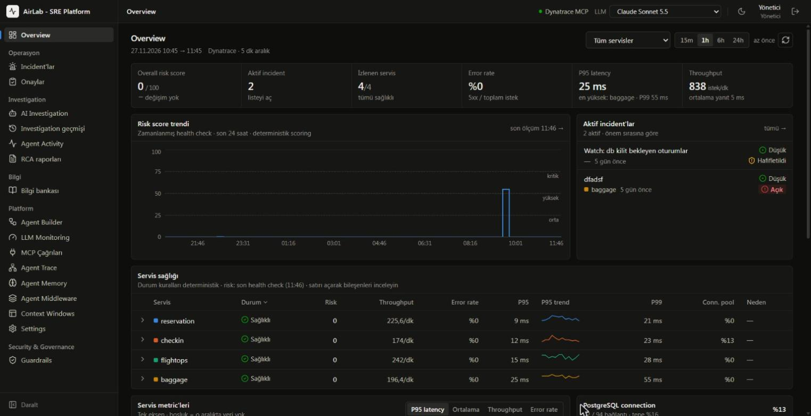

| | |
|---|---|
| **Amaç** | Sistemin anlık durumunu tek ekranda gösterir. |
| **Erişim** | Menü › Overview |
| **Temel işlevler** | Özet kartları (risk score, aktif incident, error rate, P95 latency, throughput), risk score trendi, aktif incident'lar, servis sağlığı tablosu. |
| **Dosya** | `assets/screenshots/overview-dashboard.jpg` |

### Incident'lar

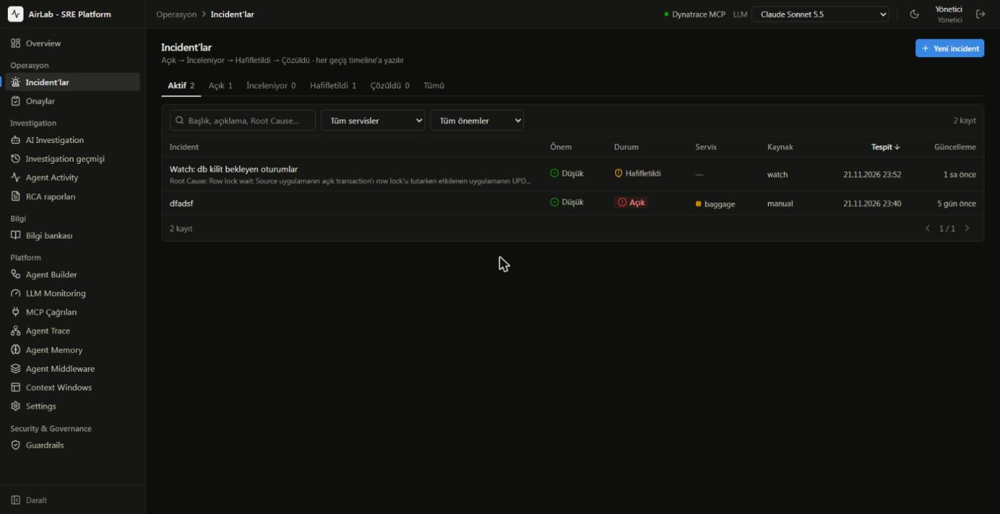

| | |
|---|---|
| **Amaç** | Olay takibi. |
| **Erişim** | Menü › Operasyon › Incident'lar |
| **Temel işlevler** | Incident listesi, durum, önem, kaynak. |
| **Dosya** | `assets/screenshots/incidents.jpg` |

### Onaylar

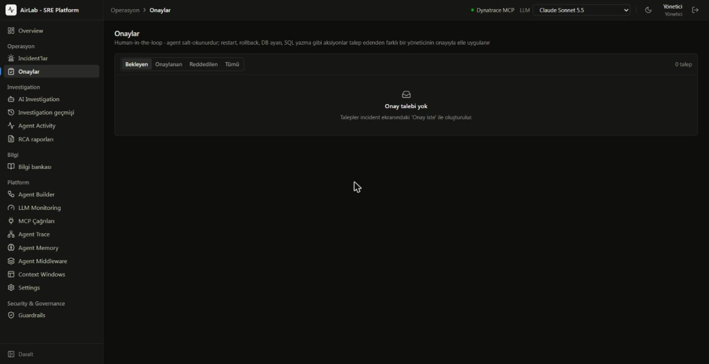

| | |
|---|---|
| **Amaç** | Salt okunur olmayan aksiyonlar için onay talepleri. |
| **Erişim** | Menü › Operasyon › Onaylar |
| **Temel işlevler** | Talep listesi, durum, karar verme. |
| **Dosya** | `assets/screenshots/approvals.jpg` |

### Bilgi bankası

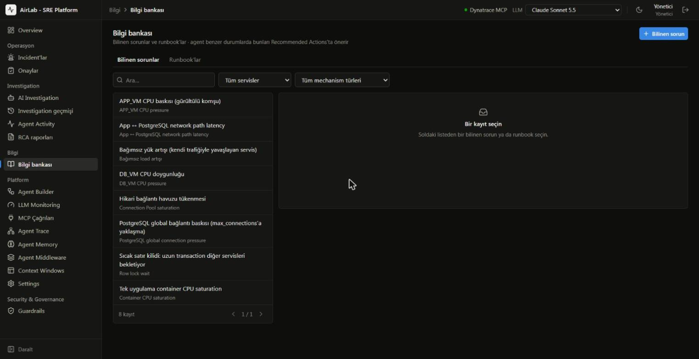

| | |
|---|---|
| **Amaç** | Bilinen sorunlar ve runbook'lar. |
| **Erişim** | Menü › Bilgi › Bilgi bankası |
| **Temel işlevler** | Bilinen sorun ve runbook listeleri, arama, yeni kayıt. |
| **Dosya** | `assets/screenshots/knowledge-base.jpg` |

## Investigation

### AI Investigation: yeni investigation

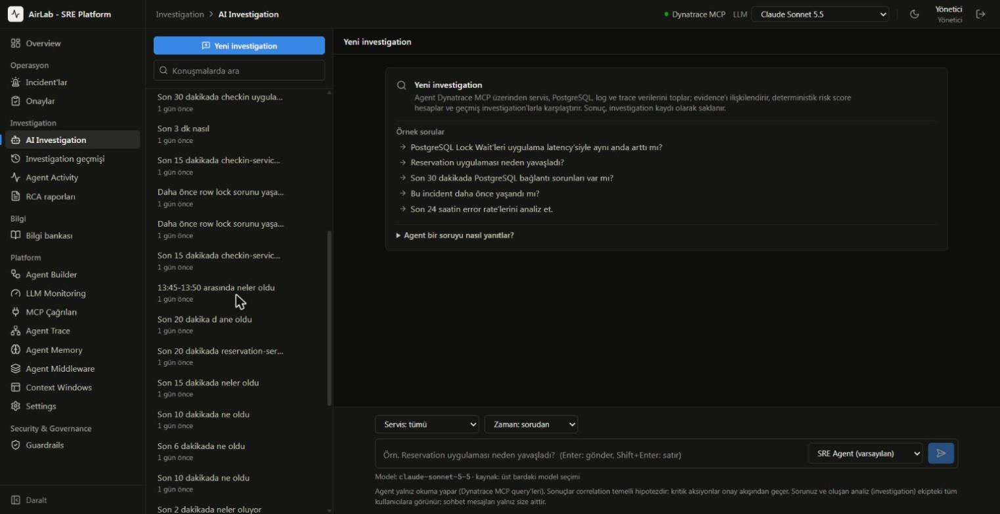

| | |
|---|---|
| **Amaç** | Agent'a doğal dille soru sorulan ekran. |
| **Erişim** | Menü › Investigation › AI Investigation › Yeni investigation |
| **Temel işlevler** | Konuşma listesi ve arama, örnek sorular, servis ve zaman seçimi, agent seçimi, soru alanı, kullanılan model bilgisi. |
| **Dosya** | `assets/screenshots/ai-investigation-new.jpg` |

### AI Investigation: yanıt

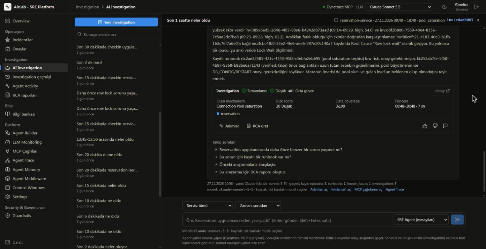

| | |
|---|---|
| **Amaç** | Agent yanıtını ve altındaki investigation kartını gösterir. |
| **Erişim** | AI Investigation'da bir konuşma açın |
| **Temel işlevler** | Yanıt metni, investigation kartı (mechanism, risk score, data coverage, pencere), RCA üret, feedback, takip soruları, adım / evidence / MCP / Agent Trace bağlantıları. |
| **Dosya** | `assets/screenshots/ai-investigation-conversation.jpg` |

### Investigation geçmişi

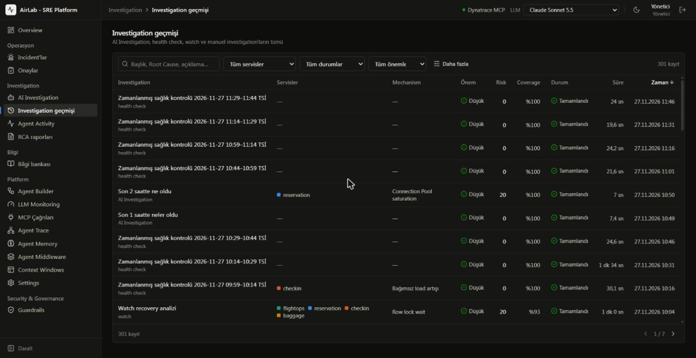

| | |
|---|---|
| **Amaç** | Tüm analizlerin listesi. |
| **Erişim** | Menü › Investigation › Investigation geçmişi |
| **Temel işlevler** | Çalışma listesi, durum, tetikleyici, risk score, süzgeçler. |
| **Dosya** | `assets/screenshots/investigation-history.jpg` |

### Investigation ayrıntısı

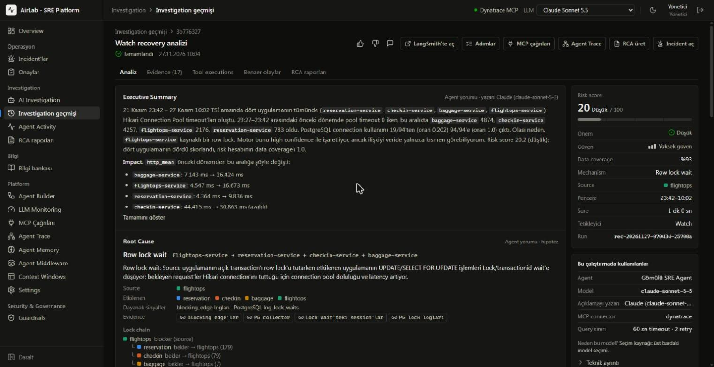

| | |
|---|---|
| **Amaç** | Tek bir analizin tam sonucu. |
| **Erişim** | Investigation geçmişinde bir satıra tıklayın |
| **Temel işlevler** | Executive Summary, Root Cause hipotezi, lock chain, sekmeler (Analiz, Evidence, Tool executions, Benzer olaylar, RCA raporları), sağ panelde risk score, güven, data coverage, kullanılan agent ve model; RCA üret ve Incident aç düğmeleri. |
| **Dosya** | `assets/screenshots/investigation-detail.jpg` |

### Agent Activity

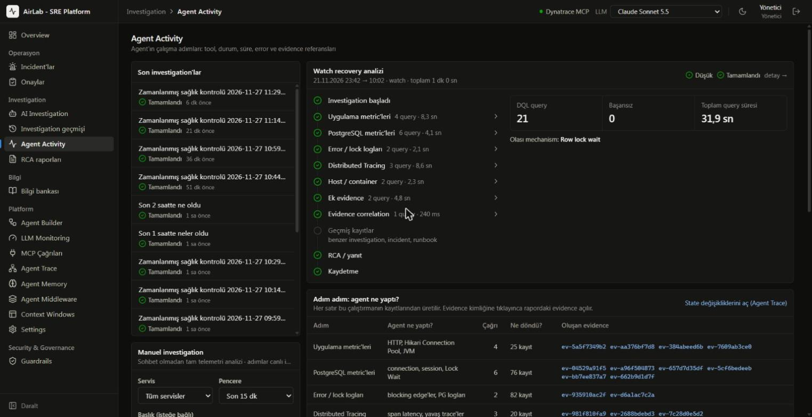

| | |
|---|---|
| **Amaç** | Bir çalışmada agent'ın attığı adımlar. |
| **Erişim** | Menü › Investigation › Agent Activity |
| **Temel işlevler** | Son investigation'lar, adım listesi (query sayısı ve süre), DQL query özeti, adım başına oluşan evidence kimlikleri, manuel investigation formu. |
| **Dosya** | `assets/screenshots/agent-activity-detail.jpg` |

### RCA raporları

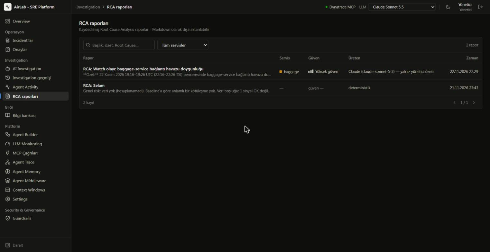

| | |
|---|---|
| **Amaç** | Üretilen RCA raporlarının listesi. |
| **Erişim** | Menü › Investigation › RCA raporları |
| **Temel işlevler** | Rapor listesi, güven düzeyi, üretim zamanı. |
| **Dosya** | `assets/screenshots/rca-reports.jpg` |

### RCA raporu ayrıntısı

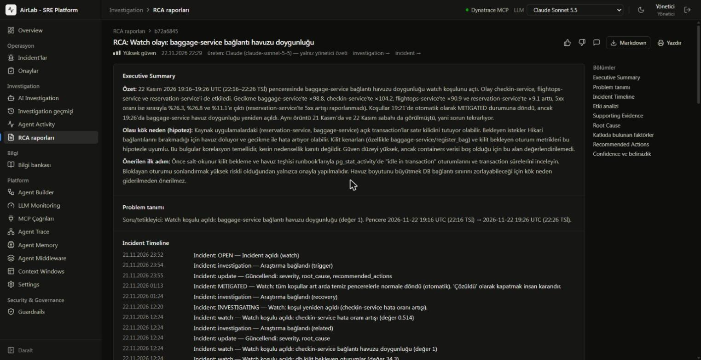

| | |
|---|---|
| **Amaç** | Tek bir RCA raporu. |
| **Erişim** | RCA raporları listesinde bir satıra tıklayın |
| **Temel işlevler** | Bölümler (Executive Summary, Problem tanımı, Incident Timeline, Etki analizi, Supporting Evidence, Root Cause, Recommended Actions, Confidence ve belirsizlik), Markdown indirme, yazdırma, feedback. |
| **Dosya** | `assets/screenshots/rca-detail.jpg` |

> Bu görseldeki rapor, saat gösterimi yalnız Türkiye saatine çevrilmeden önce üretilmiş eski bir kayıttır; yeni raporlarda saatler yalnız Türkiye saatiyle yazılır.

## Agent Builder

### Agent Builder: liste

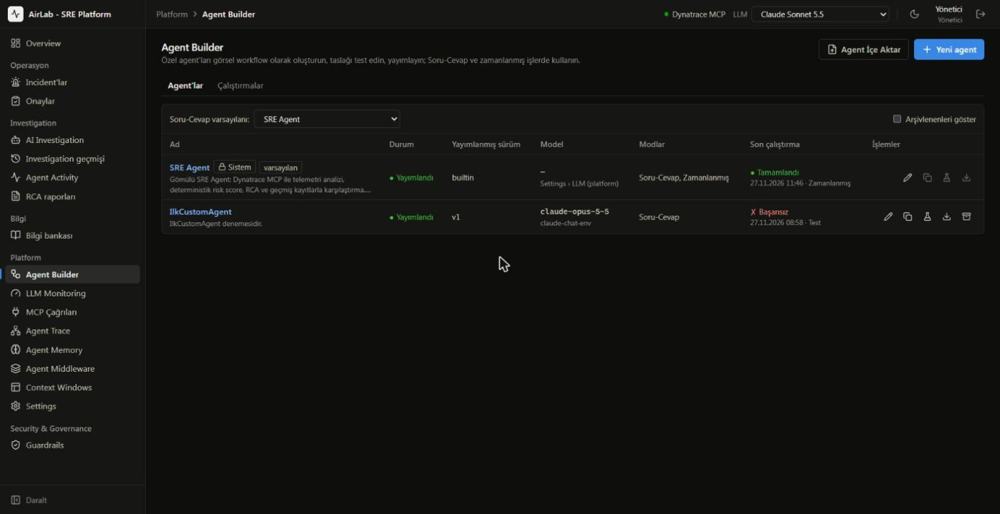

| | |
|---|---|
| **Amaç** | Custom agent'ların listesi. |
| **Erişim** | Menü › Platform › Agent Builder |
| **Temel işlevler** | Agent listesi, durum ve sürüm, yeni agent, içe aktarma. |
| **Dosya** | `assets/screenshots/agent-builder-list.jpg` |

### Agent Builder: editör

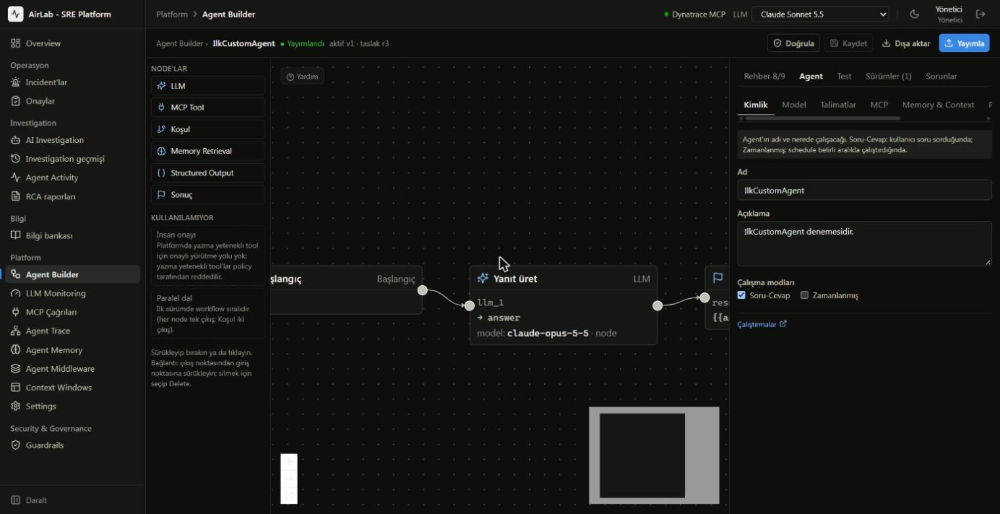

| | |
|---|---|
| **Amaç** | Custom agent workflow'unun düzenlendiği canvas. |
| **Erişim** | Agent Builder listesinde bir agent'a tıklayın |
| **Temel işlevler** | Node paleti (LLM, MCP Tool, Koşul, Memory Retrieval, Structured Output, Sonuç), canvas, sağ panel (Rehber, Agent, Test, Sürümler, Sorunlar), Doğrula / Kaydet / Dışa aktar / Yayımla. |
| **Dosya** | `assets/screenshots/agent-builder-editor.jpg` |

## Agent harness ekranları

### LLM Monitoring

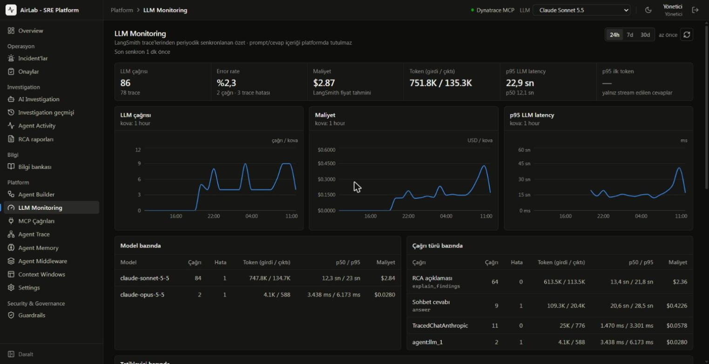

| | |
|---|---|
| **Amaç** | LLM kullanımı, maliyet ve gecikme. |
| **Erişim** | Menü › Platform › LLM Monitoring |
| **Temel işlevler** | Özet kartları, zaman grafikleri, model ve çağrı türü bazında döküm. |
| **Dosya** | `assets/screenshots/llm-monitoring.jpg` |

### MCP Çağrıları

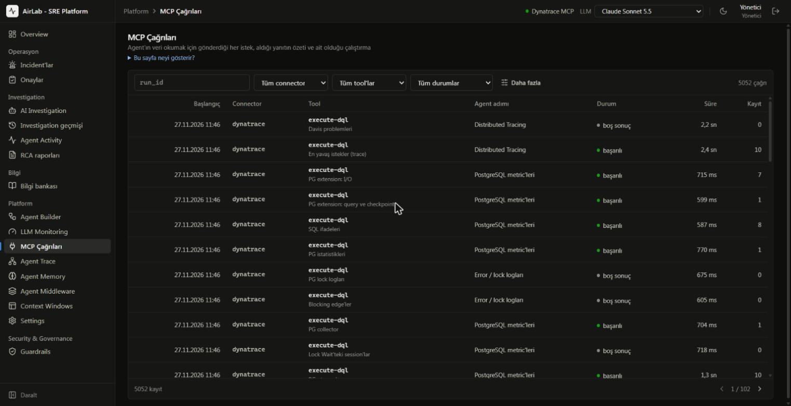

| | |
|---|---|
| **Amaç** | Agent'ın Dynatrace'e gönderdiği her istek. |
| **Erişim** | Menü › Platform › MCP Çağrıları |
| **Temel işlevler** | Connector, tool ve query konusu, agent adımı, durum, süre, kayıt sayısı; süzgeçler. |
| **Dosya** | `assets/screenshots/mcp-calls.jpg` |

### Agent Trace: liste

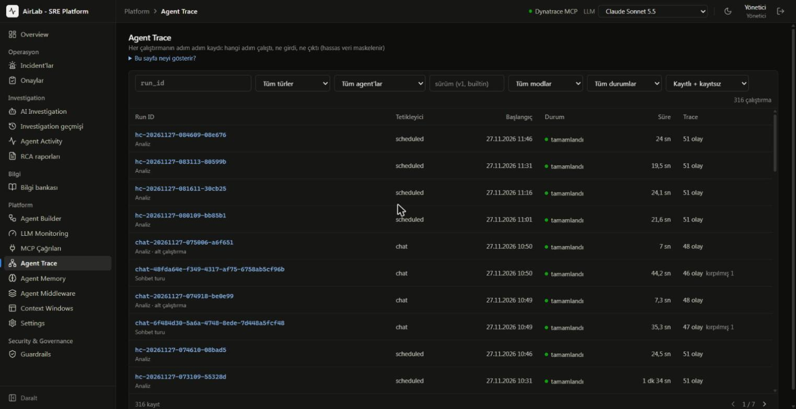

| | |
|---|---|
| **Amaç** | Kaydedilen çalışmaların listesi. |
| **Erişim** | Menü › Platform › Agent Trace |
| **Temel işlevler** | Çalışma listesi, tür, tetikleyici, durum, süre. |
| **Dosya** | `assets/screenshots/agent-trace-list.jpg` |

### Agent Trace: ayrıntı

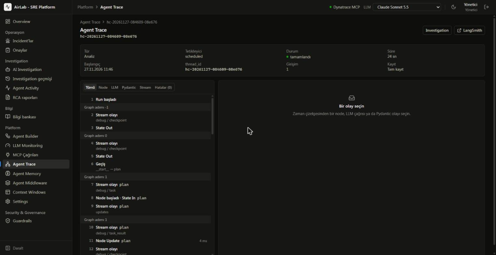

| | |
|---|---|
| **Amaç** | Bir çalışmanın graph düzeyindeki olayları. |
| **Erişim** | Agent Trace listesinde bir satıra tıklayın |
| **Temel işlevler** | Üst bilgi (tür, tetikleyici, durum, süre, thread_id), graph adımlarına göre zaman çizelgesi, olay süzgeçleri, ayrıntı paneli. |
| **Dosya** | `assets/screenshots/agent-trace-detail.jpg` |

### Agent Memory

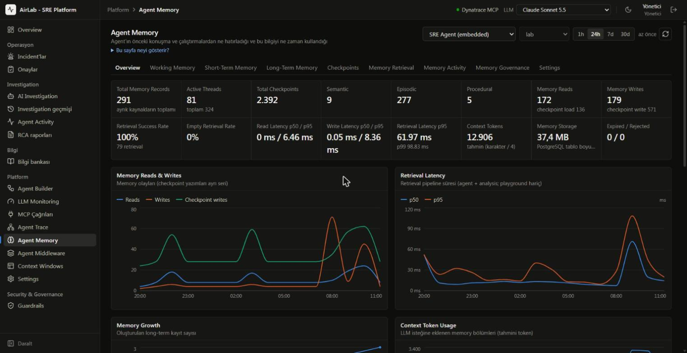

| | |
|---|---|
| **Amaç** | Agent'ın hafıza kullanımı. |
| **Erişim** | Menü › Platform › Agent Memory |
| **Temel işlevler** | Kayıt sayıları, okuma / yazma ve retrieval metrikleri, grafikler, dokuz sekme, agent ve ortam seçimi. |
| **Dosya** | `assets/screenshots/agent-memory-overview.jpg` |

### Agent Middleware: genel görünüm

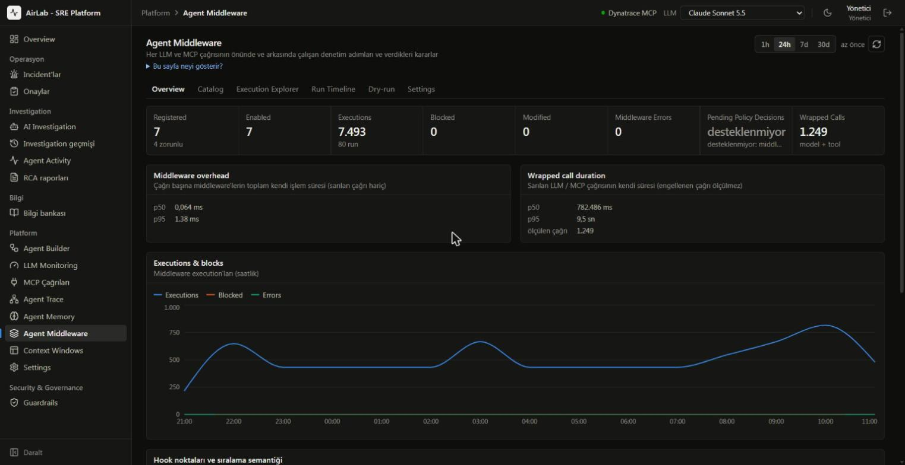

| | |
|---|---|
| **Amaç** | Middleware çalışmalarının özeti. |
| **Erişim** | Menü › Platform › Agent Middleware |
| **Temel işlevler** | Çalışma sayıları, kararlar, gecikme. |
| **Dosya** | `assets/screenshots/agent-middleware-overview.jpg` |

### Agent Middleware: katalog

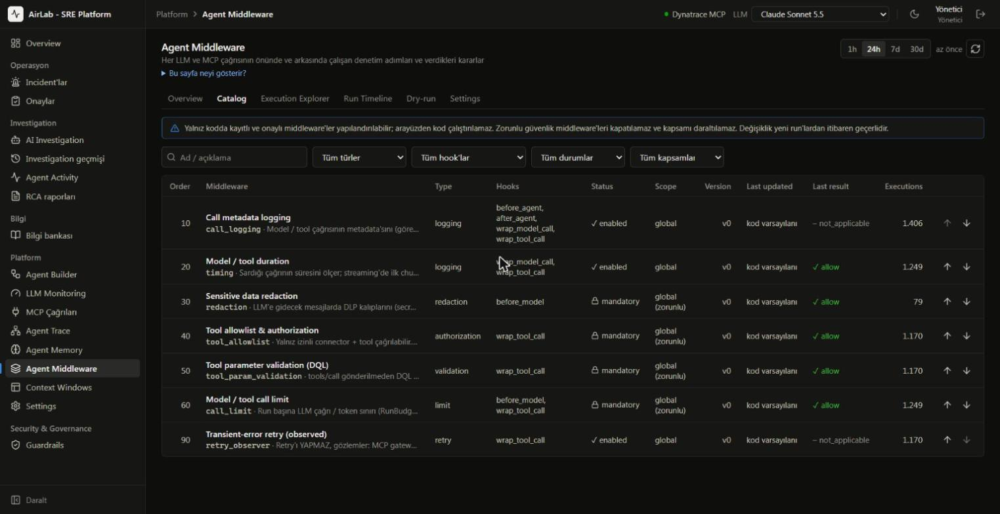

| | |
|---|---|
| **Amaç** | Yedi middleware ve yapılandırmaları. |
| **Erişim** | Agent Middleware › Catalog sekmesi |
| **Temel işlevler** | Sıra, tür, hook'lar, durum (enabled / mandatory), kapsam, son sonuç, çalışma sayısı, sıralama okları. |
| **Dosya** | `assets/screenshots/agent-middleware-catalog.jpg` |

### Context Windows

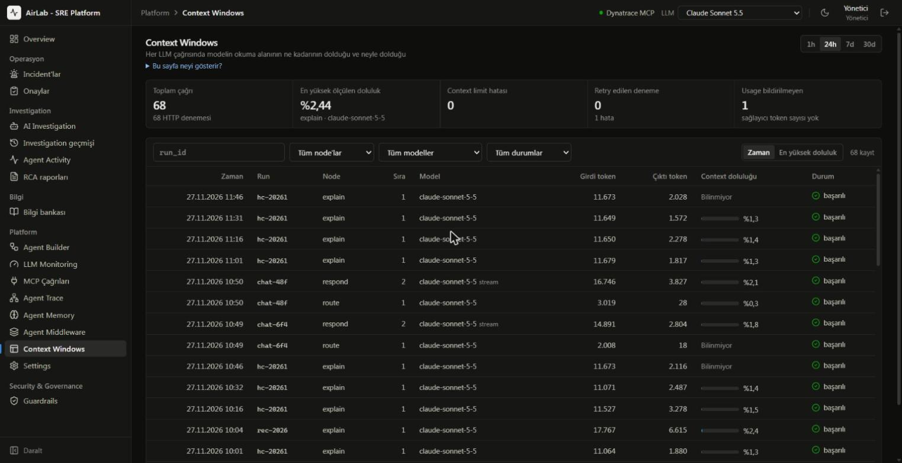

| | |
|---|---|
| **Amaç** | LLM çağrısı başına context doluluğu. |
| **Erişim** | Menü › Platform › Context Windows |
| **Temel işlevler** | Özet kartları, çağrı listesi (node, model, girdi / çıktı token'ı, doluluk, durum), süzgeçler. |
| **Dosya** | `assets/screenshots/context-windows.jpg` |

## Guardrails

### Guardrails: genel görünüm

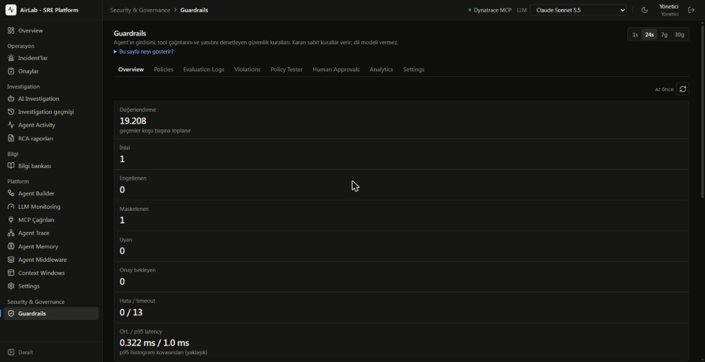

| | |
|---|---|
| **Amaç** | Guardrail değerlendirmelerinin özeti. |
| **Erişim** | Menü › Security & Governance › Guardrails |
| **Temel işlevler** | Değerlendirme, ihlal, engellenen, maskelenen, uyarı ve onay bekleyen sayıları; gecikme; sekiz sekme. |
| **Dosya** | `assets/screenshots/guardrails-overview.jpg` |

### Guardrails: policy listesi

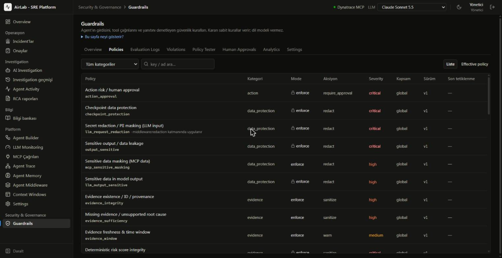

| | |
|---|---|
| **Amaç** | Tanımlı policy'ler. |
| **Erişim** | Guardrails › Policies sekmesi |
| **Temel işlevler** | Policy adı ve anahtarı, kategori, mod, aksiyon, severity, kapsam, sürüm; liste ve effective policy görünümü. |
| **Dosya** | `assets/screenshots/guardrails-policies.jpg` |

## Settings

### Settings: General & Appearance

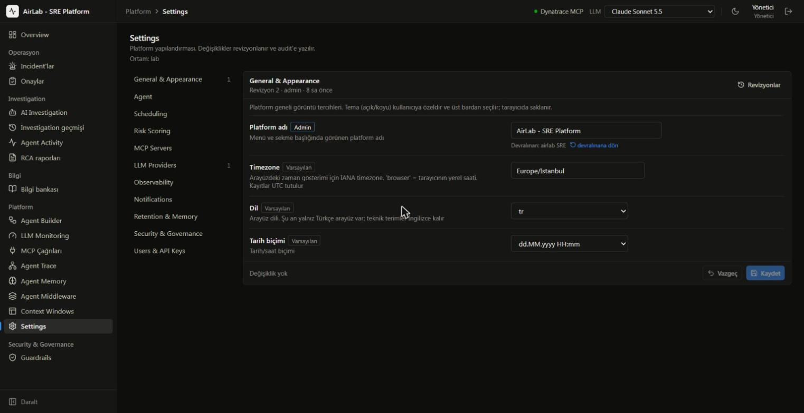

| | |
|---|---|
| **Amaç** | Genel platform ayarları. |
| **Erişim** | Menü › Platform › Settings |
| **Temel işlevler** | Bölüm listesi, platform adı, timezone, dil, tarih biçimi, değer kaynağı etiketleri, revizyonlar. |
| **Dosya** | `assets/screenshots/settings-general.jpg` |

### Settings: LLM Providers

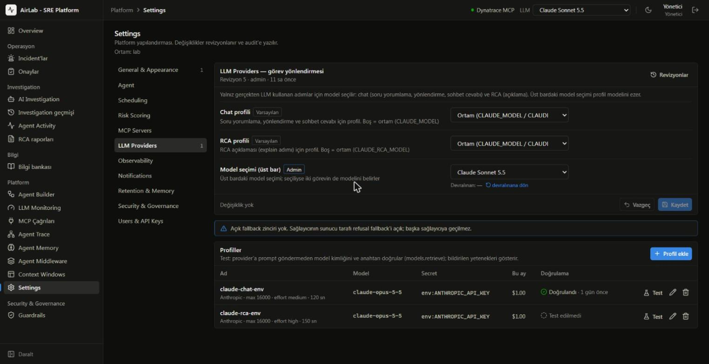

| | |
|---|---|
| **Amaç** | LLM görev profilleri ve model seçimi. |
| **Erişim** | Settings › LLM Providers |
| **Temel işlevler** | Chat ve RCA profili seçimi, üst bar model seçimi, fallback uyarısı, profil listesi (model, secret referansı, aylık kullanım, doğrulama durumu), test. |
| **Dosya** | `assets/screenshots/settings-llm-providers.jpg` |

### Settings: Scheduling

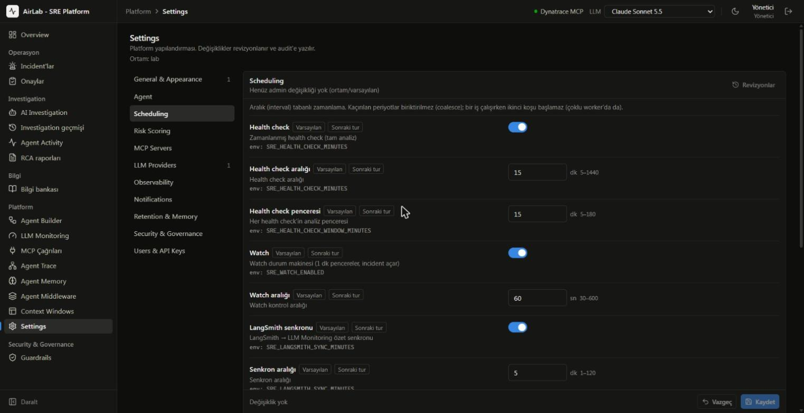

| | |
|---|---|
| **Amaç** | Zamanlanmış işlerin ayarları. |
| **Erişim** | Settings › Scheduling |
| **Temel işlevler** | Health check, watch ve LangSmith senkronu için aç / kapat ve aralık alanları, ilgili ortam değişkeni adları. |
| **Dosya** | `assets/screenshots/settings-scheduling.jpg` |

## Eksik ekran görüntüleri

Aşağıdaki ekranların görüntüsü alınmadı. Sahte görsel ya da mockup üretilmedi; bu ekranlar için dokümanlarda görsel
bağlantısı yoktur.

| Ekran | Neden alınmadı | Eklemek için |
|---|---|---|
| Giriş ekranı (`/login`) | Görüntü almak için açık oturumu kapatmak gerekiyordu | 
| Hesabım (`/account`) | Oturum listesi istemci IP adreslerini gösterir | 
| Settings › MCP Servers | Connector adresi Dynatrace tenant kimliğini içerir | Adres alanını kapatarak görüntüleyin |
| Settings › Agent, Risk Scoring, Observability, Notifications, Retention & Memory, Security & Governance, Users & API Keys | Kapsam dışında bırakıldı; Users & API Keys kullanıcı adlarını gösterir | İsteğe bağlı |
| Incident ayrıntısı | Alınmadı | Bir incident açıp görüntüleyin |
| Agent Memory, Agent Middleware ve Guardrails'in diğer sekmeleri | Yalnız ana sekmeler alındı |
| Chaos Controller (Overview, Library, Builder, Live, History) | Ayrı bir kullanıcı adı ve parola gerektirir; bu çalışmada parola girilmedi | 
| Laboratuvar servis arayüzleri (reservation, check-in, flight operations, baggage) | Laboratuvar uygulamaları bu dokümantasyonun odağı değil | 
| Açık tema | Tüm görseller koyu temada alındı | 

Yeni görsel eklerken:

1. Dosyayı [`docs/assets/screenshots/`](assets/screenshots/) altına kebab-case adla kaydedin (örnek: `chaos-library.jpg`).
2. Görselde token, parola, API key, gerçek IP adresi ya da tenant adresi olmadığını kontrol edin.
3. Bu sayfaya amaç, erişim ve temel işlevler satırlarıyla ekleyin.
