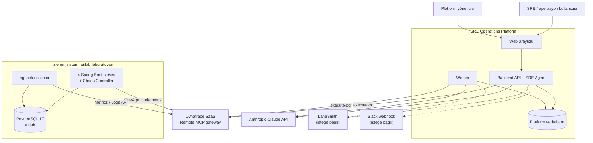
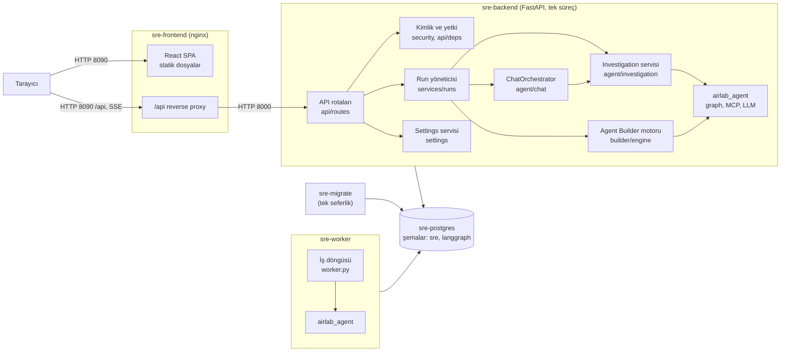
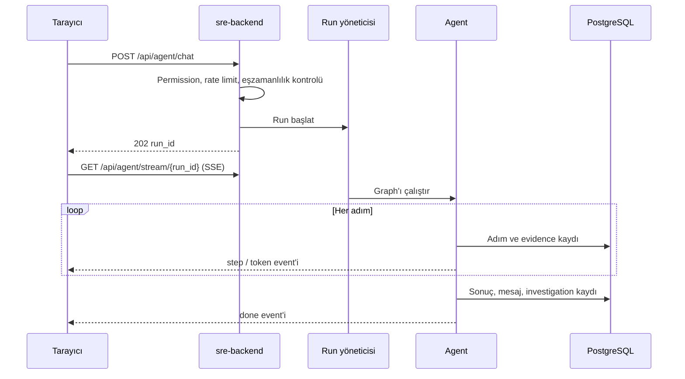
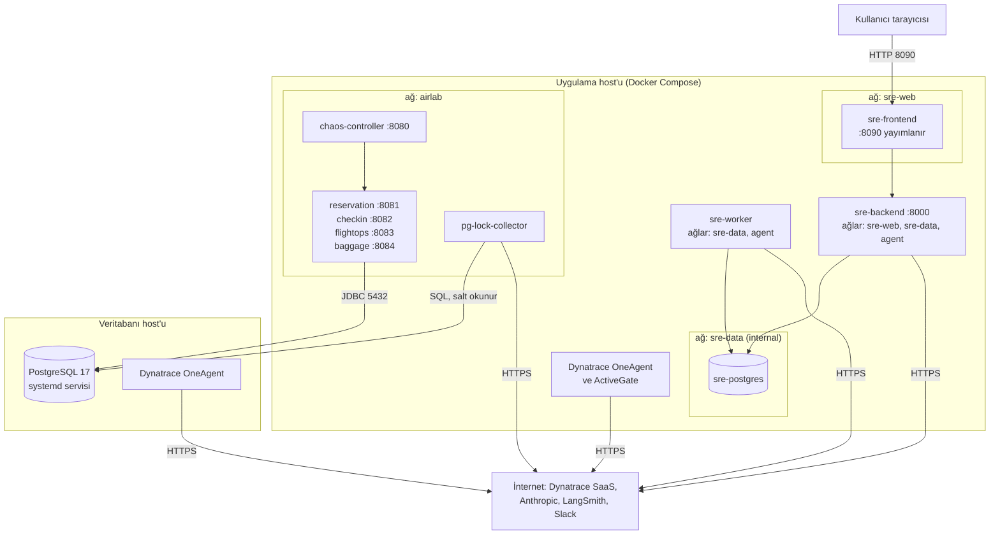
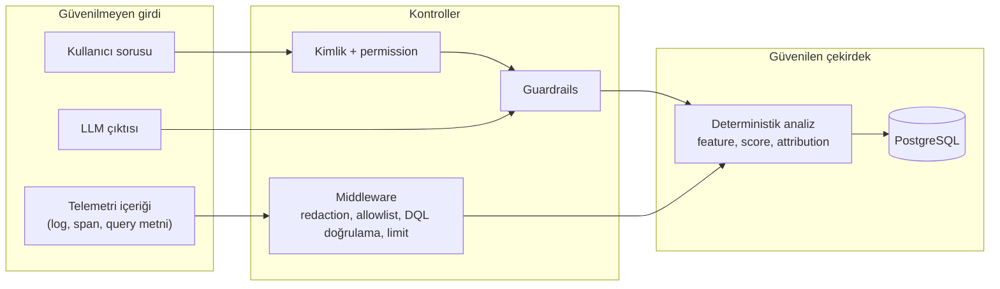

# Platform Teknik Mimarisi

Bu doküman SRE Operations Platform'un bileşenlerini, aralarındaki bağlantıları, veri katmanını, dış entegrasyonları ve
dağıtım topolojisini anlatır. Agent'ın iç yapısı ayrı bir dokümandadır: [Agent Mimarisi](AGENT_ARCHITECTURE.md).

[← Dokümantasyon merkezine dön](../README.md)

## İçindekiler

- [1. Sistem bağlamı](#1-sistem-bağlamı)
- [2. Container ve bileşenler](#2-container-ve-bileşenler)
- [3. Frontend](#3-frontend)
- [4. Backend ve API](#4-backend-ve-api)
- [5. Worker ve zamanlanmış işler](#5-worker-ve-zamanlanmış-işler)
- [6. Veri katmanı](#6-veri-katmanı)
- [7. Dış entegrasyonlar](#7-dış-entegrasyonlar)
- [8. Deployment topolojisi](#8-deployment-topolojisi)
- [9. Servisler arası protokoller](#9-servisler-arası-protokoller)
- [10. Güven sınırları ve güvenlik](#10-güven-sınırları-ve-güvenlik)
- [11. Hata davranışı](#11-hata-davranışı)
- [12. Bilinen sınırlar](#12-bilinen-sınırlar)

## 1. Sistem bağlamı

Platform iki tür sistemle konuşur: analiz için kullandığı dış servisler (Dynatrace, Anthropic, isteğe bağlı LangSmith
ve Slack) ve yalnız dolaylı olarak gördüğü izlenen laboratuvar.

Önemli nokta: platformdan laboratuvara **doğrudan bağlantı yoktur**. Agent izlenen veritabanına ya da host'lara
bağlanmaz; her veriyi Dynatrace üzerinden okur.

## 2. Container ve bileşenler

| Bileşen | Sorumluluk | Kaynak |
|---|---|---|
| `sre-frontend` | Arayüzü sunar, `/api` isteklerini backend'e iletir, güvenlik başlıklarını ekler | [`frontend/`](../sre-platform/frontend/), [`nginx.conf`](../sre-platform/frontend/nginx.conf) |
| `sre-backend` | REST API, SSE akışı, kimlik doğrulama, agent çalıştırma | [`api/app.py`](../sre-platform/backend/sre_platform/api/app.py) |
| `sre-worker` | Zamanlanmış ve sürekli işler | [`worker.py`](../sre-platform/backend/sre_platform/worker.py) |
| `sre-migrate` | Şema migration'ı ve başlangıç verisi; işini bitirip çıkar | [`db/migrate.py`](../sre-platform/backend/sre_platform/db/migrate.py), [`cli.py`](../sre-platform/backend/sre_platform/cli.py) |
| `sre-postgres` | Tüm kalıcı durum | [`db/models.py`](../sre-platform/backend/sre_platform/db/models.py) |
| `airlab_agent` | Agent çekirdeği; backend ve worker imajına paket olarak kurulur | [`sre-agent/src/airlab_agent/`](../sre-agent/src/airlab_agent/) |

Backend, worker ve migrate aynı imajı kullanır (`airlab/sre-platform-backend`); farklı olan yalnız çalıştırılan
komuttur: `serve`, `worker`, `migrate --seed`.

## 3. Frontend

Tek sayfalık bir React uygulamasıdır (SPA). Derlenmiş dosyaları nginx sunar.

| Konu | Uygulama | Kaynak |
|---|---|---|
| Sayfa yönlendirme | React Router; sayfalar lazy yüklenir | [`App.tsx`](../sre-platform/frontend/src/App.tsx) |
| Menü ve yerleşim | Rol ve permission'a göre süzülen menü grupları | [`layouts/AppLayout.tsx`](../sre-platform/frontend/src/layouts/AppLayout.tsx) |
| Sunucu verisi | TanStack Query | [`services/`](../sre-platform/frontend/src/services/) |
| Canlı akış | `fetch` ile okunan Server-Sent Events akışı (Bearer başlığı gönderilebilsin diye `EventSource` kullanılmaz) | [`services/sse.ts`](../sre-platform/frontend/src/services/sse.ts) |
| Yetki kontrolü | Permission kodları arayüzde de uygulanır; asıl kontrol backend'dedir | [`features/account/permissions.ts`](../sre-platform/frontend/src/features/account/permissions.ts) |

Frontend backend'in adresini bilmez; tüm çağrılar aynı origin'e, `/api` yoluna gider ve nginx tarafından
`sre-backend:8000` adresine iletilir. Bu nedenle CORS gerekmez.

nginx iki ayrı proxy kuralı kullanır: SSE akışı (`/api/agent/stream/`) için ara belleksiz ve uzun süreli bağlantı,
diğer API çağrıları için standart proxy.

## 4. Backend ve API

Tüm rotalar `/api` ön eki altındadır. Okuma dışındaki her rota bir permission ister
([`api/deps.py`](../sre-platform/backend/sre_platform/api/deps.py),
[`security/permissions.py`](../sre-platform/backend/sre_platform/security/permissions.py)).

| Rota grubu | Kapsam | Kaynak |
|---|---|---|
| `/api/auth/*` | Giriş, çıkış, oturum, parola, API anahtarları | [`routes/auth.py`](../sre-platform/backend/sre_platform/api/routes/auth.py) |
| `/api/conversations/*`, `/api/agent/*` | Sohbet, manuel investigation, SSE akışı, run iptali, resume | [`routes/agent.py`](../sre-platform/backend/sre_platform/api/routes/agent.py) |
| `/api/investigations`, `/api/incidents`, `/api/rca`, `/api/knowledge`, `/api/approvals` | Kayıtlar | [`routes/records.py`](../sre-platform/backend/sre_platform/api/routes/records.py) |
| `/api/agents/*` | Agent Builder: taslak, doğrulama, yayım, sürüm, import / export, test, schedule | [`routes/agents.py`](../sre-platform/backend/sre_platform/api/routes/agents.py) |
| `/api/settings/*` | Ayar bölümleri, connector'lar, LLM profilleri, secret'lar, kullanıcılar | [`routes/settings.py`](../sre-platform/backend/sre_platform/api/routes/settings.py) |
| `/api/mcp-calls`, `/api/agent-traces`, `/api/context-windows` | İzleme ekranlarının verisi | [`routes/`](../sre-platform/backend/sre_platform/api/routes/) |
| `/api/memory`, `/api/middleware`, `/api/guardrails` | Agent harness yönetimi | aynı dizin |
| `/api/health`, `/api/ready` | Sağlık kontrolü (kimlik doğrulama gerekmez) | [`api/app.py`](../sre-platform/backend/sre_platform/api/app.py) |

Tam uç listesi ve örnekler: [sre-platform/README.md](../sre-platform/README.md). OpenAPI arayüzü varsayılan olarak
kapalıdır; `SRE_API_DOCS=true` ile `/api/docs` açılır.

### Agent çalıştırma modeli

Agent çalıştırması eşzamansızdır: API hemen `202` ve bir `run_id` döndürür, iş arka planda yürür, ilerleme SSE ile
izlenir.

Run yöneticisi ([`services/runs.py`](../sre-platform/backend/sre_platform/services/runs.py)) kullanıcı başına hız
sınırını (`SRE_RUN_RATE_PER_MINUTE`), eşzamanlı çalışma sınırını (`SRE_MAX_CONCURRENT_INVESTIGATIONS`) ve toplam süre
sınırını (`SRE_INVESTIGATION_TIMEOUT_S`) uygular.

## 5. Worker ve zamanlanmış işler

Worker, iş tanımlarını veritabanından okur ve süresi gelenleri çalıştırır. Zamanlama **aralık tabanlıdır**; cron
ifadesi desteklenmez.

| İş | Varsayılan aralık | Ne yapar |
|---|---|---|
| `watch` | 60 saniye | Tamamlanmış 1 dakikalık pencereleri değerlendirir; threshold art arda aşılırsa incident açar ve tam analiz başlatır |
| `health-check` | 15 dakika | Tüm servisler için tam analiz çalıştırır |
| `agent_run` schedule'ları | Kullanıcı tanımlar | Yayımlanmış bir custom agent'ı zamanlanmış olarak çalıştırır |
| `retention` | 1 saat | Saklama süresi dolan kayıtları siler |
| `langsmith-sync` | 5 dakika | LangSmith'ten LLM çalışma özetlerini çeker (anahtar varsa) |
| `security-ops` | 60 saniye | Güvenlik olaylarının dışa aktarımı ve alarmlar; ayar kapalıyken işlem yapmaz |

Bir iş çalışırken ikinci kopyası başlamaz: iş satırı veritabanında kiralanır (lease), bu yüzden birden fazla worker
çalışsa da aynı iş iki kez yürümez. Kaçırılan periyotlar biriktirilmez. Yarıda kalan çalışmalar
[`services/reconcile.py`](../sre-platform/backend/sre_platform/services/reconcile.py) ile işaretlenir.

Kaynak: [`worker.py`](../sre-platform/backend/sre_platform/worker.py),
[`repositories/jobs.py`](../sre-platform/backend/sre_platform/repositories/jobs.py),
[`sre-agent/src/airlab_agent/watch.py`](../sre-agent/src/airlab_agent/watch.py).

## 6. Veri katmanı

Tek bir PostgreSQL 17 veritabanı, iki şema.

| Şema | Yöneten | İçerik |
|---|---|---|
| `sre` | Alembic (`0001` – `0019`) | Uygulama tabloları |
| `langgraph` | LangGraph kurulum rutini | Checkpoint ve Store tabloları |

`sre` şemasındaki başlıca tablo grupları:

| Grup | Örnek tablolar | Amaç |
|---|---|---|
| Kimlik | `users`, `auth_sessions`, `auth_login_failures`, `api_keys` | Kullanıcılar, roller, oturumlar |
| Sohbet | `conversations`, `messages` | Konuşma geçmişi (kullanıcıya özel) |
| Analiz | `investigations`, `investigation_evidence`, `agent_tool_executions` | Her agent çalışmasının sonucu ve kanıtları |
| Operasyon | `incidents`, `incident_events`, `rca_reports`, `approval_requests` | Incident, RCA ve onay kayıtları |
| Bilgi | `known_issues`, `runbooks` | Bilgi bankası |
| Memory | `agent_episodes`, `memory_records`, `memory_versions`, `memory_retrievals` | Episodic ve uzun dönem hafıza |
| Agent Builder | `agents`, `agent_versions`, `agent_runs` | Custom agent tanımları ve çalışmaları |
| İzleme | `agent_trace_runs`, `agent_trace_events`, `llm_context_calls`, `llm_runs`, `trace_links`, `middleware_executions` | Agent Trace, Context Windows, LLM Monitoring, MCP Çağrıları |
| Zamanlama | `scheduled_jobs`, `job_runs`, `watch_conditions`, `watch_windows`, `watch_events` | İş tanımları ve watch durumu |
| Yönetim | `settings_sections`, `settings_revisions`, `connectors`, `llm_profiles`, `secrets`, `guardrail_*`, `middleware_configs`, `audit_events` | Yapılandırma ve denetim |

Model tanımları: [`db/models.py`](../sre-platform/backend/sre_platform/db/models.py). Migration'lar:
[`db/migrations/versions/`](../sre-platform/backend/sre_platform/db/migrations/versions/).

Veritabanı yalnız `sre-data` iç ağına bağlıdır ve host'a port yayımlamaz. Ayrı bir cache, mesaj kuyruğu ya da vektör
veritabanı yoktur.

## 7. Dış entegrasyonlar

| Entegrasyon | Yön | Protokol | Kimlik doğrulama | Zorunlu | Kaynak |
|---|---|---|---|---|---|
| Dynatrace Remote MCP | Dışa | MCP, Streamable HTTP (HTTPS) | Bearer platform token | Evet | [`mcp_gateway.py`](../sre-agent/src/airlab_agent/mcp_gateway.py) |
| Anthropic Claude API | Dışa | HTTPS | API key | Hayır | [`llm.py`](../sre-agent/src/airlab_agent/llm.py) |
| LangSmith | Dışa | HTTPS | API key | Hayır | [`tracing.py`](../sre-agent/src/airlab_agent/tracing.py), [`langsmith_sync.py`](../sre-platform/backend/sre_platform/services/langsmith_sync.py) |
| Slack | Dışa | HTTPS webhook | Webhook URL'si | Hayır | [`slack_notify.py`](../sre-platform/backend/sre_platform/services/slack_notify.py) |

Platform dışarıdan gelen bağlantı (webhook, callback) kabul etmez; tüm entegrasyonlar dışa doğrudur. Arayüzden
eklenen connector ve webhook adresleri bir ağ korumasından geçer: private adresler ve `http` şeması yalnız
`SRE_OUTBOUND_ALLOWLIST` ile izinlidir ([`settings/netguard.py`](../sre-platform/backend/sre_platform/settings/netguard.py)).

## 8. Deployment topolojisi

Doğrulanan kurulum iki host kullanır: uygulama host'u (tüm container'lar) ve izlenen veritabanı host'u.

| Ağ | Üyeler | Özellik |
|---|---|---|
| `sre-data` | `sre-postgres`, `sre-migrate`, `sre-backend`, `sre-worker` | `internal: true`; dışarıya çıkışı yok |
| `sre-web` | `sre-frontend`, `sre-backend` | Frontend'in backend'e eriştiği ağ |
| `agent` | `sre-backend`, `sre-worker` | Dış servislere (Dynatrace, Anthropic) çıkış |
| `airlab` | Laboratuvar servisleri | Platform container'ları bu ağda değildir |

Tek host'ta çalıştırma da mümkündür: laboratuvar veritabanı `compose.local.yml` ile container olarak başlatılır
([Kurulum Kılavuzu](INSTALLATION.md#13-laboratuvarı-çalıştırma-isteğe-bağlı)).

Container sertleştirmesi Compose dosyasında tanımlıdır: bellek sınırları, `no-new-privileges`, `cap_drop: ALL`, salt okunur
kök dosya sistemi ve healthcheck'ler ([`app-vm/docker-compose.yml`](../app-vm/docker-compose.yml)).

## 9. Servisler arası protokoller

| Kaynak | Hedef | Protokol | Port |
|---|---|---|---|
| Tarayıcı | `sre-frontend` | HTTP | `8090` (host), `8080` (container) |
| `sre-frontend` | `sre-backend` | HTTP, SSE | `8000` |
| `sre-backend`, `sre-worker` | `sre-postgres` | PostgreSQL wire protocol | `5432` |
| `sre-backend`, `sre-worker` | Dynatrace | HTTPS (MCP Streamable HTTP) | `443` |
| `sre-backend`, `sre-worker` | Anthropic, LangSmith, Slack | HTTPS | `443` |
| Laboratuvar servisleri | Laboratuvar PostgreSQL | JDBC | `5432` |

Backend ile worker birbirini çağırmaz; yalnız veritabanı üzerinden eşgüdümlenirler.

## 10. Güven sınırları ve güvenlik

| Konu | Uygulama |
|---|---|
| Kimlik doğrulama | Kullanıcı adı ve parola ile giriş; imzalı oturum token'ı (JWT) `Authorization: Bearer` başlığıyla gönderilir ve sunucu tarafındaki oturum kaydıyla doğrulanır (boşta kalma ve mutlak süre sınırı). Otomasyon için scope'lu API anahtarları (`srek_` ön ekli). |
| Yetkilendirme | Üç rol (`viewer`, `sre`, `admin`), rota başına permission. Ayrıntı: [Kullanıcı Kılavuzu › Roller](USER_GUIDE.md#3-roller-ve-yetkiler) |
| Veri görünürlüğü | Tek organizasyon modeli: investigation, incident ve RCA kayıtlarını oturum açmış her kullanıcı okur. Sohbet mesajları yalnız sahibine aittir. |
| Agent'ın yetkisi | Salt okunur. Tek tool `execute-dql`; yazma yetenekli tool'lar policy tarafından reddedilir. |
| Secret'lar | Ortam dosyalarında ya da şifreli Settings deposunda; API yanıtlarında ve log'larda gösterilmez |
| LLM'e giden veri | Zorunlu redaction middleware'i secret ve kişisel veri kalıplarını maskeler |
| Prompt injection | Telemetri içeriği veri olarak işlenir; guardrail policy'leri girdi, tool çağrısı ve çıktıyı denetler |
| Denetim | Yönetim işlemleri audit kaydına yazılır; Settings değişiklikleri revizyonlanır |
| Taşıma güvenliği | Platformda TLS yoktur; arayüz düz HTTP ile sunulur (bilinen sınır) |

Ayrıntılı güvenlik dokümanları: [docs/platform/security/](platform/security/),
[Guardrails güvenlik modeli](platform/guardrails/GUARDRAILS_SECURITY_MODEL.md),
[SECURITY.md](../SECURITY.md).

## 11. Hata davranışı

| Durum | Davranış |
|---|---|
| Dynatrace MCP'ye ulaşılamıyor | Etkilenen signal'lar `UNAVAILABLE` olur; agent kısmi rapor yazar. Başka veri kaynağına geçilmez. |
| Token'da scope eksik | Signal `PERMISSION` olur; data coverage düşer ve raporda belirtilir. |
| LLM'e ulaşılamıyor ya da bütçe doldu | Analiz tamamlanır; açıklama deterministik metinle üretilir. |
| Guardrail çıktıyı engelledi | Yanıt deterministik açıklamaya düşer ya da engellendiği bildirilir. |
| Backend çalışma sırasında yeniden başladı | Çalışma yarıda kalır; checkpoint'ten sürdürülebilir (resume) ya da uzlaştırma işi tarafından işaretlenir. |
| Veritabanına ulaşılamıyor | `/api/ready` hata döner; backend healthcheck başarısız olur. |
| Çalışma süre sınırını aştı | Run `timeout` olarak kapanır; o ana kadarki adımlar kayıtlıdır. |
| Worker durdu | Zamanlanmış işler çalışmaz; arayüz ve soru-cevap etkilenmez. |

Akış diyagramları: [Çalışma Akışları](WORKFLOWS.md).

## 12. Bilinen sınırlar

- **Tek backend süreci.** Canlı SSE akışı süreç belleğindeki kuyrukla taşınır; backend yatayda ölçeklenmez.
- **TLS yok.** Erişimi ağ düzeyinde sınırlayın ya da önüne TLS sonlandıran bir proxy koyun.
- **Harici kimlik sağlayıcı (SSO) yok.** Kullanıcılar platformda tanımlanır.
- **Tek LLM provider.** Yalnız Anthropic.
- **Tek veri kaynağı.** Yalnız Dynatrace; MCP kesintisinde yedek kaynak yoktur.
- **Kubernetes manifesti yok.** Dağıtım Docker Compose iledir.

Daha kapsamlı liste: [sre-platform/README.md](../sre-platform/README.md).
