# Kullanıcı Kılavuzu

Bu kılavuz SRE Agent Management Platform'un ekranlarını gerçek menü adlarıyla tanıtır. Her ekran için amaç, erişim yolu,
ön koşul, adım adım kullanım ve beklenen sonuç verilir.

Kurulum için: [Kurulum Kılavuzu](INSTALLATION.md). Tüm ekran görüntüleri: [Ekran Görüntüleri](SCREENSHOTS.md).

[← Dokümantasyon merkezine dön](../README.md)

## İçindekiler

- [1. Temel kavramlar](#1-temel-kavramlar)
- [2. Giriş ve genel yerleşim](#2-giriş-ve-genel-yerleşim)
- [3. Roller ve yetkiler](#3-roller-ve-yetkiler)
- [4. Overview](#4-overview)
- [5. AI Investigation (soru-cevap)](#5-ai-investigation-soru-cevap)
- [6. Investigation geçmişi ve ayrıntısı](#6-investigation-geçmişi-ve-ayrıntısı)
- [7. Agent Activity](#7-agent-activity)
- [8. Incident'lar](#8-incidentlar)
- [9. RCA raporları](#9-rca-raporları)
- [10. Bilgi bankası](#10-bilgi-bankası)
- [11. Onaylar](#11-onaylar)
- [12. Agent Builder](#12-agent-builder)
- [13. LLM Monitoring](#13-llm-monitoring)
- [14. MCP Çağrıları](#14-mcp-çağrıları)
- [15. Agent Trace](#15-agent-trace)
- [16. Agent Memory](#16-agent-memory)
- [17. Agent Middleware](#17-agent-middleware)
- [18. Context Windows](#18-context-windows)
- [19. Guardrails](#19-guardrails)
- [20. Settings](#20-settings)
- [21. Hesabım](#21-hesabım)
- [22. Chaos Controller (laboratuvar)](#22-chaos-controller-laboratuvar)
- [23. Sık karşılaşılan durumlar](#23-sık-karşılaşılan-durumlar)

## 1. Temel kavramlar

| Terim | Anlamı |
|---|---|
| **Investigation** | Agent'ın belirli bir zaman penceresi için yaptığı tek bir analiz ve sonucu. |
| **Evidence** | Agent'ın topladığı her veri parçası. Her birinin kimliği (`ev-…`) ve veri durumu vardır. |
| **Risk score** | Etkinin şiddetini gösteren 0–100 arası deterministik skor. Bantlar: düşük, orta, yüksek, kritik. |
| **Data coverage** | Sonuca varmak için gereken verinin ne kadarının ölçülebildiği. |
| **Confidence (güven)** | Neden atamasının ne kadar güvenilir olduğu. Risk score'dan bağımsızdır. |
| **Mechanism** | Olası neden türü: row lock, Connection Pool saturation, DB CPU vb. Her zaman hipotezdir. |
| **Source / etkilenen** | Sorunu başlatan uygulama ve ondan etkilenen uygulamalar. |
| **Incident** | Takip edilen bir olay. Watch tarafından otomatik ya da kullanıcı tarafından açılır. |
| **RCA** | Root Cause Analysis raporu; bir investigation'dan üretilir. |
| **Gömülü agent** | Platformla gelen "SRE Agent". Analiz mantığı sabittir. |
| **Custom agent** | Agent Builder'da kullanıcının oluşturduğu workflow. |
| **MCP** | Model Context Protocol; agent'ın Dynatrace'ten veri okuduğu protokol. |

Zamanlar arayüzde Türkiye saatiyle gösterilir.

## 2. Giriş ve genel yerleşim

1. Tarayıcıda platform adresini açın (`http://<host>:8090`).
2. Kullanıcı adı ve parolanızla giriş yapın.

Ekran üç bölümden oluşur:

- **Sol menü:** Ekranlar gruplar halinde. Yetkiniz olmayan ekranlar görünmez. Alttaki **Daralt** menüyü küçültür.
- **Üst bar:** Bulunduğunuz ekran, **Dynatrace MCP** bağlantı göstergesi, **LLM** model seçimi (yalnız yönetici
  değiştirir), açık / koyu tema düğmesi, kullanıcı adı ve çıkış.
- **İçerik alanı:** Seçili ekran.

Menü grupları:

| Grup | Ekranlar |
|---|---|
| – | Overview |
| Operasyon | Incident'lar, Onaylar |
| Investigation | AI Investigation, Investigation geçmişi, Agent Activity, RCA raporları |
| Bilgi | Bilgi bankası |
| Platform | Agent Builder, LLM Monitoring, MCP Çağrıları, Agent Trace, Agent Memory, Agent Middleware, Context Windows, Settings |
| Security & Governance | Guardrails |

Oturum 30 dakika işlem yapılmazsa kapanır (varsayılan; `SRE_SESSION_IDLE_MINUTES`).

## 3. Roller ve yetkiler

Üç rol vardır. Yetkiler backend'de her API çağrısında denetlenir; menü de role göre süzülür.

| Yetenek | İzleyici (`viewer`) | SRE (`sre`) | Yönetici (`admin`) |
|---|:-:|:-:|:-:|
| Investigation, incident, RCA, bilgi bankasını görüntüleme | ✔ | ✔ | ✔ |
| Agent çalıştırma (sohbet, manuel investigation) | – | ✔ | ✔ |
| Incident, not, bilinen sorun oluşturma; RCA üretme | – | ✔ | ✔ |
| Onay talebi açma | – | ✔ | ✔ |
| Onay kararı verme | – | – | ✔ |
| Platform ekranlarını görme (LLM Monitoring, MCP Çağrıları, Agent Trace vb.) | – | ✔ | ✔ |
| Settings ve audit kayıtlarını görüntüleme | – | ✔ | ✔ |
| Settings'i değiştirme, connector / LLM profili / secret yönetimi | – | – | ✔ |
| Agent Builder'da agent oluşturma, düzenleme, test, import / export | – | ✔ | ✔ |
| Agent yayımlama, sürüm aktifleştirme, arşivleme | – | – | ✔ |
| Memory kaydı oluşturma ve düzenleme | – | ✔ | ✔ |
| Memory kaydı silme, prosedürel memory onayı | – | – | ✔ |
| Guardrail ihlallerini yönetme, Policy Tester | – | ✔ | ✔ |
| Guardrail policy'lerini değiştirme, kill switch | – | – | ✔ |
| Middleware yapılandırması, runbook yönetimi | – | – | ✔ |
| Kullanıcı yönetimi | – | – | ✔ |

Bilinmesi gerekenler:

- **Kayıtlar ekip genelinde görünür.** Investigation, incident ve RCA kayıtlarını oturum açmış her kullanıcı okur.
- **Sohbet mesajları kişiseldir.** Bir konuşmayı yalnız sahibi görür; ancak konuşmadan doğan investigation ekibe açıktır.
- **Four-eyes ilkesi.** Onay talebini açan kişi kendi talebini onaylayamaz.

Kaynak: [`security/permissions.py`](../sre-platform/backend/sre_platform/security/permissions.py).

## 4. Overview

**Amaç:** Sistemin anlık durumunu tek ekranda görmek.
**Erişim:** Menü › **Overview** (giriş sonrası açılış ekranı).

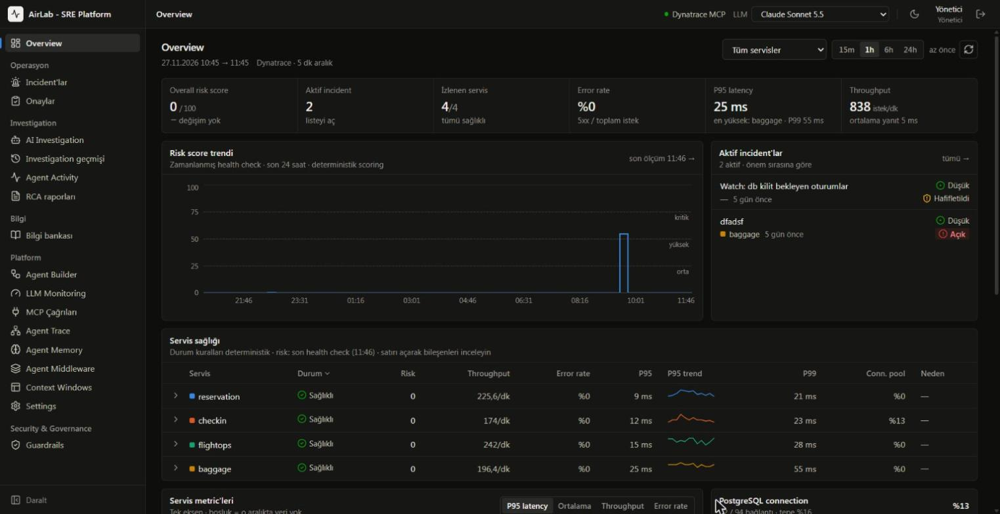

Ekranda görülenler:

- **Özet kartları:** Overall risk score, aktif incident sayısı, izlenen servis sayısı, error rate, P95 latency,
  throughput.
- **Risk score trendi:** Zamanlanmış health check sonuçlarından son 24 saat.
- **Aktif incident'lar:** Önem sırasına göre; satıra tıklayınca incident açılır.
- **Servis sağlığı:** Servis başına durum, risk, throughput, error rate, P95 / P99 ve Connection Pool doluluğu. Satırı
  açınca bileşen ayrıntısı görünür.
- **Servis metrikleri ve PostgreSQL connection:** Ekranın alt kısmında.

**Kullanım:** Sağ üstten servis ve zaman aralığını (15m, 1h, 6h, 24h) seçin. Yenile düğmesi veriyi günceller.

**Beklenen sonuç:** Risk yükselen bir servis gördüğünüzde [AI Investigation](#5-ai-investigation-soru-cevap) ile
soru sorabilir ya da ilgili incident'ı açabilirsiniz.

## 5. AI Investigation (soru-cevap)

**Amaç:** Agent'a doğal dille soru sormak ve kanıta dayalı yanıt almak.
**Erişim:** Menü › Investigation › **AI Investigation**.
**Ön koşul:** SRE ya da Yönetici rolü; Dynatrace MCP bağlantısı.

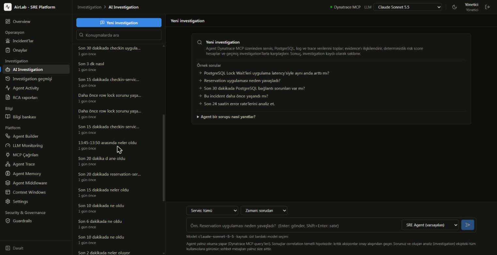

**Adımlar:**

1. **Yeni investigation**'a tıklayın ya da soldaki listeden eski bir konuşmayı açın.
2. İsterseniz **Servis** ve **Zaman** seçin. Seçmezseniz agent bunları sorudan çıkarır.
3. Sağdaki listeden agent'ı seçin: **SRE Agent (varsayılan)** gömülü agent'tır; yayımlanmış custom agent'lar da
   burada listelenir.
4. Sorunuzu yazıp Enter'a basın (Shift+Enter yeni satır). Örnek sorular ekranda hazırdır.
5. Agent adımları canlı olarak akar; yanıt tamamlanınca altında bir investigation kartı görünür.

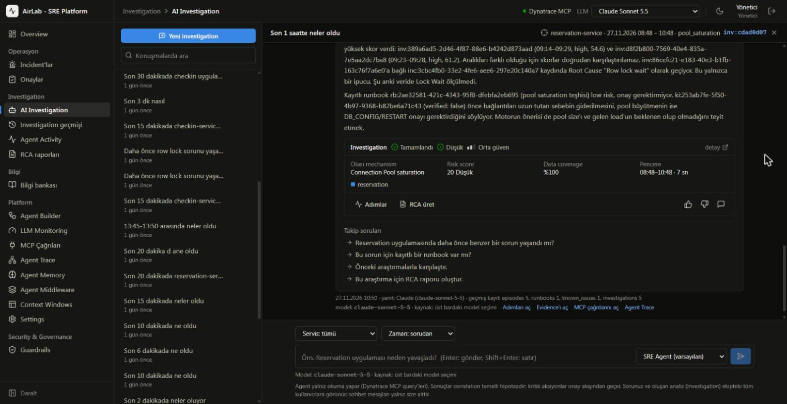

**Investigation kartı:** Olası mechanism, risk score, data coverage, incelenen pencere ve etkilenen servisler.
Kartın altındaki bağlantılar: **Adımlar**, **RCA üret**, feedback düğmeleri, **Adımları aç**, **Evidence'ı aç**,
**MCP çağrılarını aç**, **Agent Trace**.

**Örnek senaryo:** "Reservation uygulaması neden yavaşladı?" sorusunda agent ilgili pencerede tüm servisleri analiz
eder, reservation için latency değişimini, olası mechanism'i ve source uygulamayı yazar; daha önce benzer bir kayıt
varsa onu da belirtir.

**Bilinmesi gerekenler:**

- Agent yalnız okuma yapar. Yanıtlar korelasyona dayalı hipotezdir.
- Yanıtın altında hangi modelin yanıtladığı ve seçimin kaynağı yazar.
- Her soru yeni bir analiz başlatmaz: geçmişe dair sorular ve takip soruları mevcut kayıtlardan yanıtlanır.
- LLM kapalıysa yanıt deterministik metinle gelir; analiz yine yapılır.
- Bir konuşma hangi agent ile başladıysa onunla devam eder.

## 6. Investigation geçmişi ve ayrıntısı

**Amaç:** Tüm analizleri listelemek ve birini ayrıntısıyla incelemek.
**Erişim:** Menü › Investigation › **Investigation geçmişi**.

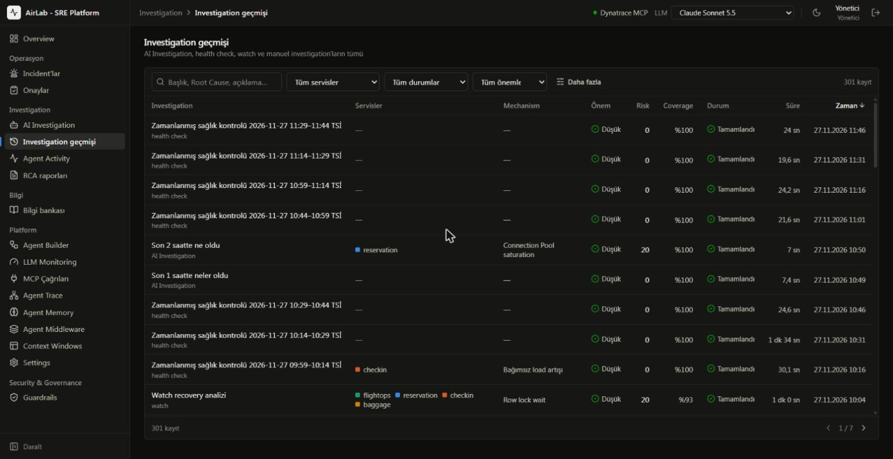

Liste her çalışmayı tetikleyicisiyle (sohbet, manuel, watch, zamanlanmış), durumuyla ve risk score'uyla gösterir;
üstteki süzgeçlerle daraltılabilir. Bir satıra tıklayınca ayrıntı açılır.

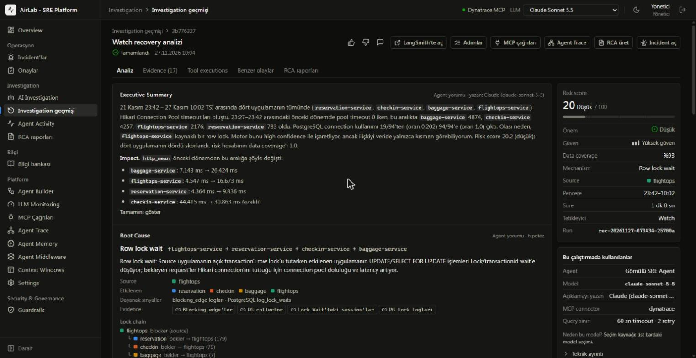

Ayrıntı ekranı:

| Bölüm | İçerik |
|---|---|
| **Analiz** sekmesi | Executive Summary, etki, Root Cause hipotezi, source ve etkilenen uygulamalar, dayanak signal'lar, lock chain |
| **Evidence** sekmesi | Toplanan her evidence, veri durumu ve satır sayısı |
| **Tool executions** sekmesi | Çalıştırılan MCP query'leri |
| **Benzer olaylar** sekmesi | Geçmişteki benzer investigation'lar |
| **RCA raporları** sekmesi | Bu investigation'dan üretilen raporlar |
| Sağ panel | Risk score, önem, güven, data coverage, mechanism, source, pencere, süre, tetikleyici; kullanılan agent, model ve MCP connector |

Üstteki düğmeler: feedback (beğen / beğenme / yorum), **LangSmith'te aç** (tracing açıksa), **Adımlar**,
**MCP çağrıları**, **Agent Trace**, **RCA üret**, **Incident aç**.

## 7. Agent Activity

**Amaç:** Bir çalışmada agent'ın hangi adımları attığını ve her adımın ne döndürdüğünü görmek; sohbet olmadan manuel
analiz başlatmak.
**Erişim:** Menü › Investigation › **Agent Activity**.

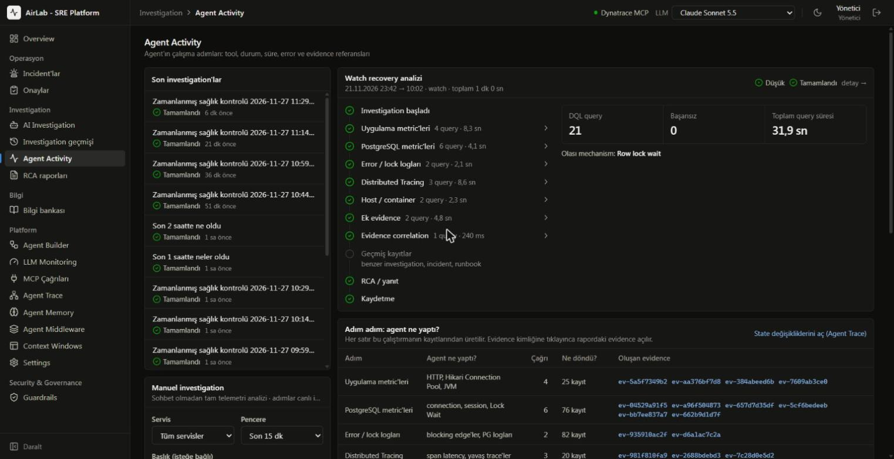

- **Son investigation'lar:** Soldaki listeden bir çalışma seçin.
- **Adım listesi:** Uygulama metrikleri, PostgreSQL metrikleri, error / lock log'ları, Distributed Tracing, host /
  container, ek evidence, evidence correlation, geçmiş kayıtlar, RCA / yanıt, kaydetme. Her adımda query sayısı ve süre.
- **Özet:** Toplam DQL query sayısı, başarısız query sayısı, toplam query süresi, olası mechanism.
- **Adım adım: agent ne yaptı?** Her adımın sorguladığı konu, dönen kayıt sayısı ve oluşan evidence kimlikleri.
- **Manuel investigation:** Servis ve pencere seçip sohbet olmadan tam analiz başlatır (SRE rolü gerekir).

Buradaki "adımlar" graph node'larının ve query'lerin kaydıdır; modelin iç düşünme süreci değildir.

## 8. Incident'lar

**Amaç:** Olayları takip etmek.
**Erişim:** Menü › Operasyon › **Incident'lar**.

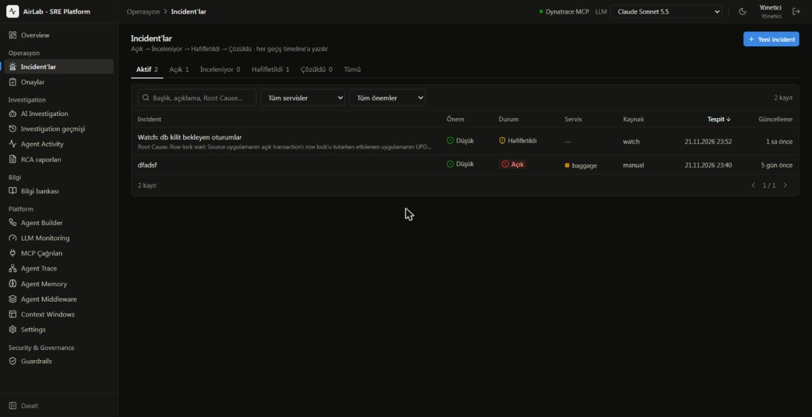

- Incident'ı **watch** otomatik açar ya da bir investigation'dan **Incident aç** ile siz açarsınız.
- Bir incident'ta durum, önem, bağlı investigation'lar, zaman çizelgesi ve notlar bulunur.
- Watch, koşullar düzeldiğinde incident'ı "hafifletildi" durumuna alır. **"Çözüldü" olarak kapatmak insan kararıdır.**

**Adımlar:** Listeden incident'ı açın › bağlı investigation'ı inceleyin › not ekleyin › durumu güncelleyin › gerekirse
RCA üretin.

## 9. RCA raporları

**Amaç:** Bir investigation'ı paylaşılabilir bir Root Cause Analysis raporuna dönüştürmek.
**Erişim:** Menü › Investigation › **RCA raporları**. Yeni rapor: investigation ayrıntısında **RCA üret**.

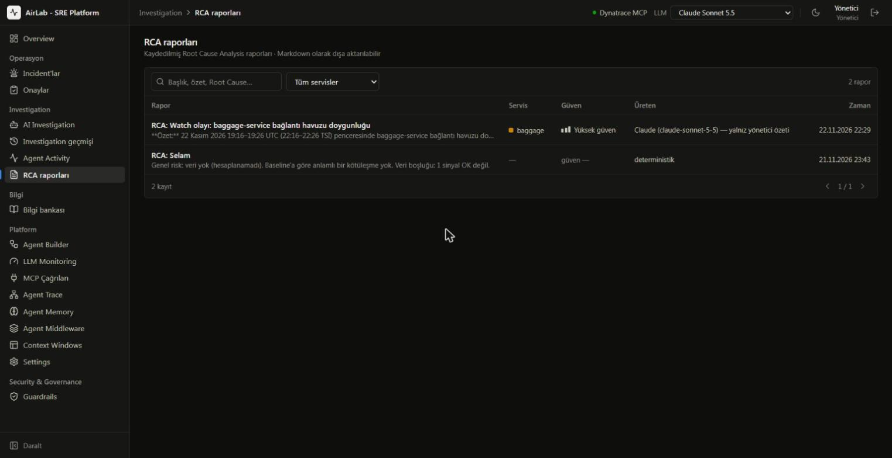

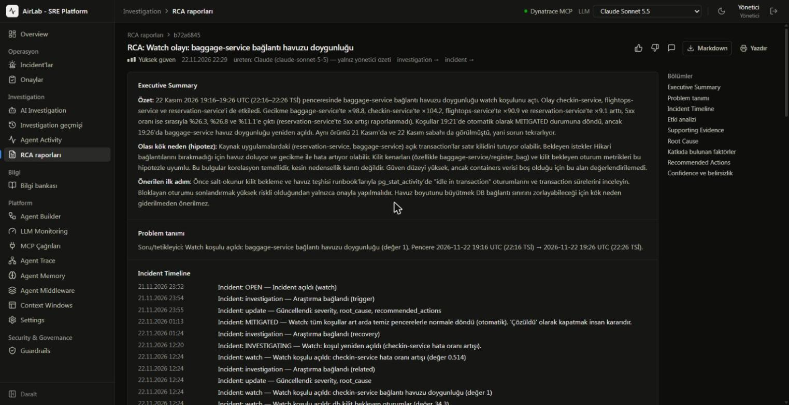

Rapor bölümleri: Executive Summary, Problem tanımı, Incident Timeline, Etki analizi, Supporting Evidence, Root Cause,
Katkıda bulunan faktörler, Recommended Actions, Confidence ve belirsizlik.

- Bölümlerin içeriği deterministiktir. LLM yalnız yönetici özetini yazar; başlıkta "üreten" bilgisi bunu gösterir.
- Root Cause hipotez olarak sunulur.
- **Markdown** ile indirebilir, **Yazdır** ile yazdırabilirsiniz.
- Yüksek riskli RCA'lar için Slack bildirimi gönderilebilir (yapılandırıldıysa).

## 10. Bilgi bankası

**Amaç:** Bilinen sorunları ve runbook'ları saklamak; agent bunları yanıtlarında ipucu olarak kullanır.
**Erişim:** Menü › Bilgi › **Bilgi bankası**.

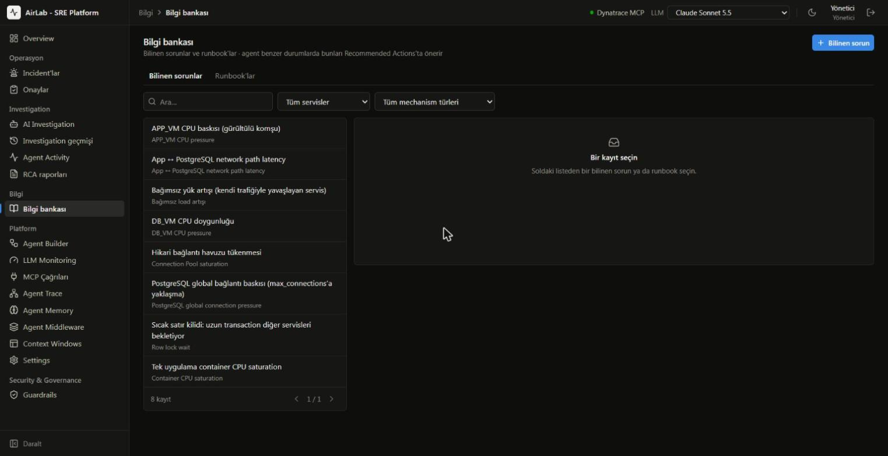

- **Bilinen sorunlar:** SRE rolü oluşturabilir.
- **Runbook'lar:** Yalnız Yönetici yönetir. Her runbook'un risk düzeyi ve onay gereksinimi vardır.

Agent bir runbook önerdiğinde onu **uygulamaz**; yalnız ilgili kaydı gösterir.

## 11. Onaylar

**Amaç:** Salt okunur olmayan aksiyonlar için insan onayı kaydı.
**Erişim:** Menü › Operasyon › **Onaylar**.

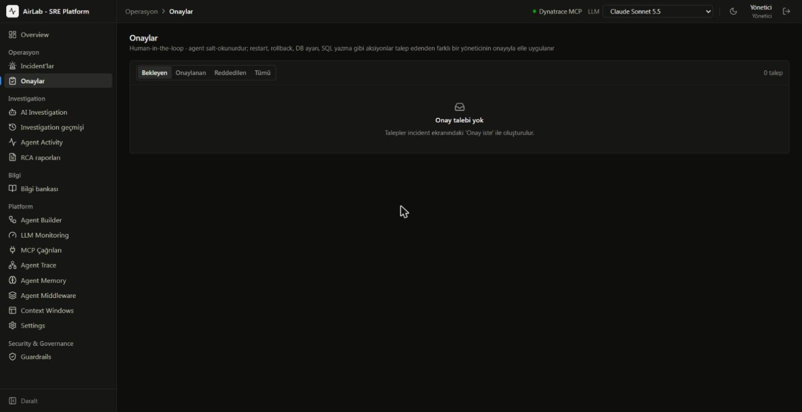

1. SRE bir aksiyon için onay talebi açar (aksiyon türü, hedef, gerekçe).
2. Yönetici talebi inceler ve onaylar ya da reddeder.
3. Karar verilmeyen talep 24 saat sonra zaman aşımına uğrar.

Platform onaylanan aksiyonu kendisi yürütmez; onay, bir insanın runbook'u uygulamasına verilen yetkinin kaydıdır.

## 12. Agent Builder

**Amaç:** Kendi agent'ınızı görsel bir workflow olarak oluşturmak.
**Erişim:** Menü › Platform › **Agent Builder**.
**Ön koşul:** Oluşturma ve test için SRE; yayımlama için Yönetici.

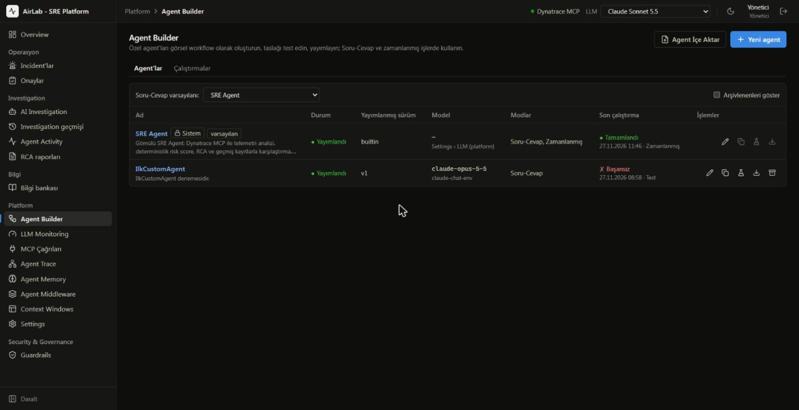

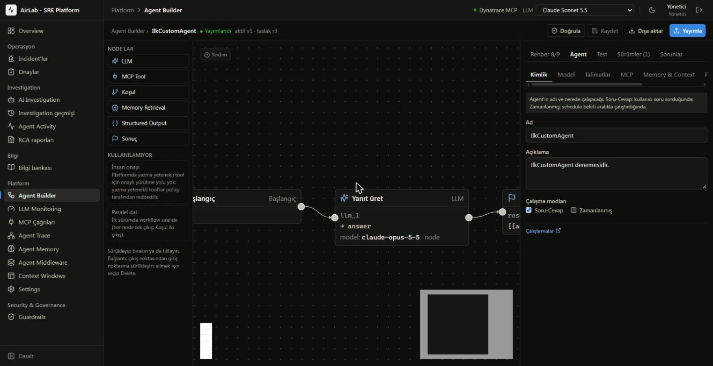

**Editör:**

- **Sol panel (Node'lar):** LLM, MCP Tool, Koşul, Memory Retrieval, Structured Output, Sonuç. Sürükleyip bırakın ya da
  tıklayın.
- **Canvas:** Node'ları çıkış noktasından giriş noktasına sürükleyerek bağlayın. Silmek için seçip Delete'e basın.
- **Sağ panel:** **Rehber** (adım adım kontrol listesi), **Agent** (Kimlik, Model, Talimatlar, MCP, Memory & Context
  sekmeleri), **Test**, **Sürümler**, **Sorunlar**.
- **Üst düğmeler:** Doğrula, Kaydet, Dışa aktar, Yayımla.

**Adım adım ilk agent:**

1. **Yeni agent** ile başlayın; ad ve açıklama verin.
2. Çalışma modunu seçin: **Soru-Cevap** ve / veya **Zamanlanmış**.
3. Model ve talimatları girin.
4. Node'ları ekleyip bağlayın (en basit akış: Başlangıç › LLM › Sonuç).
5. **Doğrula**'ya basın; **Sorunlar** sekmesindeki maddeleri giderin.
6. **Test** sekmesinde örnek bir girdiyle çalıştırın.
7. **Yayımla** (Yönetici). Yayımlanan agent AI Investigation'daki agent listesinde görünür.

**Import / export:** **Dışa aktar** tanımı JSON dosyası olarak indirir; dosya secret içermez. Listede **İçe aktar**
dosyayı önce önizler ve hedef ortamda eksik olan connector ya da modeli gösterir.

**Sınırlar (arayüzde "Kullanılamıyor" olarak gösterilir):**

- **İnsan onayı node'u yok.** Yazma yetenekli tool'lar policy tarafından reddedilir.
- **Paralel dal yok.** Workflow sıralıdır; yalnız Koşul node'unun iki çıkışı vardır.

**Gömülü agent ile farkı:** Custom agent risk score ve investigation kaydı üretmez; workflow'da ne tanımladıysanız
onu yapar. Gömülü SRE Agent Builder'da düzenlenemez.

Ayrıntı: [agent-builder.md](platform/agent-builder.md).

## 13. LLM Monitoring

**Amaç:** LLM kullanımını, maliyeti ve gecikmeyi izlemek.
**Erişim:** Menü › Platform › **LLM Monitoring**.
**Ön koşul:** Maliyet ve latency verisi için LangSmith tracing açık olmalıdır.

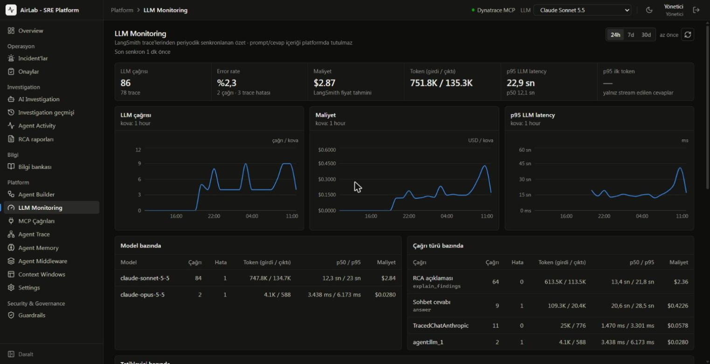

Ekranda: LLM çağrı sayısı, error rate, maliyet (LangSmith fiyat tahmini), girdi / çıktı token'ı, p95 latency, ilk
token süresi; zaman grafikleri; model bazında ve çağrı türü bazında döküm.

Veri LangSmith'ten periyodik olarak senkronlanan **özettir**; prompt ve yanıt içeriği platformda tutulmaz.

## 14. MCP Çağrıları

**Amaç:** Agent'ın Dynatrace'e gönderdiği her isteği ve sonucunu görmek.
**Erişim:** Menü › Platform › **MCP Çağrıları**.

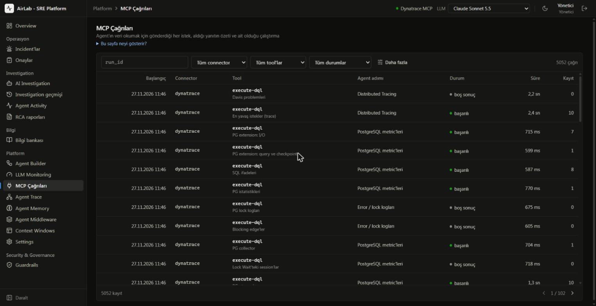

Her satır: başlangıç zamanı, connector, tool (`execute-dql`) ve query'nin konusu, ait olduğu agent adımı, durum
(başarılı, boş sonuç, hata), süre ve dönen kayıt sayısı. `run_id`, connector, tool ve duruma göre süzebilirsiniz.
Satıra tıklayınca istek özeti ve yanıt ayrıntısı açılır.

**Ne zaman kullanılır:** Bir investigation'da veri eksikse hangi query'nin boş ya da hatalı döndüğünü buradan
görürsünüz.

## 15. Agent Trace

**Amaç:** Bir çalışmanın graph düzeyindeki ayrıntısını incelemek: node geçişleri, state değişimleri, LLM çağrıları.
**Erişim:** Menü › Platform › **Agent Trace**; ya da bir investigation'daki **Agent Trace** düğmesi.

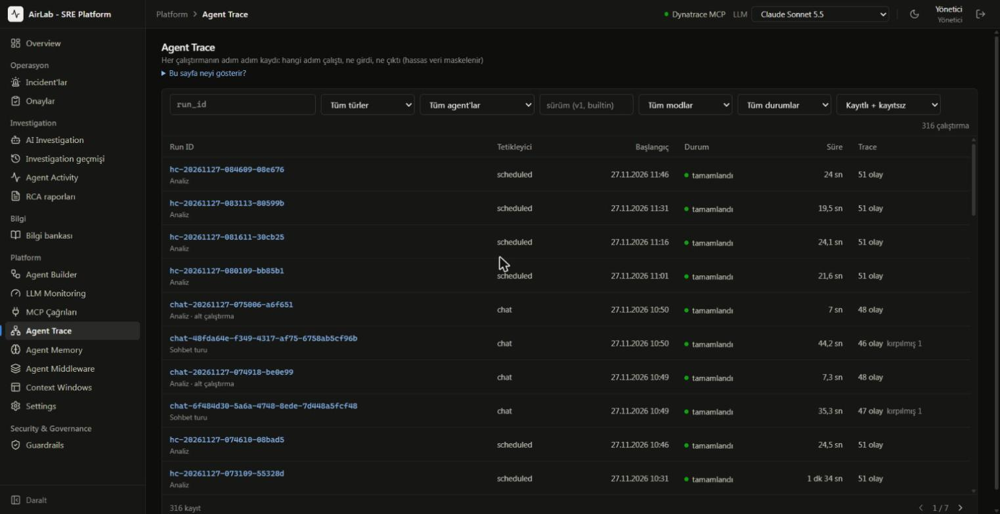

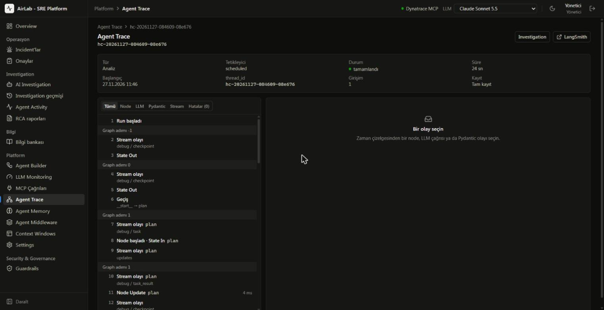

- **Üst bilgi:** Tür (analiz, sohbet, custom agent), tetikleyici, durum, süre, `thread_id`.
- **Zaman çizelgesi:** Graph adımlarına göre gruplanmış olaylar: run başladı, node başladı (State In), node update,
  geçiş, stream olayı, State Out. Süzgeçler: Tümü, Node, LLM, Pydantic, Stream, Hatalar.
- **Ayrıntı paneli:** Seçilen olayın içeriği: node'un giriş ve çıkış state'i, state farkı, LLM isteği ve yanıtı.

Kayıtlar maskelenmiş olarak saklanır. Modelin iç akıl yürütmesi kaydedilmez ve gösterilmez.

## 16. Agent Memory

**Amaç:** Agent'ın önceki konuşma ve çalışmalardan ne hatırladığını ve bu bilgiyi ne zaman kullandığını görmek.
**Erişim:** Menü › Platform › **Agent Memory**.

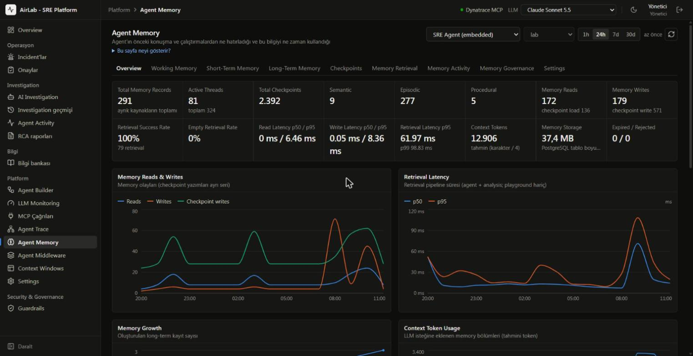

| Sekme | İçerik |
|---|---|
| Overview | Kayıt sayıları (semantic, episodic, procedural), okuma / yazma sayıları, retrieval başarı oranı, gecikmeler, depolama boyutu |
| Working Memory | Aktif konuşmaların odağı ve tur özetleri |
| Short-Term Memory | Konuşma thread'leri |
| Long-Term Memory | Kalıcı kayıtlar; oluşturma, düzenleme, arşivleme |
| Checkpoints | LangGraph checkpoint'leri |
| Memory Retrieval | Hangi çalışmada hangi kayıt neden getirildi |
| Memory Activity | Okuma ve yazma olayları |
| Memory Governance | Onay bekleyen kayıtlar, sürümler |
| Settings | Memory ayarları |

Üstteki seçicilerle agent'ı (gömülü ya da custom) ve ortamı seçersiniz.

**Riskler:** Memory kaydı silmek geri alınamaz (Yönetici). Prosedürel memory kayıtları, agent'ın davranışını
etkileyebileceği için ikinci bir kişinin onayını gerektirir.

Ayrıntı: [MEMORY_USER_GUIDE.md](platform/memory/MEMORY_USER_GUIDE.md).

## 17. Agent Middleware

**Amaç:** Her LLM ve MCP çağrısının önünde ve arkasında çalışan denetim adımlarını izlemek ve yapılandırmak.
**Erişim:** Menü › Platform › **Agent Middleware**.

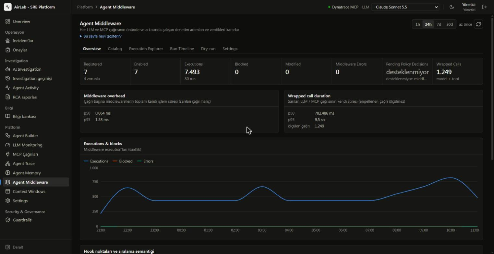

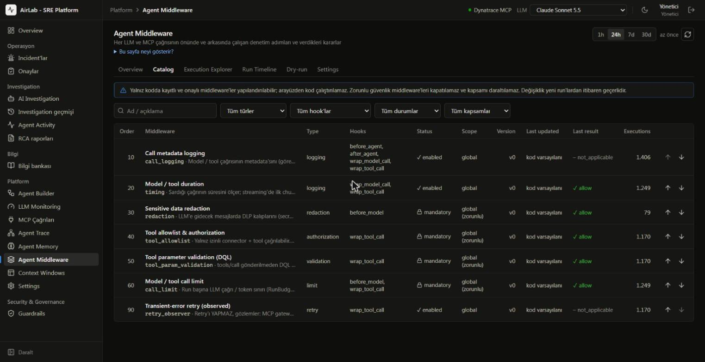

| Sekme | İçerik |
|---|---|
| Overview | Çalışma sayıları, kararlar, gecikme |
| Catalog | Yedi middleware: sıra, tür, hook'lar, durum, kapsam, son sonuç, çalışma sayısı |
| Execution Explorer | Tek tek middleware çalışmaları |
| Run Timeline | Bir çalışmadaki middleware sırası |
| Dry-run | Bir middleware'i örnek girdiyle canlıya almadan deneme |
| Settings | Genel ayarlar |

**Bilinmesi gerekenler:**

- Kilit simgeli (`mandatory`) dört middleware kapatılamaz: redaction, tool allowlist, tool parameter validation, call
  limit.
- Arayüzden kod çalıştırılamaz; yalnız kodda kayıtlı middleware'ler yapılandırılır.
- Değişiklikler yeni başlayan çalışmalardan itibaren geçerlidir.
- **Risk:** Call limit değerini çok düşürmek analizlerin yarıda kalmasına (`SKIPPED_BUDGET`) yol açar.

## 18. Context Windows

**Amaç:** Her LLM çağrısında modelin context'inin ne kadar dolduğunu ve neyle dolduğunu görmek.
**Erişim:** Menü › Platform › **Context Windows**.

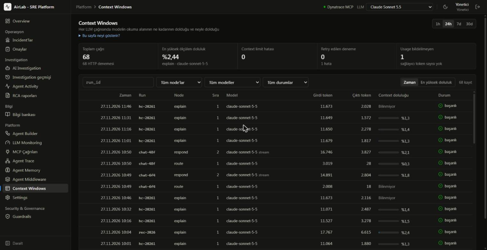

- **Özet:** Toplam çağrı, en yüksek ölçülen doluluk, context limit hatası, retry edilen deneme, usage bildirilmeyen
  çağrı.
- **Liste:** Zaman, run, node (`route`, `explain`, `respond`), model, girdi ve çıktı token'ı, context doluluğu, durum.
- Satıra tıklayınca context'in bölümlere göre dökümü açılır (sistem talimatı, analiz verisi, geçmiş, memory).

Doluluk "Bilinmiyor" görünüyorsa provider o çağrı için token sayısı bildirmemiştir.

## 19. Guardrails

**Amaç:** Agent'ın girdisini, tool çağrılarını ve çıktısını denetleyen güvenlik kurallarını izlemek ve yönetmek.
**Erişim:** Menü › Security & Governance › **Guardrails**.

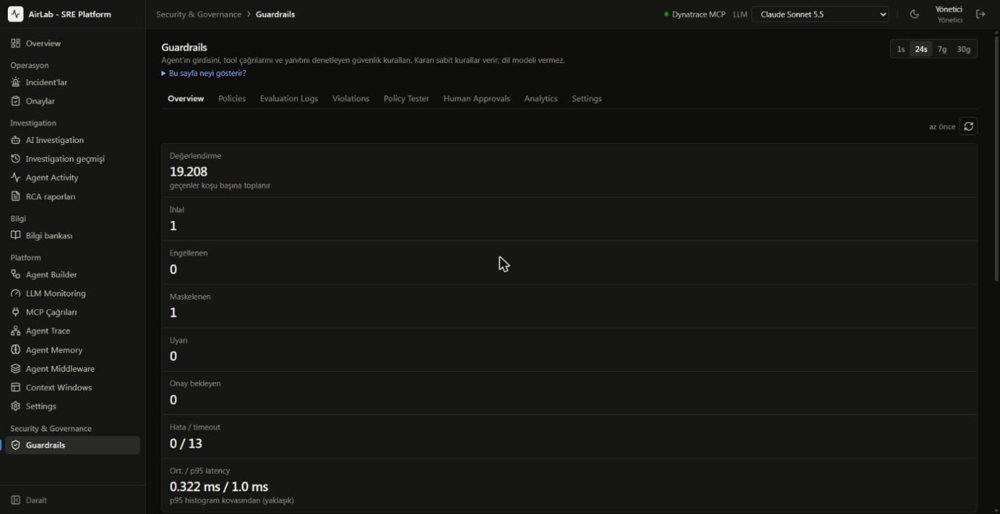

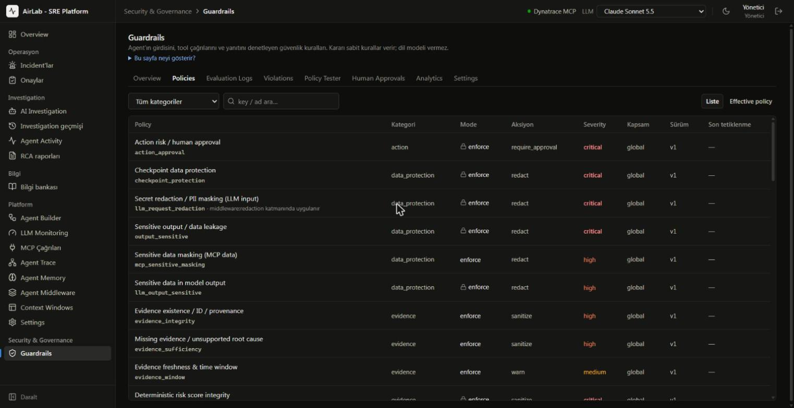

| Sekme | İçerik |
|---|---|
| Overview | Değerlendirme, ihlal, engellenen, maskelenen, uyarı, onay bekleyen sayıları; gecikme |
| Policies | Policy listesi: kategori, mod, aksiyon, severity, kapsam, sürüm. "Effective policy" görünümü geçerli sonucu gösterir |
| Evaluation Logs | Tek tek değerlendirmeler |
| Violations | İhlaller; durum ve atama |
| Policy Tester | Bir girdiyi policy'lere karşı canlıya almadan deneme |
| Human Approvals | Onay gerektiren kararlar |
| Analytics | Eğilimler |
| Settings | Genel ayarlar ve kill switch |

**Bilinmesi gerekenler:**

- Kararı sabit kurallar verir; dil modeli vermez.
- Kilit simgeli policy'ler zorunludur ve `enforce` modundan çıkarılamaz.
- **Modlar:** `monitor` yalnız kaydeder, `enforce` uygular. Yeni bir policy'yi önce `monitor` modunda izlemek
  güvenlidir.
- **Kill switch** tüm agent çalıştırmalarını durdurur; yalnız Yönetici kullanır.
- **Risk:** Zorunlu olmayan bir policy'yi kapatmak ilgili korumayı kaldırır; değişiklikler sürümlenir ve geri
  alınabilir.

Ayrıntı: [docs/platform/guardrails/](platform/guardrails/).

## 20. Settings

**Amaç:** Platform yapılandırması.
**Erişim:** Menü › Platform › **Settings**. SRE görüntüler; Yönetici değiştirir.

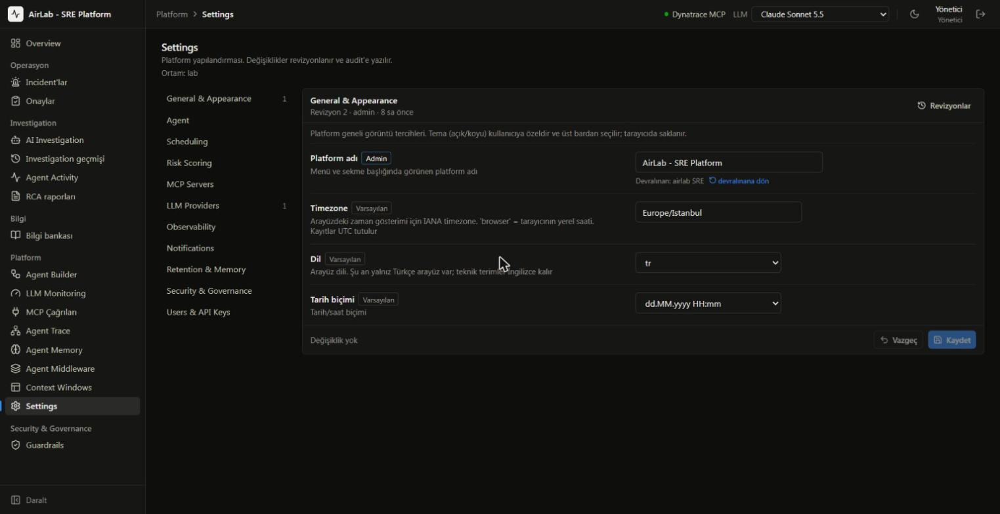

| Bölüm | İçerik | Etkisi ve riski |
|---|---|---|
| General & Appearance | Platform adı, timezone, dil, tarih biçimi | Yalnız görünüm |
| Agent | Agent'ı etkinleştirme, bütçeler, süre sınırları | Agent kapatılırsa yeni çalışma başlamaz |
| Scheduling | Health check, watch ve senkron aralıkları | Sık aralık Dynatrace query ve LLM maliyetini artırır |
| Risk Scoring | Ağırlıklar, threshold'lar, bantlar; geçmiş veriyle önizleme | Skorların anlamını değiştirir; önce önizleyin |
| MCP Servers | Connector ekleme, bağlantı testi, tool keşfi ve onayı | Yanlış adres ya da token agent'ı veri kaynağından koparır |
| LLM Providers | Görev profilleri (chat, RCA), model, token sınırı, aylık bütçe, test | Model değişikliği yanıt kalitesini ve maliyeti etkiler |
| Observability | LangSmith ve izleme ayarları | Tracing açıkken maskelenmiş veri LangSmith'e gider |
| Notifications | Slack bildirimi | – |
| Retention & Memory | Saklama süreleri, checkpoint ve memory yönetimi | Süreyi kısaltmak eski kayıtları siler |
| Security & Governance | Oturum, parola ve audit ayarları | – |
| Users & API Keys | Kullanıcılar, roller, API anahtarları | Yönetici rolü tüm yetkileri verir |

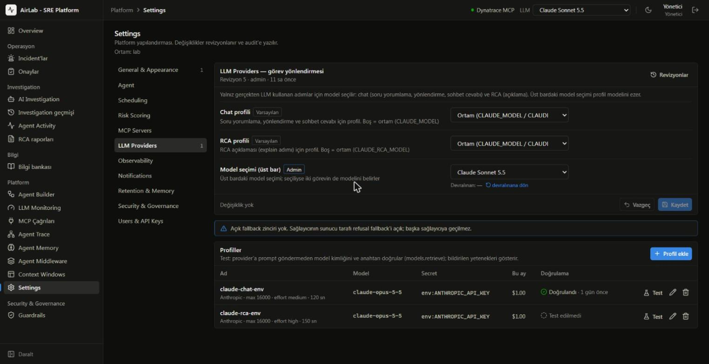

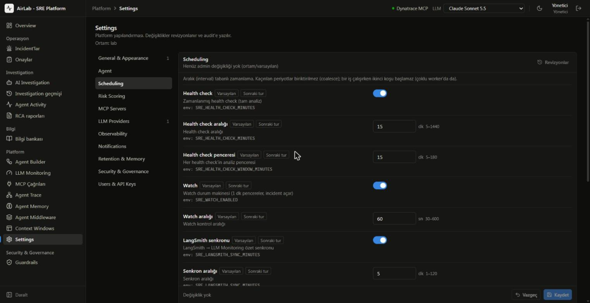

**Nasıl çalışır:**

- Her değişiklik bir **revizyon** oluşturur ve audit'e yazılır. **Revizyonlar** düğmesiyle eski bir revizyona
  dönebilirsiniz.
- Her alanın yanında değerin kaynağı görünür: **Varsayılan**, **Admin** (arayüzden değiştirilmiş) ya da ortam
  değişkeni. Öncelik: deployment lock › admin › ortam değişkeni › varsayılan.
- "Sonraki tur" etiketli alanlar bir sonraki iş periyodunda geçerli olur; yeniden başlatma gerekmez.
- Secret'lar girildikten sonra gösterilmez; yalnız referans olarak (`env:…` ya da `secret:…`) görünür.

**Model yönetimi:** Üst bardaki **LLM** seçimi (Yönetici) her iki görevin modelini anında değiştirir ve profildeki
modeli ezer. Açık bir fallback zinciri yoktur; başka provider'a geçilmez.

Ayrıntı: [settings.md](platform/settings.md).

## 21. Hesabım

**Erişim:** Sağ üstte kullanıcı adınıza tıklayın.

Parolanızı değiştirir, aktif oturumlarınızı görür ve sonlandırır, rolünüzün yetkilerini görüntülersiniz.

## 22. Chaos Controller (laboratuvar)

Chaos Controller SRE platformunun bir ekranı **değildir**; laboratuvarın ayrı bir uygulamasıdır. Agent'ın analiz
edeceği gerçek arızaları üretmek için kullanılır.

**Erişim:** `http://<host>:8080/ui/` (ayrı kullanıcı adı ve parola; varsayılan olarak yalnız `127.0.0.1` adresine
bağlıdır).

| Ekran | Amaç |
|---|---|
| Overview | Servislerin ve veritabanının anlık durumu |
| Library | 20 hazır senaryo (S01–S20); hepsi paylaşılan PostgreSQL'de yük oluşturur: lock, connection, DB CPU, DB I/O ve WAL, DB belleği, vacuum, birleşik yükler |
| Builder | Senaryo, başlatan uygulama, hedefler ve yoğunluk seçerek deney oluşturma |
| Live | Çalışan deneyin canlı metrikleri ve durdurma |
| History | Geçmiş deneyler ve raporları |

**Tipik kullanım:**

1. Library'den bir senaryo seçin (örnek: S03 Long-running transactions).
2. Başlatan uygulamayı ve yoğunluğu seçip deneyi başlatın.
3. Live ekranında etkiyi izleyin.
4. SRE platformunda AI Investigation'a "Son 15 dakikada ne oldu?" diye sorun ya da watch'ın incident açmasını
   bekleyin.
5. Deney bittikten sonra Chaos raporundaki beklenen etkiyi agent'ın bulgusuyla karşılaştırın.

Agent hangi senaryonun çalıştığını bilmez; yalnız telemetriyi görür. Bu ekranların görüntüsü bu dokümantasyonda yer
almıyor ([neden](SCREENSHOTS.md#eksik-ekran-görüntüleri)).

Ayrıntı: [chaos-v2-architecture.md](lab/chaos-v2-architecture.md).

## 23. Sık karşılaşılan durumlar

| Durum | Anlamı | Yapılacak |
|---|---|---|
| Yanıtta "veri yok" ya da düşük data coverage | Bazı signal'lar ölçülemedi | Investigation › Evidence sekmesinde veri durumlarına, MCP Çağrıları'nda boş ya da hatalı query'lere bakın |
| Risk score görünmüyor | Ölçülebilen veri skor için yetersiz | Telemetri kaynağını kontrol edin |
| Mechanism "açıklanamayan" | Etki var ama katalogdaki kurallardan hiçbiri tutmadı | Evidence'ı elle inceleyin; agent neden uydurmaz |
| Yanıt kısa ve şablon gibi | LLM kapalı ya da ulaşılamıyor; deterministik metin | Settings › LLM Providers'ta profili test edin |
| "Dakikada en fazla N çalıştırma" hatası | Hız sınırı | Bir dakika bekleyin |
| Menüde bir ekran yok | Rolünüz yetmiyor | Yöneticiden rol isteyin |
| Yanıt engellendi | Bir guardrail policy'si devreye girdi | Guardrails › Violations'ta ayrıntıya bakın |
| Üst barda Dynatrace MCP kırmızı | MCP bağlantısı yok | Settings › MCP Servers'ta bağlantıyı test edin |
