# Sistem ve Agent Çalışma Akışları

Bu doküman platformda gerçekten var olan akışları diyagramlarla anlatır. Her akış için tetikleyici, ön koşul, katılan
bileşenler, başarılı ve hatalı yollar ve çıktı verilir.

Bileşenlerin tanımı için: [Teknik Mimari](TECHNICAL_ARCHITECTURE.md) ve [Agent Mimarisi](AGENT_ARCHITECTURE.md).

[← Dokümantasyon merkezine dön](../README.md)

## İçindekiler

- [1. Kullanıcı sorusundan yanıta](#1-kullanıcı-sorusundan-yanıta)
- [2. Zamanlanmış çalışma: watch ve health check](#2-zamanlanmış-çalışma-watch-ve-health-check)
- [3. Dynatrace MCP veri toplama ve korelasyon](#3-dynatrace-mcp-veri-toplama-ve-korelasyon)
- [4. Risk score ve RCA üretimi](#4-risk-score-ve-rca-üretimi)
- [5. Graph node geçişleri ve state değişimi](#5-graph-node-geçişleri-ve-state-değişimi)
- [6. LLM retry, fallback ve hata akışı](#6-llm-retry-fallback-ve-hata-akışı)
- [7. Guardrail ve middleware kararları](#7-guardrail-ve-middleware-kararları)
- [8. Memory retrieval ve persistence](#8-memory-retrieval-ve-persistence)
- [9. Agent Builder: oluşturma, çalıştırma, import ve export](#9-agent-builder-oluşturma-çalıştırma-import-ve-export)
- [10. Chaos senaryosundan agent analizine](#10-chaos-senaryosundan-agent-analizine)
- [11. Onay akışı (human-in-the-loop)](#11-onay-akışı-human-in-the-loop)

## 1. Kullanıcı sorusundan yanıta

| | |
|---|---|
| **Tetikleyici** | Kullanıcı AI Investigation ekranında bir soru gönderir. |
| **Ön koşul** | Oturum açık, `agent:run` yetkisi var, agent etkin, Dynatrace MCP yapılandırılmış. |
| **Bileşenler** | Arayüz, backend, `ChatOrchestrator`, analiz graph'ı, `McpGateway`, `Llm`, PostgreSQL. |
| **Çıktı** | Sohbet yanıtı, investigation kaydı, evidence kayıtları, izleme kayıtları. |

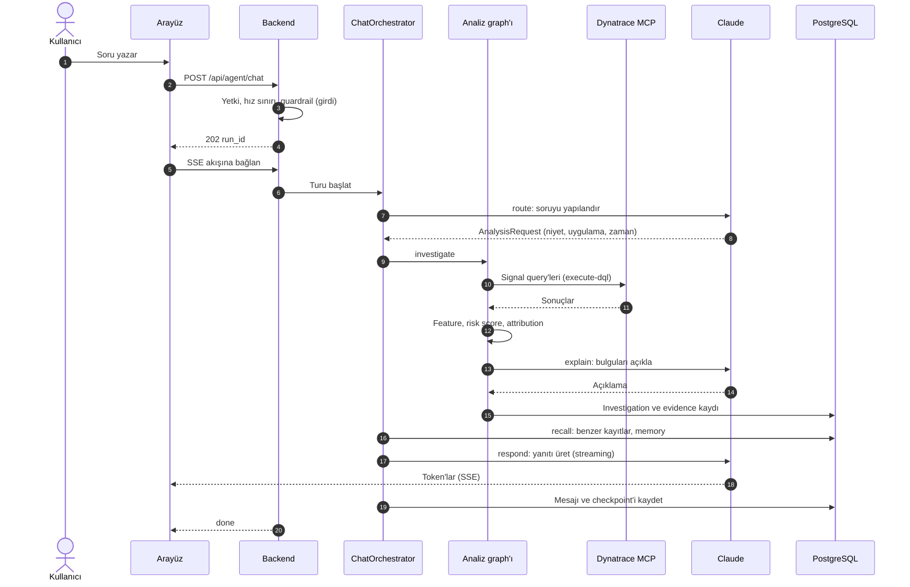

**Başarılı yol:** Yanıt, altında risk score, olası mechanism, data coverage ve incelenen pencereyi gösteren bir
investigation kartıyla gelir. Kullanıcı karttan adımları, evidence'ı, MCP çağrılarını ve Agent Trace'i açabilir.

**Hatalı yollar:**

| Durum | Sonuç |
|---|---|
| Niyet `smalltalk` | Analiz çalışmaz; doğrudan yanıt verilir. |
| Niyet `history` ya da `followup` | Yeni analiz çalışmaz; mevcut kayıtlardan yanıt verilir. |
| Guardrail girdiyi engelledi | Akış doğrudan yanıta gider; engel nedeni bildirilir. |
| MCP'ye ulaşılamadı | Investigation `partial` olur; yanıt eksik veriyi açıkça yazar. |
| LLM'e ulaşılamadı | Soru sezgisel ayrıştırıcıyla yorumlanır, açıklama deterministik metinle üretilir. |
| Kullanıcı iptal etti ya da süre doldu | Run `cancelled` / `timeout` olarak kapanır; o ana kadarki adımlar kayıtlıdır. |
| Hız ya da eşzamanlılık sınırı | API `429` döner; run başlamaz. |
| Aynı konuşmada süren bir tur var | API `409` döner. |

## 2. Zamanlanmış çalışma: watch ve health check

| | |
|---|---|
| **Tetikleyici** | Worker'daki aralık tabanlı işler: `watch` (60 s), `health-check` (15 dk), custom agent schedule'ları. |
| **Ön koşul** | `sre-worker` çalışıyor, iş Settings › Scheduling'de etkin. |
| **Bileşenler** | Worker, watch durum makinesi, analiz graph'ı, MCP, PostgreSQL, isteğe bağlı Slack. |
| **Çıktı** | Watch olayları, incident, investigation, isteğe bağlı bildirim. |

### Watch durum makinesi

Normal watch döngüsü LLM çağırmaz. Tamamlanmış 1 dakikalık pencereleri, önceki 15 pencerenin medyanıyla karşılaştırır.

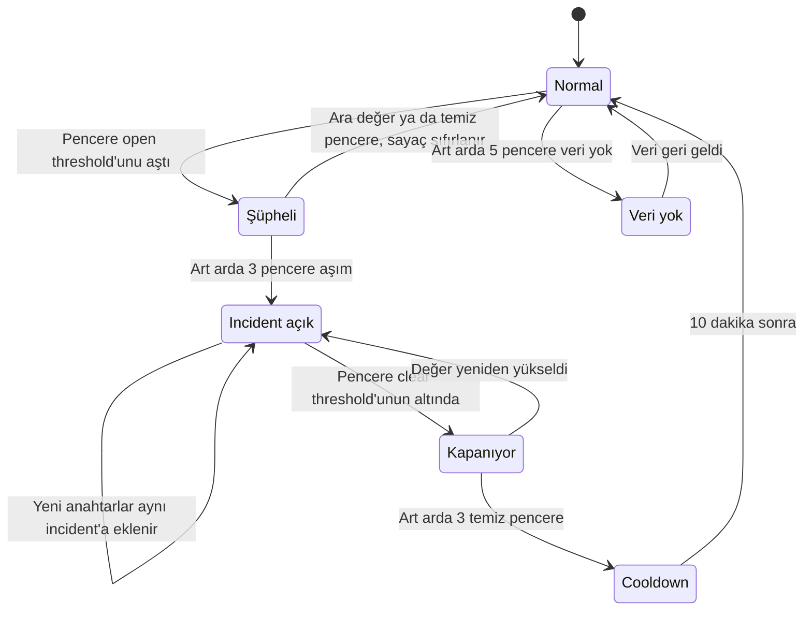

İzlenen değerler ve threshold'lar (`open` / `clear`): latency oranı 2,0 / 1,3; hata oranı 0,02 / 0,005; Connection Pool
doluluğu 0,9 / 0,7; lock bekleyen 1,0 / 0,2; veritabanı bağlantı oranı 0,85 / 0,7; host CPU %85 / %70. Açma ve kapama
threshold'larının farklı olması (hysteresis) değerin sınırda gidip gelmesi durumunda incident'ın sürekli açılıp
kapanmasını önler.

Veri gelmeyen pencere sıfır sayılmaz: sayaçlar değişmez. Uzun süren veri boşluğu ayrı bir "telemetri eksik" olayıdır.

### Incident açıldığında

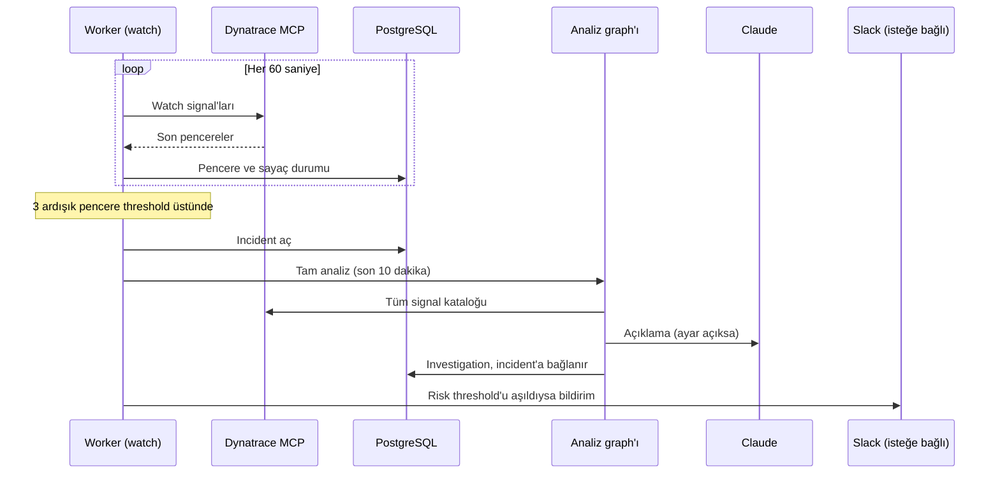

### Health check ve custom agent schedule'ı

- **Health check** her 15 dakikada tüm servisler için tam analiz çalıştırır ve sonucu investigation olarak kaydeder
  (`SRE_HEALTH_CHECK_MINUTES`, `SRE_HEALTH_CHECK_WINDOW_MINUTES`).
- **Custom agent schedule'ı**, yayımlanmış ve "Zamanlanmış" modu açık bir custom agent'ı belirlenen aralıkta
  çalıştırır; sonuç `agent_runs` kaydıdır.

**Hatalı yollar:** Bir iş çalışırken ikinci kopyası başlamaz; kaçan periyotlar biriktirilmez. İş hata verirse hata
`job_runs` kaydına yazılır ve bir sonraki periyotta yeniden denenir. Worker dururken hiçbir zamanlanmış iş çalışmaz;
soru-cevap etkilenmez.

Kaynak: [`watch.py`](../sre-agent/src/airlab_agent/watch.py),
[`worker.py`](../sre-platform/backend/sre_platform/worker.py),
[`watch_pg.py`](../sre-platform/backend/sre_platform/services/watch_pg.py).

## 3. Dynatrace MCP veri toplama ve korelasyon

| | |
|---|---|
| **Tetikleyici** | Analiz graph'ının `collect` ve `extra_evidence` node'ları. |
| **Ön koşul** | MCP adresi ve token tanımlı; tool tanımı onaylı. |
| **Bileşenler** | Signal kataloğu, middleware zinciri, `McpGateway`, Dynatrace. |
| **Çıktı** | Signal başına sonuç ve veri durumu; evidence kayıtları. |

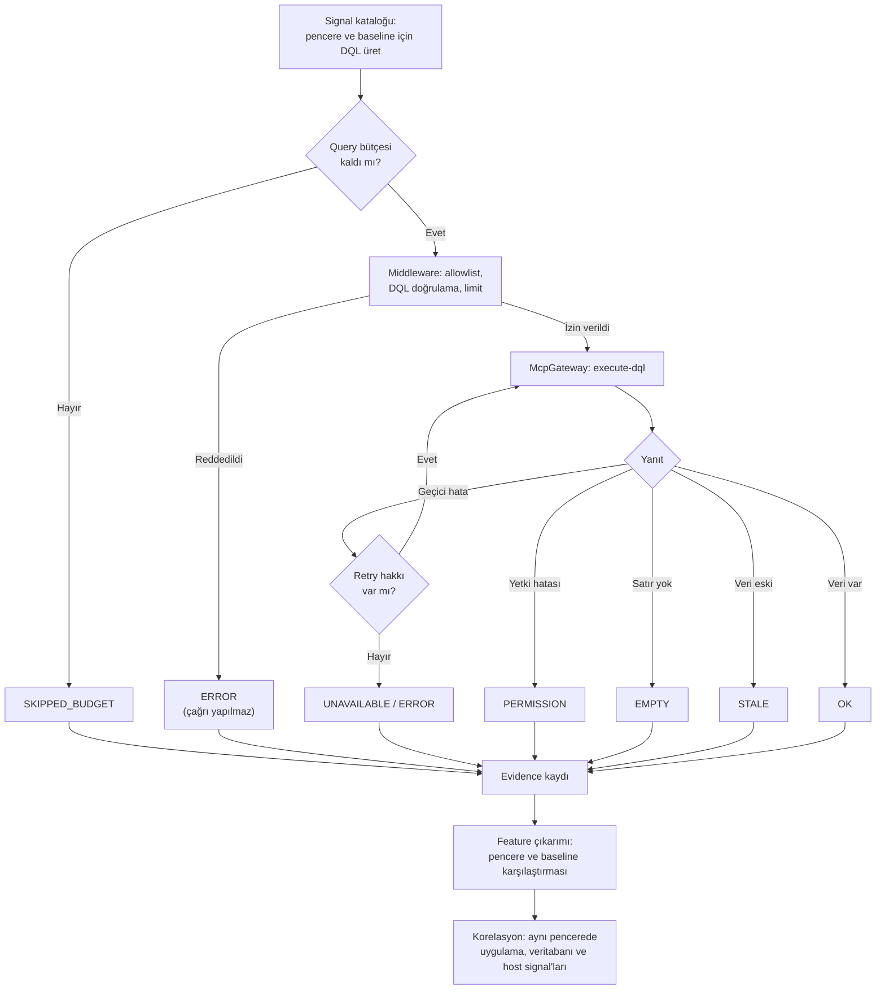

Korelasyon zaman hizalamasına dayanır: uygulama metrikleri (latency, hata, Connection Pool), veritabanı metrikleri
(oturumlar, lock'lar, statement'lar) ve host metrikleri (CPU) aynı pencere ve aynı baseline üzerinden karşılaştırılır.
Lock edge kayıtları hangi uygulamanın hangisini beklettiğini doğrudan gösterir.

Ek kanıt turu yalnız gerektiğinde çalışır: `row_lock` bulunursa lock edge ayrıntısı; `db_cpu`,
`global_connection_pressure`, `db_memory_pressure` ya da bir PostgreSQL workload mechanism'i bulunursa en pahalı
statement'lar toplanır.

## 4. Risk score ve RCA üretimi

| | |
|---|---|
| **Tetikleyici** | Risk score: her analizde otomatik. RCA: kullanıcı investigation'da "RCA üret" der. |
| **Ön koşul** | RCA için tamamlanmış bir investigation ve `incident:write` yetkisi. |
| **Bileşenler** | `features`, `scoring`, `attribution`, `rca_service`, isteğe bağlı LLM. |
| **Çıktı** | Uygulama başına skor ve bant; mechanism hipotezi; RCA raporu. |

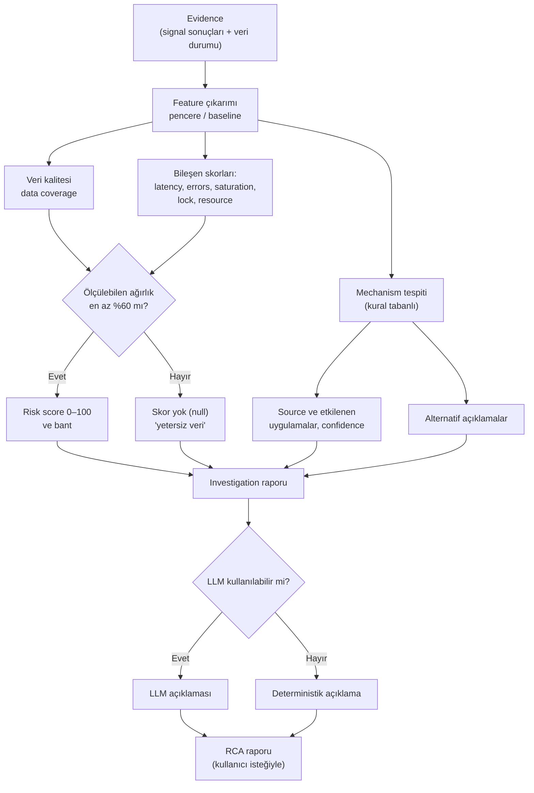

RCA raporunun bölümleri (bulgular, evidence, incident zaman çizelgesi, bilgi bankası önerileri) deterministik olarak
doldurulur. LLM varsa yalnız "Yönetici özeti" paragrafını yazar. Root Cause her zaman **hipotez** olarak sunulur;
confidence ve belirsizlik ayrı bir bölümdür.

**Hatalı yollar:** Veri yetersizse skor üretilmez ve bu açıkça yazılır. Hiçbir mechanism kuralı tutmazsa etki
raporlanır, neden "açıklanamayan" olarak bırakılır; agent bir neden uydurmaz.

## 5. Graph node geçişleri ve state değişimi

| | |
|---|---|
| **Tetikleyici** | Her analiz çalışması. |
| **Bileşenler** | Analiz graph'ı, guardrails (`guard_node`), checkpointer, `TraceRecorder`. |
| **Çıktı** | Her node'dan sonra güncellenmiş state, checkpoint ve trace event'i. |

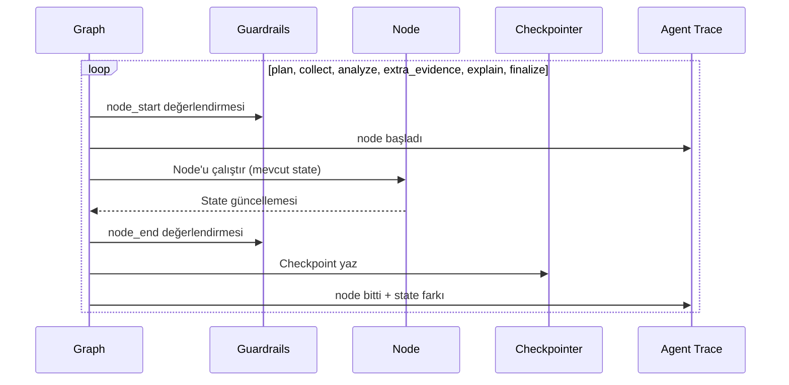

Node başına state'e eklenenler:

| Node | State'e yazdıkları |
|---|---|
| `plan` | `start`, `end`, `baseline_start`, `baseline_end`, `windows`, `notes` |
| `collect` | `results`, `evidence`, `budget`, `errors` |
| `analyze` | `quality`, `features_summary`, `scores`, `attribution`, `alternatives`, `status` |
| `extra_evidence` | `extra`, `iterations`, güncellenmiş `evidence` |
| `explain` | `explanation`, `explanation_source` |
| `finalize` | `status` (`completed` / `partial`), rapor |

`analyze` node'undan sonra `needs_extra` fonksiyonu karar verir: ek kanıt gerekiyorsa ve tur ile bütçe sınırı
aşılmadıysa `extra_evidence`, aksi halde `explain`.

**Hatalı yol:** Backend çalışma sırasında durursa son checkpoint korunur. Sohbet turu "resume" ile kaldığı node'dan
sürdürülebilir.

## 6. LLM retry, fallback ve hata akışı

| | |
|---|---|
| **Tetikleyici** | Her LLM çağrısı (`route`, `explain`, `respond`, RCA özeti, custom agent LLM node'u). |
| **Bileşenler** | `Llm`, `RunBudget`, middleware zinciri, Anthropic SDK. |
| **Çıktı** | Model yanıtı ya da deterministik yedek metin. |

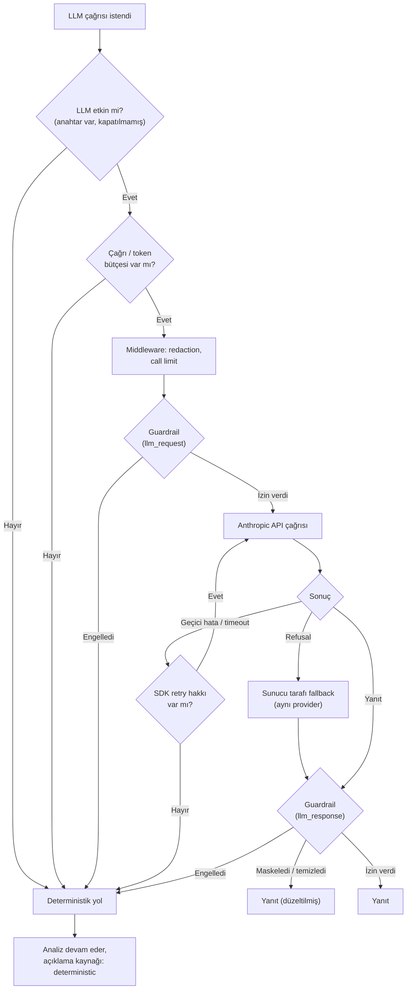

- **Retry** Anthropic SDK tarafından yapılır (varsayılan 2). Platform ikinci bir retry katmanı eklemez.
- **Fallback** yalnız Anthropic'in sunucu tarafı refusal fallback'idir.
- **Provider failover yoktur.** Başka bir provider'a ya da modele geçilmez.
- **Deterministik yol** her zaman vardır: soru yorumlama için sezgisel ayrıştırıcı, açıklama için kural tabanlı metin.

Yanıtın altında açıklamanın kaynağı (`Claude` ya da deterministik) her zaman gösterilir.

## 7. Guardrail ve middleware kararları

| | |
|---|---|
| **Tetikleyici** | Her agent çalışmasının girdisi, her LLM ve MCP çağrısı, her memory işlemi, son çıktı. |
| **Bileşenler** | Middleware zinciri, guardrails motoru, policy deposu. |
| **Çıktı** | Karar kaydı; gerekirse engellenen, maskelenen ya da temizlenen içerik. |

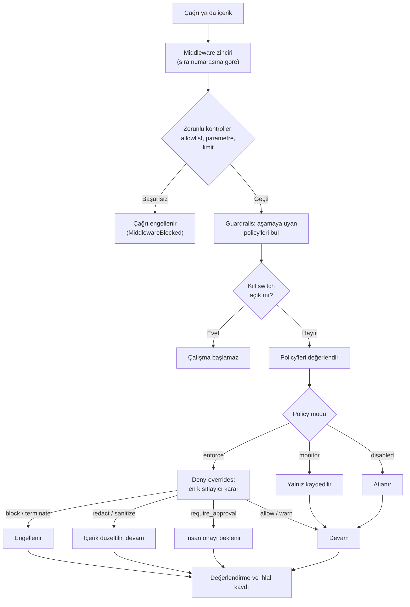

**Örnekler:**

| Durum | Karar |
|---|---|
| LLM'e gidecek mesajda bir secret kalıbı | `redaction` middleware'i maskeler; çağrı devam eder |
| Yazma yetenekli bir tool çağrısı | `tool_allowlist` engeller |
| DQL'de okuma dışı komut | `tool_param_validation` engeller; çağrı Dynatrace'e gitmez |
| Yanıtta evidence kimliği olmayan Root Cause iddiası | Guardrail çıktıyı temizler (`sanitize`) |
| Kullanıcı girdisinde prompt injection kalıbı | Guardrail engeller; yanıt engeli bildirir |

Zorunlu middleware'ler ve zorunlu policy'ler arayüzden kapatılamaz. Bir policy'nin etkisini canlıya almadan görmek
için Guardrails › **Policy Tester** ve Agent Middleware › **Dry-run** kullanılır.

## 8. Memory retrieval ve persistence

| | |
|---|---|
| **Tetikleyici** | Sohbet turunun `recall` node'u (okuma); tur ve investigation sonu (yazma). |
| **Bileşenler** | `ChatOrchestrator`, memory yöneticisi, checkpointer, guardrails. |
| **Çıktı** | Yanıta eklenen geçmiş bağlamı; güncellenen working ve episodic memory. |

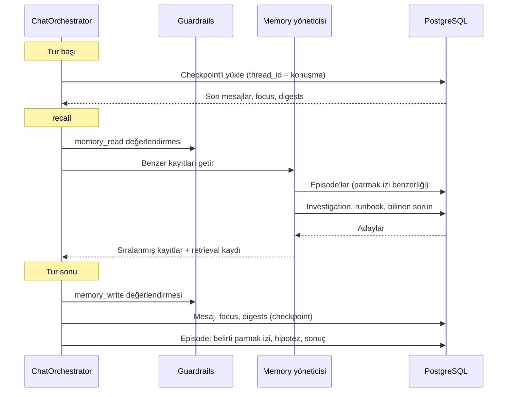

- **Okuma:** Benzerlik, belirti parmak izlerinin Jaccard benzerliğiyle hesaplanır; embedding yoktur. Getirilen her
  kayıt, neden seçildiğiyle birlikte **Agent Memory › Memory Retrieval** sekmesinde görünür.
- **Yazma:** Working memory her turda checkpoint'e yazılır. Episodic memory investigation tamamlandığında güncellenir.
- **Kullanım:** Getirilen kayıtlar yanıta ipucu olarak girer; güncel risk score'u ve mechanism'i değiştirmez.

**Hatalı yollar:** Guardrail hassas içerikli bir memory yazımını engelleyebilir ya da maskeleyebilir. Memory
retrieval başarısız olursa yanıt geçmiş bağlamı olmadan üretilir; analiz sonucu etkilenmez.

## 9. Agent Builder: oluşturma, çalıştırma, import ve export

| | |
|---|---|
| **Tetikleyici** | Kullanıcı Agent Builder'da bir agent oluşturur, test eder, yayımlar ya da içe / dışa aktarır. |
| **Ön koşul** | Oluşturma ve test için `agent:build`; yayım ve arşiv için `agent:publish`; çalıştırma için `agent:run`. |
| **Bileşenler** | Arayüz (canvas), builder servisi, doğrulayıcı, builder motoru, LLM, MCP. |
| **Çıktı** | Sürümlenmiş agent tanımı; `agent_runs` kayıtları. |

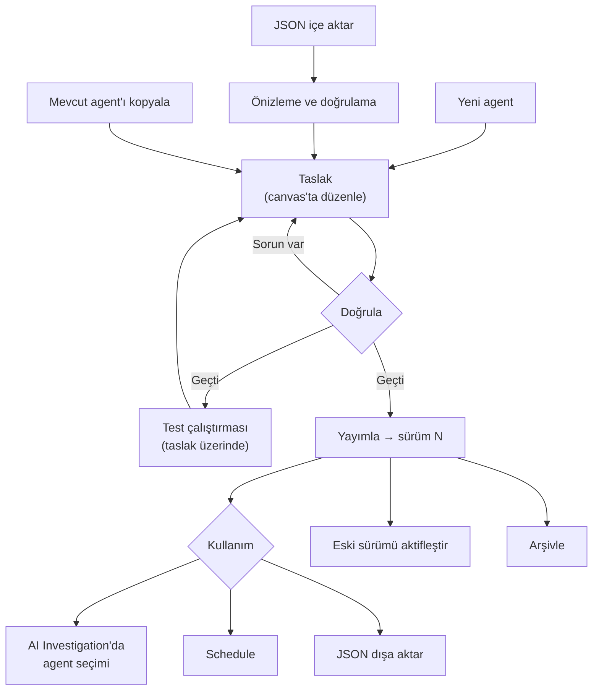

### Çalıştırma

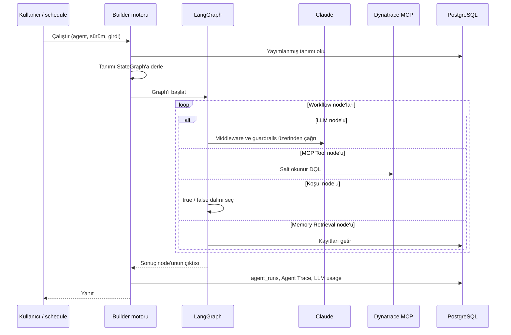

- Tanım çalışma başında belleğe alınır; çalışma sürerken yapılan düzenleme ya da yeni yayım onu etkilemez.
- **Export** dosyası secret içermez: connector ve model referansları ad olarak taşınır. **Import** önce önizlenir;
  hedef ortamda bulunmayan connector ya da model sorun olarak listelenir.
- Custom agent risk score üretmez ve investigation kaydı oluşturmaz.

**Hatalı yollar:** Doğrulama sorunları yayımı engeller. Çalışma sırasında bir node hata verirse çalışma `failed`
olur, hata `agent_runs` kaydına yazılır ve çalışma yeniden denenebilir. Yazma yetenekli tool içeren bir tanım policy
tarafından reddedilir.

Ayrıntı: [agent-builder.md](platform/agent-builder.md).

## 10. Chaos senaryosundan agent analizine

| | |
|---|---|
| **Tetikleyici** | Operatör Chaos Controller'da bir senaryo başlatır. |
| **Ön koşul** | Laboratuvar çalışıyor; OneAgent ve `pg-lock-collector` Dynatrace'e veri gönderiyor. |
| **Bileşenler** | Chaos Controller, laboratuvar servisleri, laboratuvar PostgreSQL'i, Dynatrace, platform. |
| **Çıktı** | Chaos raporu (beklenen ve gözlenen etki) ve agent'ın bağımsız investigation'ı. |

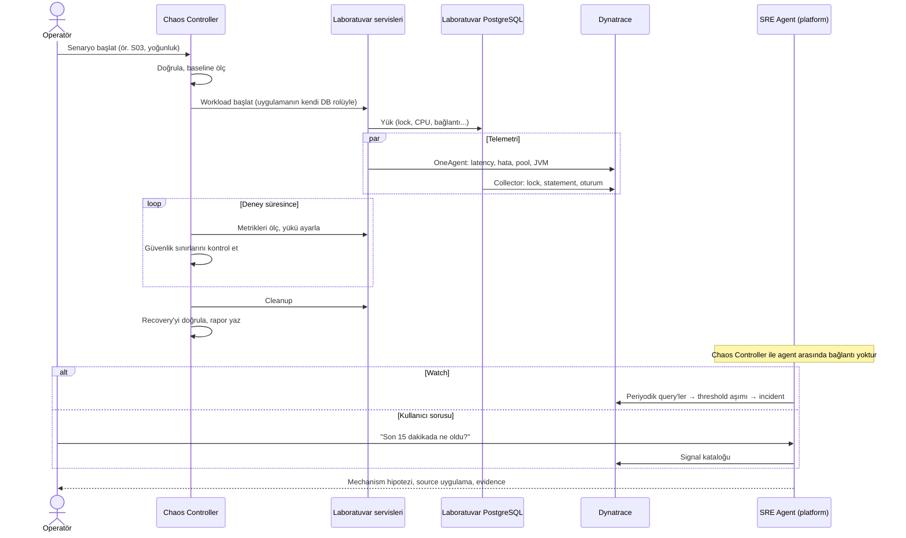

Önemli nokta: agent Chaos Controller'dan **haber almaz**. Hangi senaryonun çalıştığını bilmez; yalnız Dynatrace'teki
telemetriyi görür. Bu, agent'ın değerlendirmesini "kör" kılar: senaryo adı agent'a sızmaz.

Chaos Controller deney durumları: `CREATED`, `VALIDATING`, `BASELINING`, `RAMPING_UP`, `RUNNING`, `RECOVERING` ve
sonuç durumları `COMPLETED`, `FAILED`, `ABORTED`, `TIMED_OUT`. Aynı anda tek deney çalışır.

**Hatalı yollar:** Güvenlik sınırı aşılırsa (bütçe, disk, veritabanı bağlantısı, erişilemezlik) deney kesilir ve
cleanup çalışır. Agent tarafında, katalogda karşılığı olmayan bir arıza türünde etki raporlanır ama mechanism
"açıklanamayan" kalır.

Kör değerlendirme sonuçları ve bilinen eksikler: [chaos-v2-agent-eval.md](lab/chaos-v2-agent-eval.md). Senaryo
listesi ve API: [chaos-v2-architecture.md](lab/chaos-v2-architecture.md).

## 11. Onay akışı (human-in-the-loop)

| | |
|---|---|
| **Tetikleyici** | Bir kullanıcı salt okunur olmayan bir aksiyon için onay talebi açar. |
| **Ön koşul** | Talep için `approval:request`; karar için `approval:decide`. |
| **Çıktı** | Onaylanan ya da reddedilen talep; audit kaydı. |

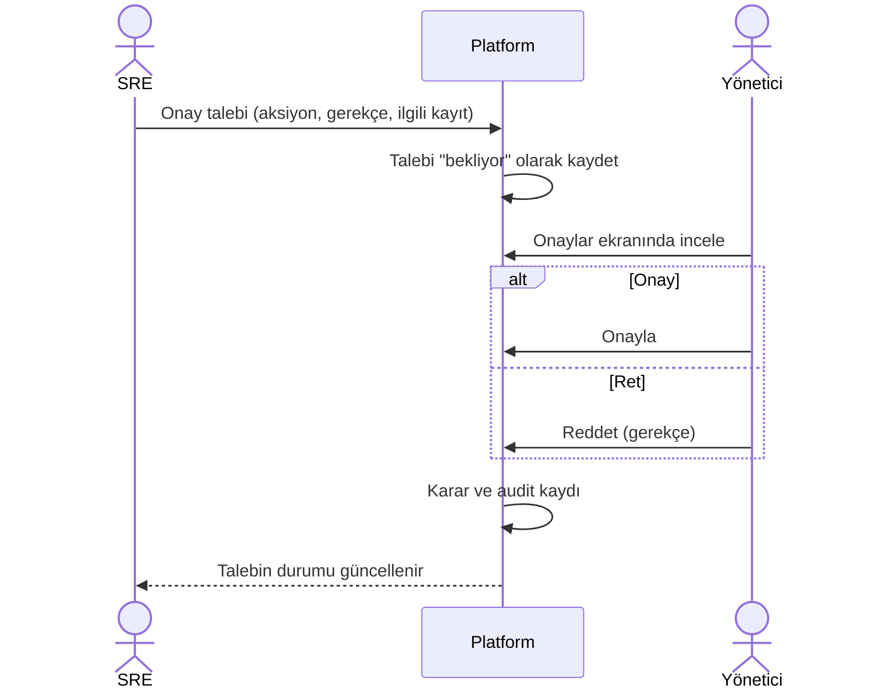

- **Four-eyes:** Talebi açan kişi kendi talebini onaylayamaz.
- **Süre:** Karar verilmeyen talep 24 saat sonra zaman aşımına uğrar.

Platform onaylanan aksiyonu **kendisi yürütmez**. Onay, kararın kim tarafından ve ne zaman verildiğinin kaydıdır;
aksiyonu operatör kendi araçlarıyla uygular. Agent hiçbir koşulda izlenen sistemi değiştirmez.
