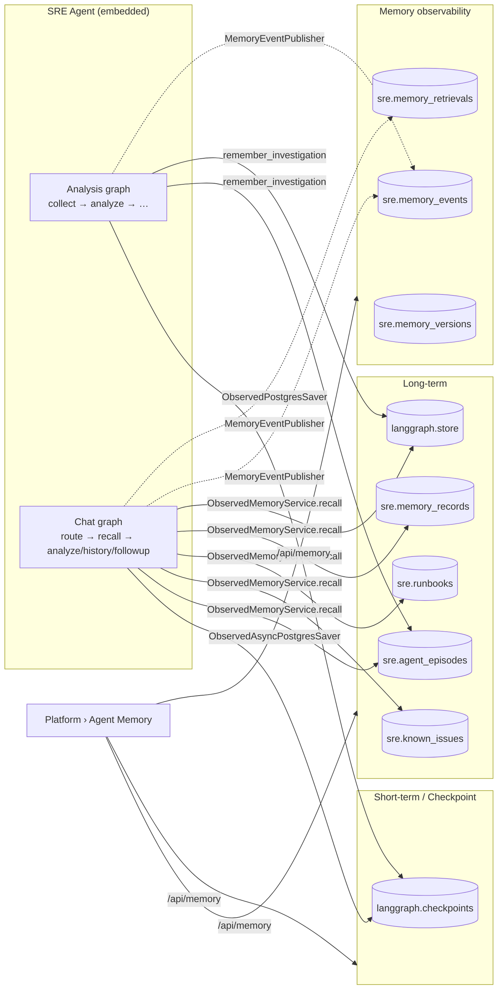
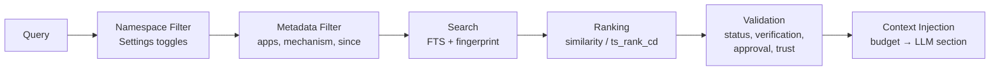
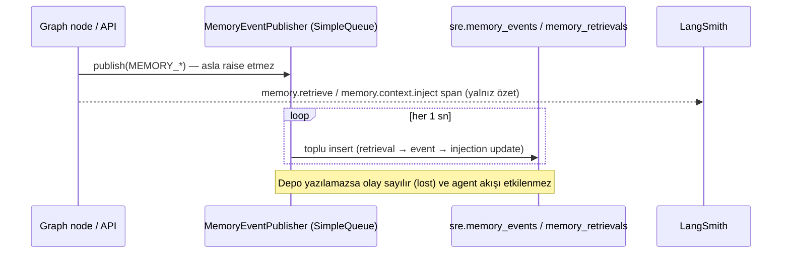

# Agent Memory — Architecture

Bu doküman SRE Agent'ın memory katmanlarını, hangi verinin hangi fiziksel depoda durduğunu ve platformun bu katmanları
nasıl gözlemlediğini anlatır. Uygulama ayrıntısı: [MEMORY_IMPLEMENTATION.md](MEMORY_IMPLEMENTATION.md).

## 1. Memory katmanları

| Katman | Ne tutar | Fiziksel depo | Yaşam süresi | Yazan |
|---|---|---|---|---|
| **Working memory** | Tek bir graph çalışmasının anlık state'i (windows, results, evidence, scores, mechanisms…) | LangGraph state (bellek içi) + checkpoint | Çalışma süresi | Graph node'ları |
| **Short-term memory** | Sohbet thread'i: son 20 mesaj, `focus`, `digests` | `langgraph.checkpoints` (thread_id = konuşma thread'i) | Retention › `checkpoints_days` | Chat graph |
| **Checkpoint** | Her graph adımından sonraki state anlık görüntüsü | `langgraph.checkpoints / checkpoint_blobs / checkpoint_writes` | Retention › `checkpoints_days` | PostgresSaver / AsyncPostgresSaver |
| **Episodic (long-term)** | Geçmiş investigation özetleri ve sonuçları | `sre.agent_episodes`, Store `("app", x)` | Investigation retention + arşiv | InvestigationRunner, feedback |
| **Semantic (long-term)** | Doğrulanmış olgular (topology, known issue) | `sre.memory_records`, `sre.known_issues`, Store `("user", u, "context")` | `memory_retention_days`, TTL | SRE (manual/import), opsiyonel auto extraction |
| **Procedural (long-term)** | Onaylı runbook'lar (talimat) | `sre.runbooks` (+ bekleyen revizyonlar `sre.memory_versions`) | Arşivlenene kadar | SRE önerir, admin onaylar (four-eyes) |

Kopya yoktur: Memory Manager mevcut tabloları (episode, known issue, runbook, Store) **adapter** ile aynı görünümde
sunar. Yeni olgular için tek yeni depo `sre.memory_records`'tır.

## 2. Retrieval pipeline

Agent'ın gerçek retrieval'ı (sohbet `recall` node'u; opsiyonel olarak analiz sonrası) şu aşamalardan geçer ve her aşama
`sre.memory_retrievals.stages` içinde kaydedilir:

* **Search** stratejisi `fts_fingerprint`: PostgreSQL full-text search + episode belirti parmak izi benzerliği
  (`MIN_SIMILARITY` 0.35, Settings › `similarity_threshold`). Embedding / vector search **yoktur**; Semantic ve Hybrid
  stratejileri arayüzde devre dışıdır, `embedding_status = not_indexed`.
* **Validation**: `active` olmayan, `rejected`, onaysız procedural ve (varsayılan) doğrulanmamış güvenilmeyen kayıtlar
  dışlanır; dışlanma nedeni `excluded` listesindedir.
* **Context Injection**: Blok, `<history_data>`, `<memory_data>` veya `<context_data>` veri bölümüne gider (talimat değil).
  `max_retrieved_records` / `max_context_tokens` 0 ise blok değiştirilmez (önceki davranış).

## 3. Olay akışı

Korelasyon `MemCtx` contextvar'ı ile taşınır: `run_id`, `thread_id`, `trace_id`, `node`, `correlation_id`, `user_id`
ve çalışma başındaki ayar snapshot'ı. Platform okumaları (`events.suppressed()`) olay üretmez.

## 4. İzolasyon modeli

* **Tenant**: tek tenant `default`; her satırda `tenant_id`, her query'de filtre.
* **Agent**: `registry` (agent_id → namespace öneki). Başka agent'ın kaydı 404 döner. Agent Builder yoktur; kayıt
  arayüzü (`registry.register`) gelecekteki kullanıcı tanımlı agent'lar için hazırdır, önek çakışmasını reddeder.
* **Kullanıcı**: sohbet thread'leri, olayları ve retrieval'ları yalnız sahibine ve admin'e görünür. Analiz
  (investigation) verisi ekip geneli görünür (mevcut güvenlik kararı).
* Namespace tek başına güvenlik sınırı değildir; erişim RBAC + agent/tenant filtresi ile uygulanır.

## 5. Kapsam dışı (bilinçli)

Vector search / embedding, consolidation, replay / fork / resume, çoklu tenant ve çoklu environment bu sürümde yoktur.
Ayrıntı: [MEMORY_IMPLEMENTATION.md › Sınırlamalar](MEMORY_IMPLEMENTATION.md#sınırlamalar).
