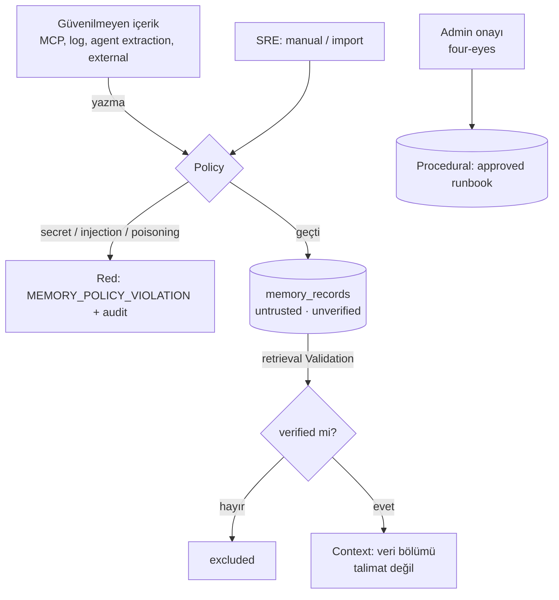

# Agent Memory — Security

## Tehdit modeli

| Tehdit | Kontrol | Kapatılabilir mi |
|---|---|---|
| Secret'ın memory'ye yazılması | `policy.has_secret` (agent redaction kalıpları) → red | Hayır |
| Prompt injection içeren olgu | Kural tabanlı tespit (instruction override, role hijack, prompt delimiter, exfiltration, tool abuse, policy bypass; TR/EN) → red | `require_validation` |
| Memory poisoning | Güvenilmeyen kaynak procedural yazamaz, kendini verified/approved işaretleyemez; içerik değişince verified düşer | `poisoning_protection_enabled` |
| Doğrulanmamış bilginin agent'a girmesi | Validation aşaması: untrusted + unverified dışlanır | `require_evidence_verification` |
| Onaysız talimat | Procedural yalnız `approved` runbook; öneri pending, four-eyes | Hayır (`require_procedural_approval` kilitli) |
| PII | E-posta, IBAN, kart numarası (Luhn), TCKN redaction (agent DLP kalıpları) | `pii_redaction_enabled` |
| Agent / tenant sızıntısı | Her query'de `tenant_id` + `agent_id`; başka agent → 404 | Hayır |
| Başka kullanıcının sohbet memory'si | Thread / olay / retrieval sahiplik kontrolü (admin hariç) → 404 | Hayır |
| Telemetri sızıntısı | Olay payload'ı `safe_copy` ile maskeli ve boyut sınırlı; LangSmith'e yalnız `step_summary` | Hayır |
| Yan etkili replay | Checkpoint Explorer salt okunur; replay/fork/resume yok | — |
| Duplicate / şişme | `content_hash` (NFKC + casefold + boşluk normalize) | Hayır |
| Denetlenemeyen değişiklik | Değişmez `memory_versions` + append-only `audit_events` (section=memory); red ve ret ayrı transaction'da audit'lenir | Hayır |

## RBAC

| İzin | viewer | sre | admin |
|---|---|---|---|
| `observability:read` (tüm okuma, playground) | — | ✓ | ✓ |
| `memory:write` (oluştur, düzenle, arşiv, verify, procedural öneri) | — | ✓ | ✓ |
| `memory:delete` (kalıcı silme, onay metniyle) | — | — | ✓ |
| `memory:approve` (procedural onay / ret, export) | — | — | ✓ |
| `settings:write` (`agent_memory` ayarları) | — | — | ✓ |

## Artık riskler

* Prompt injection tespiti kural tabanlıdır; yeni kalıplar kaçabilir. Bu yüzden memory içeriği LLM'e her zaman veri
  bölümünde (`<history_data>`, `<memory_data>`, `<context_data>`) gider ve sistem prompt'u bu bölümleri talimat
  saymaz.
* PII redaction kalıp tabanlıdır (isim gibi serbest metin PII'ı yakalamaz).
* Admin rolü hem onaylayabilir hem silebilir; four-eyes yalnız "öneren ≠ onaylayan" kuralıdır, iki ayrı admin gerektirir.
* Tek tenant: `tenant_id` sütunu ve filtre vardır, ancak çok tenant'lı kimlik doğrulama yoktur.
* Store notları (`langgraph.store`) agent tarafından yazılır ve platformdan salt okunurdur; policy'den geçmez
  (mevcut davranış), retrieval'da untrusted işaretlenir.
