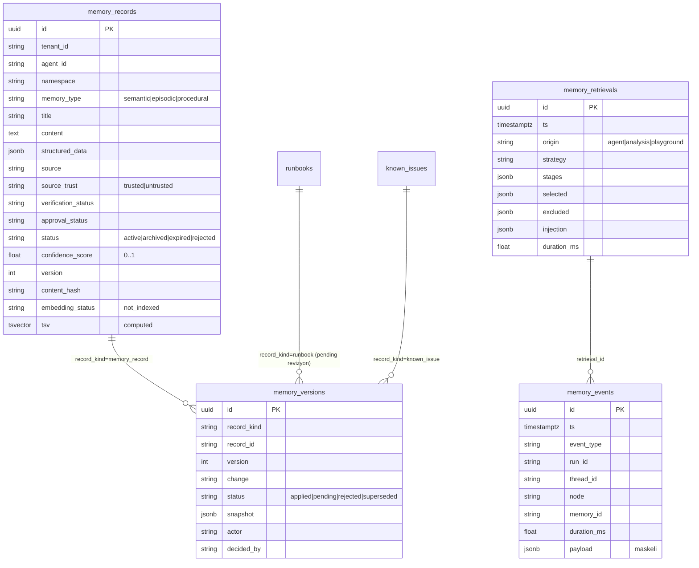

# Agent Memory — Storage Schema

Migration: `0015_agent_memory` (revises `0014`). Yalnız ekleme yapar; mevcut checkpoint, Store ve episode verisi
taşınmaz. Downgrade yeni tabloları ve sütunları kaldırır.

## Yeni tablolar (`sre` şeması)

| Tablo | Amaç | Önemli indeksler / kısıtlar |
|---|---|---|
| `memory_records` | Yeni long-term olgular | (tenant, agent, namespace, status), content_hash, GIN(tsv); CHECK memory_type / verification / approval / status / trust / confidence 0..1 |
| `memory_versions` | Değişmez versiyon geçmişi + bekleyen procedural revizyonlar | UNIQUE(record_kind, record_id, version) |
| `memory_events` | Memory olayları | ts DESC, (event_type, ts), run_id, thread_id |
| `memory_retrievals` | Retrieval pipeline kayıtları | ts DESC, run_id, thread_id |

## Mevcut tablolara eklenen sütunlar

| Tablo | Sütunlar | Varsayılan (geri uyum) |
|---|---|---|
| `runbooks` | `version`, `approval_status`, `approved_by`, `approved_at`, `archived_at` | `approval_status = 'approved'` (mevcut runbook'lar agent'a görünmeye devam eder) |
| `known_issues` | `version`, `archived_at` | `version = 1`, arşivsiz |
| `agent_episodes` | `archived_at` | arşivsiz |

## LangGraph tabloları (değişmedi)

`langgraph.checkpoints`, `checkpoint_blobs`, `checkpoint_writes`, `store` — LangGraph'ın kendi şeması. Platform yalnız
okur (Explorer) ve retention ile thread bazında siler (mevcut davranış).

## Retention

| Veri | Kural | Ayar |
|---|---|---|
| Süresi dolan kayıt | `status = expired` + `MEMORY_EXPIRED` | `auto_archive_expired`, `default_ttl_days` |
| Arşiv / expired / rejected kayıt | Kalıcı silme | `memory_retention_days` (0 = kapalı) |
| Olay ve retrieval kayıtları | Silme | `memory_event_retention_days` (90) |
| Checkpoint / Store | Mevcut retention | Settings › Retention |
